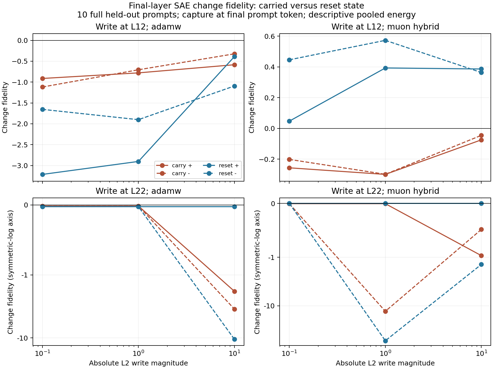

# Does recurrent state cause the reconstruction problem?

**The failure does not require second-pass state carry, but carry changes what the SAE can track.** The controlled results separate a limitation of the sparse measurement from a change in the model's response to an intervention.

In the one-pass reference and the equivalent 44-layer reset control, Muon reconstructs layer-22 baseline states with 0.862 explained variance. Nevertheless, all six local signed-dose conditions have negative intervention-change fidelity. For the -1 write, holding the same hidden-state change fixed while freezing the baseline feature support improves fidelity from -52.37 to approximately -0.0005. This removes the large error spike without making the reconstruction meaningfully accurate. The spike is attributable to the SAE's support-selection step in this assay; it does not require a second executed pass.

State carry still matters for propagated effects. With the same layer-12 write magnitude, all six Muon conditions measured at layer 22 have positive fidelity under reset (0.047 to 0.572) and negative fidelity under carry (-0.300 to -0.046). This is not a universal worsening: AdamW has higher fidelity with carry in ten of the twelve local/propagated conditions, although every one remains negative. The effect depends on the dictionary and the response being measured.

The unit-norm direction-swap assay further distinguishes the starting state from the propagated change. For Muon, carry-derived directions have fidelity around 0.05-0.06 on either baseline, while reset-derived directions reach about 0.35-0.38 on either baseline. In this specific offline control, changing the response direction has a much larger effect than swapping the baseline state. Thus poorer baseline state reconstruction alone is insufficient to explain the difference: state carry also changes the direction of the model's downstream response relative to the dictionary.

This experiment manipulates state carry within the existing Nanbeige checkpoint. It tests a specific pathway through which recurrence could affect measurement fidelity. It does not compare separately trained looped and unlooped models.

The control executes both 22-layer passes, then replaces each token's boundary state with its original embedding before the second pass. Carry and reset therefore execute 44 layers with the same weights and token sequence. Reset removes cross-pass information and reduces effective dependent depth; executed depth and effective depth must not be conflated. A separate 22-layer one-pass run validates the reset.

All 150 baseline/intervention pairs passed the reset-versus-one-pass check. Maximum residual-state error was 0; maximum logit error was 0. There were 60 identity-write checks, 13240 upstream-state checks and 420 write-norm checks.

## Matched state and write controls

The cohort is the original ten held-out inputs (eight task groups), spanning both ARC families and INTELLECT-3 logic/math. Full prompts are used, with no new generated reasoning. Writes affect the final prompt token at layer 12 or 22, in the final executed pass. They follow the normalized output direction of already-fitted VPD component 0, with absolute norms 0.1, 1 and 10 in both signs. These are residual interventions along a VPD direction, not repetitions of the paper's fixed-coefficient weight edits.

## Frozen dictionary quality on the new distribution

| Site | Dictionary | One-pass EV | Carry EV | Reset EV |
|---|---|---:|---:|---:|
| model.layers.11 | adamw | 0.6760 | 0.4118 | 0.6760 |
| model.layers.11 | muon_hybrid | 0.6838 | 0.4716 | 0.6838 |
| model.layers.21 | adamw | 0.3280 | 0.2498 | 0.3280 |
| model.layers.21 | muon_hybrid | 0.8620 | 0.4935 | 0.8620 |
| model.norm | adamw | 0.4827 | 0.3824 | 0.4827 |
| model.norm | muon_hybrid | 0.4757 | 0.3639 | 0.4757 |

EV uses the across-input mean at that site/history as reference. Ten prompt-end vectors give a small, previously inspected sample; these are descriptive scores. Frozen SAE weights are identical across histories.

## Does failure remain after removing state carry?

| Dictionary at L22 | Negative F: carry / 12 | Negative F: reset / 12 | Carry higher F / 12 | Frozen support higher F: carry / 12 |
|---|---:|---:|---:|---:|
| adamw | 12 | 12 | 10 | 10 |
| muon_hybrid | 12 | 6 | 2 | 10 |

Each column counts repeated conditions, not independent tasks. Negative F means reconstruction mismatch exceeds actual change energy. The complete signed-dose table is in the analysis directory.

Freezing the baseline top-k support changes only the dictionary measurement: it retains the same encoder, ReLU and decoder while preventing new support selection. It is not an intervention on the model's internal computation.

## Baseline state versus propagated direction

For a layer-12 +1 write, an additional offline assay crosses carry/reset baseline states with the corresponding L22 response directions, normalizing each response to L2=1. This keeps magnitude fixed at the measurement site. Counterfactual vectors are re-encoded through the frozen dictionary; they were not passed through the model.

| Dictionary | Baseline state | Direction donor | F |
|---|---|---|---:|
| adamw | carry | carry | -0.0756 |
| adamw | carry | reset | 0.1106 |
| adamw | reset | carry | -0.0324 |
| adamw | reset | reset | 0.0580 |
| muon_hybrid | carry | carry | 0.0587 |
| muon_hybrid | carry | reset | 0.3537 |
| muon_hybrid | reset | carry | 0.0509 |
| muon_hybrid | reset | reset | 0.3775 |

## Downstream endpoint and limits

Next-token logits are preserved for every model replay. Among 120 nonzero-dose conditions per history, the argmax changes in two one-pass/reset conditions and none of the carry conditions. Maximum baseline-to-intervention KL is 0.00269 for one-pass/reset and 0.03726 for carry. Distributional effects therefore occur without an argmax change, but these are not solved-task scores or evidence of a semantic mediator.

The experiment can show whether the reconstruction problem requires cross-pass state carry in this checkpoint and whether carry changes its severity at a fixed direct-write magnitude. It cannot isolate looped training, architectural weight sharing or effective depth as a general cause. A matched independently trained untied model remains necessary for that stronger comparison. It also uses CPU Q4 prompt-end states; the paper's earlier BF16 continuation interventions are a different distribution and precision setting.

Prior manuscript v006 remains unchanged. Source records, exact prompts and token IDs, runtime/model hashes, all-layer states, component directions, checks and frozen-SAE outputs are retained in the adjacent recurrence_state directories.
