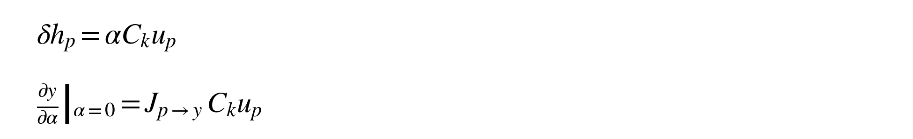
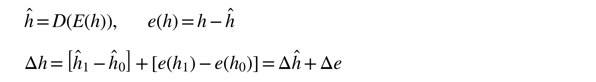
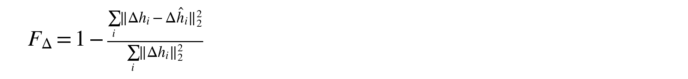

# Tracking Shared Parameter Effects Through Transformer Passes

Reconstruction quality and intervention fidelity

Version 4 | 9 September 2026 | Research manuscript

## Abstract

How faithfully can we track a shared parameter's effects through successive passes? We investigate this question in Nanbeige4.2-3B by perturbing fixed parameter components at separate invocations and describing their effects in common sparse autoencoder dictionaries. A paired optimizer control improves layer-22 second-pass state reconstruction from -0.180 to 0.453 explained variance, with an advantage that persists on saved BF16 intervention baselines. We now test whether this improvement extends to reconstruction of the intervention-induced change itself. Across all 12 signed intervention conditions measured at layer 22's second pass, Muon-hybrid improves change fidelity relative to AdamW. Yet 11 of those 12 conditions still have greater reconstruction mismatch than the error of predicting no change. For small same-layer edits, mismatch is concentrated at a few token positions where sparse feature support changes; float64 re-encoding preserves the result. These findings distinguish the quality of a state description from its fidelity to an experimental effect. We develop a method for carrying the unexplained change alongside feature changes, and use it to specify what further evidence would connect a shared parameter operation to a semantic relation across passes.

## 1. The measurement problem inside the loop

A shared transformer layer names a physical operation that occurs more than once. On a later pass, its weights receive a state with a different computational history. Mechanistic interpretation needs to explain what the operation does under those changed conditions. To make that explanation empirical, we must first be able to follow the consequences of an intervention without confusing changes in the model with failures of the representation used to inspect it.

This paper asks: **How faithfully can we track a shared parameter's effects through successive passes?** The question joins two parts of interpretability that are often inspected separately. A parameter decomposition gives us an operation to perturb. An activation dictionary gives us a vocabulary for describing its effects. Holding the parameter component fixed across invocations and the dictionary fixed across conditions creates a consistent experimental comparison. Its usefulness depends on whether the vocabulary actually preserves the differences produced by the intervention.

Our initial measurements exposed a specific difficulty. At physical layer 22, a common SAE reconstructed first-pass held-out states reasonably well while describing second-pass states poorly. Changing the dictionary optimizer substantially improved second-pass reconstruction, including when the frozen dictionary was transferred to saved parameter-intervention baselines. This supplied a concrete reason to revisit those interventions: did the better state representation also provide a better account of what the parameter edit changed?

The new analysis gives a qualified answer. Muon improves the measured second-pass intervention-change fidelity at layer 22, but most reconstructed changes remain worse in squared error than predicting zero change. This is an informative outcome for mechanistic interpretation. It locates a limitation between an experimentally controlled parameter edit and the feature-level account of its consequences. The dictionary has become better at describing the states, while its account of the transition between them remains inadequate under the tested metric.

We use Nanbeige4.2-3B because its weights and execution are available for direct inspection. The pinned implementation executes all 22 physical transformer layers twice, with loop-boundary normalization and no adaptive routing. Capture covers both invocations of all 22 layers. Focused parameter decomposition targets the MLP down projections at layers 12 and 22; SAE measurements include those layers and loop normalization. The scientific object is an invocation in context: an input, token position, physical layer, pass, and intervention condition. [Nanbeige checkpoint and source](https://huggingface.co/Nanbeige/Nanbeige4.2-3B/tree/451ed48c3273ecef7ea8faaa43c31ce529763bb1).

Blayney et al. study how latent states and attention behavior evolve across recurrences, finding cyclic fixed points in many of their studied models and examining their dependence on architectural choices. Their work makes invocation-level dynamics an explicit object of mechanistic analysis. Our experiment examines a complementary connection: the fidelity with which sparse representations describe the effects of interventions on shared parameter components. We do not establish priority for this combination. [A Mechanistic Analysis of Looped Reasoning Language Models](https://arxiv.org/abs/2604.11791).

## 2. A shared operation acts on a changing state

Parameter identity gives an investigator a stable reference across passes. Its output still depends on the state it receives. Let the input to a selected shared down projection at one token on pass p be u_p, and let C_k be a chosen parameter component. With column-vector notation, an additive edit of coefficient alpha makes the following direct change to that projection's write when its input is held fixed:

The second expression describes a downstream observable y to first order around the baseline. Its Jacobian contains the subsequent computation's response to the local write. The two factors separate the state-dependent write from its later use. A difference between pass responses may arise because the component encounters different input vectors, because subsequent transformations use its output differently, or both.

These equations specify a localized, differentiable control in real arithmetic. The archived interventions act across positions and use a finite coefficient in BF16 execution. Their total endpoint response need not equal a single-token linearization. If an edit is applied at many positions or invocations, the corresponding first-order contributions must be combined; later inputs can themselves change under earlier edits. Numerical rounding adds a further distinction between this explanatory algebra and a measured finite-dose response.

Our VPD implementation adapts Goodfire's parameter decomposition to shared matrices with invocation-specific masks. A selected matrix has one fitted collection of components, with its undecomposed contribution retained as a residual. We perturb component 0 on the first pass, second pass, or both, at coefficients +0.05 and -0.05. The completed 64-component fit captures approximately 2.2% of the selected matrices' squared weight energy. Keeping the residual preserves the baseline transformation, while the fitted components provide a limited set of addressable contributions. Weight-energy coverage does not by itself measure semantic importance. [Goodfire parameter interpretation research](https://www.goodfire.com/research/interpreting-lm-parameters), [implementation source](https://github.com/goodfire-ai/param-decomp).

The recorded responses make the need for the factorization concrete. For the positive layer-22 component edit, the pooled final-normalization effect norms are 31.70 for a first-pass intervention and 2.78 for a second-pass intervention. These are different responses of a downstream endpoint. The first-pass write also has more subsequent computation through which to propagate. A comparison of immediate writes, followed by interventions matched in write magnitude, would help distinguish the role of the input state from later sensitivity. That control remains prospective; the archived endpoint norms do not supply it.

The current study instead examines a prerequisite for tracing either response semantically: whether the SAE reconstruction follows the change that actually occurred at a capture site. A faithful description of that change would let us investigate how the component's effects are distributed across features. An unfaithful description must retain an explicit account of what the features missed or distorted.

## 3. Improving the description of the second-pass state

At each selected capture site, one top-k SAE is fitted on training rows from both passes and frozen across comparisons. This common dictionary keeps coordinate identity stable between invocations. It does not ensure equally good reconstruction of the two state distributions. In particular, equal sampling of the passes does not guarantee that their states are equally accessible to the fitted sparse representation.

The paired optimizer control follows the approach of Patrick Dugan's earlier SAE study. Within each site, initialization and sampled batches are identical across AdamW and Muon-hybrid. The hybrid uses Muon for matrix parameters and AdamW for biases. Both conditions use 6,144 features, top-32 sparsity, batch size 128, and 1,000 updates. Eight inputs provide training trajectories and ten provide held-out trajectories. This is one paired seed on a previously inspected cohort. [Late-Layer Feature Reweighting by an Alignment Adapter: Improving SAE Quality with Muon](https://www.moralitylab.xyz/papers/Late_Layer_Feature_Reweighting_by_a_Constitutional_Adapter_An_Industrial_Sparse_Autoencoder_Analysis.pdf).

| Layer-22 held-out state reconstruction | AdamW EV | Muon-hybrid EV |
|---|---:|---:|
| Original Q4 evaluation, pass 1 | 0.830 | 0.918 |
| Original Q4 evaluation, pass 2 | -0.180 | 0.453 |
| BF16 intervention baselines, pass 1 | 0.763 | 0.942 |
| BF16 intervention baselines, pass 2 | -0.535 | 0.312 |

At the second pass, AdamW's negative explained variance means its state reconstruction is worse than the held-out mean reference used in the recorded evaluation. Muon makes a substantially larger portion of the state recoverable. Freezing these dictionaries and applying them to the BF16 intervention baselines preserves the advantage. Since both precision and sampled positions differ from the original evaluation, the lower transferred score cannot be attributed to either factor alone.

The intervention baselines are the relevant states for the new analysis. Their reconstruction scores establish a substantial difference between the two instruments before any perturbation effect is interpreted. Feature identities are consistent within a frozen dictionary; the independently trained AdamW and Muon dictionaries do not have aligned feature IDs. We therefore compare their reconstructions in the original hidden-state coordinates, where both are accountable to the same measured change.

A better state score is encouraging but leaves two possibilities open. The improved dictionary might recover directions along which the intervention acts, making the edit easier to follow. It might instead reconstruct background structure more accurately while missing the intervention's comparatively small effect. These possibilities cannot be distinguished by baseline explained variance. They require a paired measurement of the change.

## 4. Accounting for the change, including what the dictionary misses

Let the dictionary's reconstruction of a hidden state be h-hat = D(E(h)), and let its error be e(h). For baseline state h_0 and intervention state h_1, the complete change has an exact decomposition:

The second term is necessary even when the first has an appealing feature-level description. It records the difference between what the model changed and what the dictionary says changed. The two terms are not generally orthogonal, so their energies should not be presented as percentages that add to 100%. Retaining the error term also makes cancellation visible: large reconstruction errors in individual states can cancel in their difference, while modest state errors can differ in a way that overwhelms a small intervention signal.

We evaluate the reconstructed change using the following score, with sums taken over matched token positions within a specified capture invocation and intervention condition:

A score of one denotes exact reconstruction of the changes; zero denotes the squared error of predicting no change. Negative values mean that the mismatch exceeds the intervention signal's energy. The denominator uses uncentered change energy. Thus this diagnostic is not ordinary state explained variance, and a negative value is not a claim that the sparse code contains no information about the intervention. We report a pooled cosine similarity alongside it to distinguish directional agreement from magnitude mismatch.

For a linear decoder with a fixed reconstruction bias, the reconstructed change equals the decoder applied to the nonlinear feature difference E(h_1) - E(h_0). Both complete states must be encoded. Encoding only h_1 - h_0 would omit baseline-dependent thresholding and top-k support changes. Correct nonlinear re-encoding is necessary to describe the SAE's response; it does not guarantee that the response faithfully represents the model's change.

We apply this accounting to the existing 20 parameter-intervention records: two edited physical matrices on ten held-out inputs. Each has six signed intervention conditions, measured at three sites and two capture invocations, under two frozen dictionaries. This yields 144 pooled strata, each containing 80 token positions. Eighteen of the 72 optimizer-paired strata have exactly zero signal because of causal ordering. Their fidelity and cosine are undefined and are reported as such. The remaining 54 paired strata retain all observed nonzero effects.

This analysis uses archived BF16-exact hidden states and archived nonlinear feature encodings, with float64 decoding and metric accumulation. It sums signal and mismatch energies before taking their ratio, rather than averaging token-level ratios. We also retain per-input results and a numerical-resolution sensitivity restricted to coordinates where the actual change exceeds one larger adjacent baseline BF16 step. That restriction is a descriptive check, not an established noise floor.

Making unexplained changes explicit has a useful methodological precedent in Anthropic's Circuit Tracing work. Its attribution graphs include reconstruction-error nodes, and its authors test how well inferred influences and replacement-model responses agree with interventions in the underlying model. They find that perturbation discrepancies can compound across layers. Our diagnostic evaluates a narrower property: reconstruction of an already measured hidden-state change by a frozen SAE. It does not establish the faithfulness of a replacement model or an inferred causal graph. [Circuit Tracing: Revealing Computational Graphs in Language Models](https://transformer-circuits.pub/2025/attribution-graphs/methods.html).

## 5. Better state reconstruction, incomplete recovery of parameter effects

The connection between the optimizer control and the intervention analysis is strongest at layer 22's second pass. Muon improves fidelity in all 12 conditions measured there, across edits at both physical matrices, both signs, and all three invocation masks. Yet only one Muon condition has positive fidelity. AdamW has none. The improvement in the measurement is real for these saved effects, while adequate recovery of the change generally remains absent under the zero-change reference.

| Edited matrix / invocation mask | AdamW F_delta | Muon F_delta | AdamW cosine | Muon cosine |
|---|---:|---:|---:|---:|
| L12 / first + | -1.431 | -0.014 | -0.006 | 0.398 |
| L12 / first - | -2.311 | -0.363 | 0.044 | 0.210 |
| L12 / second + | -15.873 | -3.088 | 0.071 | 0.201 |
| L12 / second - | -16.931 | -5.782 | 0.057 | 0.138 |
| L12 / both + | -0.721 | 0.030 | -0.011 | 0.412 |
| L12 / both - | -2.463 | -0.285 | 0.039 | 0.216 |
| L22 / first + | -8.282 | -2.207 | 0.054 | 0.156 |
| L22 / first - | -14.013 | -1.688 | 0.033 | 0.169 |
| L22 / second + | -249.681 | -13.724 | 0.003 | 0.001 |
| L22 / second - | -135.391 | -26.561 | 0.002 | 0.006 |
| L22 / both + | -8.255 | -2.287 | 0.054 | 0.153 |
| L22 / both - | -13.400 | -1.663 | 0.033 | 0.172 |

All rows describe capture at layer 22, pass 2. Signs denote coefficients of +0.05 or -0.05 on component 0; each row pools the same ten inputs and 80 positions. Conditions share inputs and dictionaries and are not independent replications.

The positive condition is the layer-12 edit applied on both passes at +0.05. Its Muon fidelity of 0.030 represents a small reduction in squared error relative to predicting no change, while its cosine of 0.412 indicates partial directional agreement. It should not be read as 3% of a semantic mechanism explained. The negative conditions likewise distinguish degrees of failure: Muon can substantially reduce mismatch without crossing the zero-change reference.

The smallest same-layer edits are especially revealing. For a positive edit confined to layer 22's second pass, the reconstructed change norm is 15.80 times the actual norm with AdamW and 3.71 times with Muon, while both cosines are near zero. At 3 of 80 token positions, the AdamW top-k support changes; those positions account for 99.61% of its mismatch energy. Muon's support changes at one position, which accounts for 93.26% of its mismatch. For the negative edit, the corresponding shares are 99.25% and 96.47%. These are descriptive partitions of the observed mismatch, not interventions proving that support changes caused it.

A top-k encoder can replace one active direction with another across two nearby inputs. When the decoder directions differ, that support change can produce a reconstructed transition much larger than the actual transition. The concentration observed here is consistent with that failure mode. Correctly re-encoding both states exposes it; treating the feature difference as a faithful account without decoding it back into hidden-state space would leave it unmeasured.

These extreme scores also concern effects near BF16 resolution. Only about 28% of the actual change energy for the same-layer second-pass edits lies in coordinates exceeding one larger adjacent baseline step. Restricting the metric to those coordinates reduces the extreme mismatch, but the Muon scores remain negative: -7.323 and -14.327 for the positive and negative edits. Larger propagated effects also fail the reference. For a first-pass edit at layer 22, over 97% of the measured second-pass change energy lies above one step, while Muon fidelity remains -2.207 and -1.688. The conclusion therefore does not rest entirely on the smallest effects.

We separately recomputed all layer-22 second-pass encodings in float64 from the saved states and dictionary weights. Across the 24 optimizer-specific pooled conditions, the largest absolute fidelity change was 0.000036. This supports the stability of the reported metric against float32 encoding arithmetic. It leaves the underlying BF16 intervention's numerical-resolution limitations intact.

The effect is also site-dependent. Across both capture invocations, Muon improves 18 of 20 nonzero layer-22 comparisons, none of 14 layer-12 comparisons, and four of 20 loop-normalization comparisons. Baseline reconstruction gains therefore do not establish a general improvement in tracing effects through the whole loop. The full stratified results are retained, rather than selecting the favorable late-layer conditions as an overall optimizer ranking.

## 6. What a semantic interpretation would now have to explain

The revised evidence changes the next mechanistic question. The original optimizer result suggested that a better dictionary might make shared-parameter interventions more legible. We can now state where that suggestion succeeds and fails. At layer 22 the dictionary usually reduces mismatch, but it can still represent a small parameter effect as a much larger feature transition with weak directional agreement. Any proposed semantic account must explain the measured hidden-state change, including the portion left in reconstruction error.

A useful hypothesis would connect a specific input relation to an operation and its later use. For example: a component changes object-membership information on the first pass, and this alters the destination represented during the second pass. This remains an illustrative hypothesis. No saved feature has been validated as object membership or destination information. To test it, controlled inputs would need labels for those intermediate relations, with variations that separate the relation from colors, positions, or formatting that merely correlate with it.

The direct-write factorization supplies a sequence of controls. First, measure what the selected component writes at the targeted token and invocation. Next, compare propagation after matching write magnitudes across passes, while reporting any change in direction. Then examine whether the proposed relation changes at the predicted downstream site. Alongside feature measurements, retain actual hidden-state changes and their reconstruction-error differences so that apparent movement of a semantic feature cannot conceal a larger unexplained response.

A restoration experiment would test whether recovering the proposed intermediate relation also recovers its predicted downstream consequence. An SAE decoder edit could be one intervention handle, but the present results show why it needs validation: it may alter several relations or fail to restore the part represented in reconstruction error. Comparisons with irrelevant directions, alternative mediators, and direct state restoration would help distinguish the claimed relation from a generic change in the trajectory. A high F_delta would establish fidelity to a tested change, not the semantic identity of the coordinates that describe it.

Feature 574 remains an existing handle for such work. It was selected by maximum mean absolute pass difference on training inputs, rather than by a semantic label. The completed generation experiment saved continuations without new intermediate hidden-state trajectories, so it cannot establish which relation mediated its observed output changes. Following a particular relation through the second pass would require targeted captures on controlled inputs. This is a bounded next experiment with an explicit explanatory purpose, rather than a request for a larger capability evaluation.

The emerging account of recurrence is one of reusable operations acting on evolving representations. A parameter component provides continuity across invocations; a common dictionary provides a provisional description of the states; intervention accounting tests how well that description follows an actual effect. The new result shows why all three are needed. The ability to recover more of a state does not by itself make its transitions faithfully interpretable. Carrying the unexplained change through the analysis keeps the eventual semantic explanation answerable to the computation it is meant to describe.

## Appendix A. Scope and measurement checks

The new contribution in this revision is CPU analysis of existing archives, including float64 re-encoding of the layer-22 second-pass states. No model inference, dictionary training, immediate-write experiment, matched-write intervention, or semantic restoration experiment was added. Version 2 preserves the full experimental record; version 3 preserves the earlier interpretive manuscript.

The paired SAE study uses one seed and a previously inspected cohort of eight training and ten evaluation inputs. The ten evaluation records correspond to eight task groups. Multiple positions, signs, masks, and dictionaries are repeated measurements on these inputs. We report descriptive pooled comparisons without interpreting the number of conditions as an independent sample size or claiming a general optimizer ranking.

Primary F_delta is calculated from summed signal and mismatch energies over all 80 positions in each stratum. Cosine uses the corresponding pooled inner product and norms. Exact zero signal yields an undefined ratio, even when predicting zero is itself exact. Per-input metrics expose heterogeneity hidden by energy pooling: for the positive layer-22 second-pass edit, AdamW's pooled fidelity is -249.681 while its median per-input fidelity is approximately -0.037. The pooled statistic addresses total reconstruction mismatch; it does not describe a typical input's ratio.

| Capture site and pass | Nonzero conditions per optimizer | Muon higher fidelity | Positive F_delta: AdamW / Muon |
|---|---:|---:|---:|
| Layer 12, pass 1 | 4 | 0 | 2 / 0 |
| Layer 12, pass 2 | 10 | 0 | 0 / 0 |
| Layer 22, pass 1 | 8 | 6 | 4 / 4 |
| Layer 22, pass 2 | 12 | 12 | 0 / 1 |
| Loop norm, pass 1 | 8 | 4 | 0 / 0 |
| Loop norm, pass 2 | 12 | 0 | 2 / 0 |

The decoder analysis validates 146 source files against archived hashes and checks token-position alignment. It performs 4,320 checks of the decoder-difference calculation and reconstruction-error accounting, plus eight analytical metric checks covering exact recovery, zero prediction, opposite direction, magnitude error, zero signal, and cancellation. A separate sensitivity pass checks 280 eight-position encoding arrays in float64 against the archived encodings. These validate the saved-state calculation; they do not independently rerun the original model experiment.

The hidden states come from BF16 teacher-forced analysis of saved Q4-generated sequences. They are not BF16 self-generated trajectories. The dictionaries were trained on Q4 states at a different selection of positions. This transfer setting is part of the measured result, and the present analysis does not isolate its contributing shifts. Causal-order checks apply to a fixed token sequence; subsequent first-pass states during free generation can change after an earlier intervention changes the generated tokens.

The one-step coordinate restriction is a sensitivity analysis on the observed signal. It excludes coordinates according to actual change magnitude, and its score is not the primary whole-vector score. A measured noise floor would require appropriate repeated or higher-precision model controls. Neither the float64 SAE check nor the restriction removes BF16 effects already present in the saved model states.

## Appendix B. Reproducibility and sources

All paths below are relative to the VPD workspace. The analysis directory includes the metric definition, 1,440 per-input rows, 144 pooled strata, 72 optimizer comparisons, source hashes, and the separate numerical/support sensitivity. Machine-readable results preserve exact values and undefined cases; manuscript tables round for readability.

| Analysis or source | Location |
|---|---|
| New intervention-change analysis | `artifacts/nanbeige_reasoning/intervention_change_fidelity_v1/` |
| CPU analysis implementation | `experiments/nanbeige_reasoning/intervention_change_fidelity.py` |
| Precision and support check | `experiments/nanbeige_reasoning/check_change_fidelity_sensitivity.py` |
| Paired optimizer dictionaries | `artifacts/nanbeige_reasoning/muon_sae_control_v1/` |
| Frozen feature responses | `artifacts/nanbeige_reasoning/muon_vpd_transfer_v1/` |
| Detailed technical companion | `output/paper_versions/v002_2026-09-09_with_campsite/` |

The VPD source run is `prime-20260906T204058Z-561` under `artifacts/nanbeige_reasoning/`. Its factor, intervention, and provenance records remain unchanged. The separately completed Hermes study and capability-oriented grading audits remain in the technical companion; they do not supply evidence for the internal mechanism considered here. This manuscript makes no inference about an undisclosed architecture from benchmark behavior.

The literature cited in the main text places the work alongside Blayney et al.'s April 2026 analysis of looped model dynamics, Goodfire's parameter-decomposition methods, Dugan's SAE optimizer study, and Anthropic's 2025 Circuit Tracing methods. The proposed change-fidelity score is used here as an explicit zero-change-reference diagnostic. We make no priority claim for normalized reconstruction-error metrics or for the broader combination of parameter and activation analysis.
