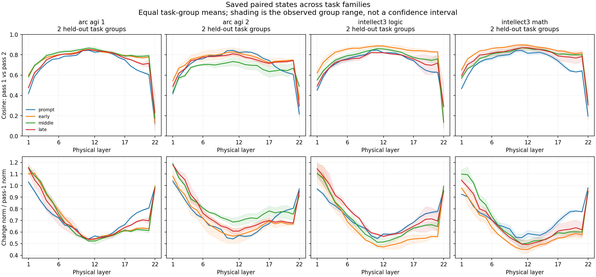

# Shared operations across four task families

The same physical layer can receive a different state on its second invocation. The useful mechanistic question is how that difference is organized across the network, and whether it helps explain an intervention’s consequences. We examined the saved Nanbeige trajectories across ARC-AGI-1, ARC-AGI-2, INTELLECT-3 logic and INTELLECT-3 math, preserving the token correspondence between passes. Both states come from the same native two-pass replay. Separately generated one-pass trajectories are outside this analysis; these statistics do not measure a loop-count ablation.

Across these small cohorts, the middle layers have relatively aligned pass states, followed by a sharp decline in alignment at the final physical layer. The table shows the late-generation window at the two layers already selected for VPD in the existing study; those sites were not chosen from this new plot. Each entry averages task groups equally. Multiple ARC test grids from one task are averaged within that task first.

| Family | Held-out inputs / task groups | Layer 12 cosine | Layer 22 cosine | Cosine after loop normalization |
|---|---:|---:|---:|---:|
| arc_agi_1 | 3 / 2 | 0.842 | 0.230 | 0.229 |
| arc_agi_2 | 3 / 2 | 0.799 | 0.294 | 0.212 |
| intellect3_logic | 2 / 2 | 0.821 | 0.290 | 0.184 |
| intellect3_math | 2 / 2 | 0.869 | 0.307 | 0.188 |

This profile is also visible at the prompt suffix, before the sampled continuation. It therefore cannot be attributed specifically to successful reasoning or to a late discovery in the generated text. It instead motivates a hypothesis about how the shared computation is used at different points in the loop. Controlled interventions and a behavioral endpoint are needed to turn that hypothesis into a mechanistic explanation.

The loop-normalization control preserves low terminal directional alignment, but changes the scale of the relative difference substantially: the late-window change divided by the first-pass norm is about 0.95–0.98 before normalization and 4.84–5.15 after it. This cautions against reading an effect magnitude without specifying the measurement site and reference scale. Neither number identifies a semantic operation.

The accompanying frozen-SAE tables describe feature-support overlap and feature-change norms separately from actual hidden-state changes. They use matching positions and the same dictionary within each pass comparison. Feature IDs are not aligned across dictionaries, and low feature overlap is not evidence of a new reasoning concept. The manuscript’s state-reconstruction and intervention-change-fidelity checks remain necessary before interpreting those coordinates.

There are 18 inputs, 1,584 layer/region state windows and 648 dictionary/region feature windows. Those windows do not create independent tasks. Each family has only two held-out task groups, so the plotted bands show observed group ranges, not confidence intervals. Thirteen of the 18 two-pass continuations reached the output cap; all five ARC-AGI-2 inputs did. No answer score or reasoning advantage is inferred from these state differences.

The comparison requirement remains open. The verified fresh Campsite run reports plain-skill success on 13/109 puzzles and routed final success on 35/109; all 109 vanilla calls were capped. Only 1 pilot question identifier overlaps that cohort. These are not matched cross-model results, and the available comparison does not cover ARC or math. The original claim that the skills cleared those evaluations is not established by these artifacts.

This analysis is a candidate supplement to the existing mechanistic manuscript. It adds observations across all four requested task families without changing the model or treating the unfinished ledger pilot as evidence. The full goal remains incomplete; see `goal_evidence_audit.json`.

## Reproduction and verification

Run `python -m scripts.nanbeige.summarize_pass_dynamics --output <fresh-directory>` from the project root. Source archives, dictionaries and exact two-pass token sequences are checked against the existing dataset index. `check_pass_boundary_geometry.py` performs the linked normalization control. CSV and JSON exports retain input IDs, task groups, calibration splits, regions, output-censoring flags and measurement sites. The source snapshots are stored in `source/`.
