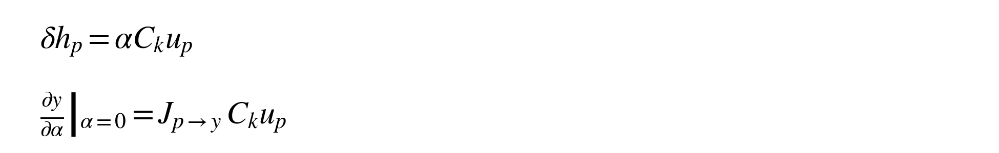
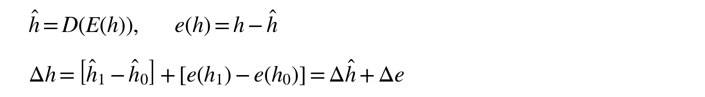
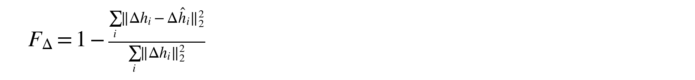

# Tracking Shared Parameter Effects Through Transformer Passes

Invocation geometry, reconstruction quality and intervention fidelity

Version 7 | 12 September 2026 | Research manuscript

## Abstract

How faithfully can we track a shared parameter's effects through successive passes? We investigate this question in Nanbeige4.2-3B using paired invocation states, parameter-component interventions and frozen sparse autoencoder dictionaries. Across small ARC-AGI-1, ARC-AGI-2, INTELLECT-3 logic and math cohorts, final-layer pass states diverge in direction even before generation. A paired optimizer control improves second-pass state reconstruction, yet most measured parameter effects remain poorly reconstructed. A new state-carry control separates two sources of difficulty. Removing cross-pass state carry while retaining 44 executed layers reproduces a one-pass reference exactly. Reconstruction failure persists, and freezing the SAE's baseline support removes large error spikes without making local changes faithfully recoverable. State carry also changes downstream response directions: for six signed layer-12 writes, Muon reconstructs the layer-22 change better than a zero-change reference under reset but worse under carry. An offline direction-swap assay preserves much of that difference across exchanged baseline states. These results locate a sparse-measurement failure that does not require a second executed pass and an invocation-dependent change in which model effects the dictionary can describe. They test state carry within one checkpoint, not the effect of training a looped architecture. We retain unexplained changes alongside feature responses so that a future semantic account remains answerable to the computation it aims to explain.

## 1. The measurement problem inside the loop

A shared transformer layer names a physical operation that occurs more than once. On a later pass, its weights receive a state with a different computational history. Mechanistic interpretation needs to explain what the operation does under those changed conditions. To make that explanation empirical, we must first be able to follow the consequences of an intervention without confusing changes in the model with failures of the representation used to inspect it.

This paper asks: **How faithfully can we track a shared parameter's effects through successive passes?** The question joins two parts of interpretability that are often inspected separately. A parameter decomposition gives us an operation to perturb. An activation dictionary gives us a vocabulary for describing its effects. Holding the parameter component fixed across invocations and the dictionary fixed across conditions creates a consistent experimental comparison. Its usefulness depends on whether the vocabulary actually preserves the differences produced by the intervention.

Across four task families, the saved trajectories show why this distinction matters. Mid-network pass states are relatively aligned, while the final shared layer has a different directional profile. This difference is present in the input prompt as well as the generated continuation. It invites an explanation of how an operation is used at successive invocations, while leaving the semantic content of that operation unresolved.

Our initial measurements exposed a specific difficulty. At physical layer 22, a common SAE reconstructed first-pass held-out states reasonably well while describing second-pass states poorly. Changing the dictionary optimizer substantially improved second-pass reconstruction, including when the frozen dictionary was transferred to saved parameter-intervention baselines. This supplied a concrete reason to revisit those interventions: did the better state representation also provide a better account of what the parameter edit changed?

The intervention-change analysis gives a qualified answer. Muon improves the measured second-pass intervention-change fidelity at layer 22, but most reconstructed changes remain worse in squared error than predicting zero change. This is an informative outcome for mechanistic interpretation. It locates a limitation between an experimentally controlled parameter edit and the feature-level account of its consequences. The dictionary has become better at describing the states, while its account of the transition between them remains inadequate under the tested metric.

A controlled state-carry experiment now separates two parts of that difficulty. Reconstruction failures persist when the second pass is reset to the original embeddings, and an intervention on sparse support removes large error spikes. At the same time, carrying the first pass's state changes downstream response directions and their recoverability. The distinction lets us investigate the measurement failure without assuming either that recurrence caused it or that recurrence is irrelevant to it.

We use Nanbeige4.2-3B because its weights and execution are available for direct inspection. The pinned implementation executes all 22 physical transformer layers twice, with loop-boundary normalization and no adaptive routing. Capture covers both invocations of all 22 layers. Focused parameter decomposition targets the MLP down projections at layers 12 and 22; SAE measurements include those layers and loop normalization. The scientific object is an invocation in context: an input, token position, physical layer, pass, and intervention condition. [Nanbeige checkpoint and source](https://huggingface.co/Nanbeige/Nanbeige4.2-3B/tree/451ed48c3273ecef7ea8faaa43c31ce529763bb1).

Blayney et al. study how latent states and attention behavior evolve across recurrences, finding cyclic fixed points in many of their studied models and examining their dependence on architectural choices. Their work makes invocation-level dynamics an explicit object of mechanistic analysis. Our experiment examines a complementary connection: the fidelity with which sparse representations describe the effects of interventions on shared parameter components. We do not establish priority for this combination. [A Mechanistic Analysis of Looped Reasoning Language Models](https://arxiv.org/abs/2604.11791).

## 2. A shared operation acts on a changing state

Parameter identity gives an investigator a stable reference across passes. Its output still depends on the state it receives. Let the input to a selected shared down projection at one token on pass p be u_p, and let C_k be a chosen parameter component. With column-vector notation, an additive edit of coefficient alpha makes the following direct change to that projection's write when its input is held fixed:

The second expression describes a downstream observable y to first order around the baseline. Its Jacobian contains the subsequent computation's response to the local write. The two factors separate the state-dependent write from its later use. A difference between pass responses may arise because the component encounters different input vectors, because subsequent transformations use its output differently, or both.

These equations specify a localized, differentiable control in real arithmetic. The archived interventions act across positions and use a finite coefficient in BF16 execution. Their total endpoint response need not equal a single-token linearization. If an edit is applied at many positions or invocations, the corresponding first-order contributions must be combined; later inputs can themselves change under earlier edits. Numerical rounding adds a further distinction between this explanatory algebra and a measured finite-dose response.

Our VPD implementation adapts Goodfire's parameter decomposition to shared matrices with invocation-specific masks. A selected matrix has one fitted collection of components, with its undecomposed contribution retained as a residual. We perturb component 0 on the first pass, second pass, or both, at coefficients +0.05 and -0.05. The completed 64-component fit captures approximately 2.2% of the selected matrices' squared weight energy. Keeping the residual preserves the baseline transformation, while the fitted components provide a limited set of addressable contributions. Weight-energy coverage does not by itself measure semantic importance. [Goodfire parameter interpretation research](https://www.goodfire.com/research/interpreting-lm-parameters), [implementation source](https://github.com/goodfire-ai/param-decomp).

The recorded responses make the need for the factorization concrete. For the positive layer-22 component edit, the pooled final-normalization effect norms are 31.70 for a first-pass intervention and 2.78 for a second-pass intervention. These are different responses of a downstream endpoint. The first-pass write also has more subsequent computation through which to propagate. A comparison of immediate writes, followed by interventions matched in write magnitude, would help distinguish the role of the input state from later sensitivity. Section 7 adds matched-magnitude residual writes along a VPD direction. It does not measure or equalize the original fixed-coefficient projection writes, so the archived endpoint norms still do not separate those factors.

The current study instead examines a prerequisite for tracing either response semantically: whether the SAE reconstruction follows the change that actually occurred at a capture site. A faithful description of that change would let us investigate how the component's effects are distributed across features. An unfaithful description must retain an explicit account of what the features missed or distorted.

## 3. The terminal pass difference across task families

Recurrence makes parameter identity a poor substitute for computational identity. The same weights are reused, but their place in the computation changes: an intermediate invocation supplies a later pass, while the final invocation supplies the output path. This suggests looking for a systematic difference between their states before assigning any feature a semantic role. We tested that observational prerequisite across ARC-AGI-1, ARC-AGI-2, INTELLECT-3 logic and INTELLECT-3 math.

The dataset contains 18 measured inputs: five in each ARC family and four in each INTELLECT-3 family. Eight inputs provide the dictionary-calibration set and ten are held out from that calibration. Each trajectory has paired captures from all 22 physical layers, with eight sampled token positions in each of four regions: the prompt suffix and early, middle and late generated text. A pair compares the two invocations at the same token in a fixed, recorded sequence replayed through the native two-pass model. It does not compare independently generated one-pass and two-pass solutions.

Figure 1 shows a common profile across the held-out task groups. Pass states become relatively aligned through the middle of the network, then diverge sharply in direction at the final physical layer. The late-window cosine at layer 12 ranges from 0.799 to 0.869 across families, compared with 0.230 to 0.307 at layer 22. These two sites were already selected for VPD in the existing study; they were not selected from this new profile.

The prompt suffix already shows the terminal decline, before any sampled continuation. The observation therefore cannot identify a late reasoning discovery, and it cannot explain successful reasoning by itself. It supports a narrower hypothesis: the terminal shared operation encounters different representational conditions depending on whether it feeds another pass or the final output path. The saved geometry motivates that hypothesis; an intervention that separates these roles is still needed to test it.

| Family | Inputs / groups | L12 cosine | L22 cosine | After loop norm |
|---|---:|---:|---:|---:|
| ARC-AGI-1 | 3 / 2 | 0.842 | 0.230 | 0.229 |
| ARC-AGI-2 | 3 / 2 | 0.799 | 0.294 | 0.212 |
| INTELLECT-3 logic | 2 / 2 | 0.821 | 0.290 | 0.184 |
| INTELLECT-3 math | 2 / 2 | 0.869 | 0.307 | 0.188 |

The table reports late-generation task-group means. Multiple ARC test grids belonging to one task are averaged within that task before averaging groups. Each family has only two held-out groups; the ten held-out inputs represent eight task groups. Late generated text can include an answer as well as reasoning. The regional sampling identifies positions in a sequence, not semantic stages of a solution. The holdout concerns dictionary fitting on this inspected cohort; it is not a claim of uncontaminated benchmark testing. The INTELLECT-3 sources include public reinforcement-learning training data.

Measurement location matters. Comparing the saved states after loop normalization leaves the terminal directions poorly aligned, with cosines from 0.184 to 0.229. Yet the relative change, computed as the norm of the pass difference divided by the first-pass norm, rises from 0.95-0.98 at the raw terminal layer to 4.84-5.15 after normalization. These are observations at two sites, not an intervention on normalization. They show that a large relative effect depends on the reference scale as well as the direction of change. Neither cosine nor norm identifies what information the operation represents.

The cross-family profile gives a reason to take invocation-conditioned dictionary quality seriously. A common physical layer can present a common dictionary with substantially different states. The accompanying frozen-SAE data retain feature-support overlap and feature-change norms separately from hidden-state geometry, but sparse support differences do not establish new concepts. The next question is whether a dictionary can describe both state distributions and, more stringently, the changes produced by controlled parameter edits.

## 4. Improving the description of the second-pass state

At each selected capture site, one top-k SAE is fitted on training rows from both passes and frozen across comparisons. This common dictionary keeps coordinate identity stable between invocations. It does not ensure equally good reconstruction of the two state distributions. In particular, equal sampling of the passes does not guarantee that their states are equally accessible to the fitted sparse representation.

The paired optimizer control follows the approach of Patrick Dugan's earlier SAE study. Within each site, initialization and sampled batches are identical across AdamW and Muon-hybrid. The hybrid uses Muon for matrix parameters and AdamW for biases. Both conditions use 6,144 features, top-32 sparsity, batch size 128, and 1,000 updates. Eight inputs provide training trajectories and ten provide held-out trajectories. This is one paired seed on a previously inspected cohort. [Late-Layer Feature Reweighting by an Alignment Adapter: Improving SAE Quality with Muon](https://www.moralitylab.xyz/papers/Late_Layer_Feature_Reweighting_by_a_Constitutional_Adapter_An_Industrial_Sparse_Autoencoder_Analysis.pdf).

| Layer-22 held-out state reconstruction | AdamW EV | Muon-hybrid EV |
|---|---:|---:|
| Original Q4 evaluation, pass 1 | 0.830 | 0.918 |
| Original Q4 evaluation, pass 2 | -0.180 | 0.453 |
| BF16 intervention baselines, pass 1 | 0.763 | 0.942 |
| BF16 intervention baselines, pass 2 | -0.535 | 0.312 |

At the second pass, AdamW's negative explained variance means its state reconstruction is worse than the held-out mean reference used in the recorded evaluation. Muon makes a substantially larger portion of the state recoverable. Freezing these dictionaries and applying them to the BF16 intervention baselines preserves the advantage. Since both precision and sampled positions differ from the original evaluation, the lower transferred score cannot be attributed to either factor alone.

The intervention baselines are the relevant states for the new analysis. Their reconstruction scores establish a substantial difference between the two instruments before any perturbation effect is interpreted. Feature identities are consistent within a frozen dictionary; the independently trained AdamW and Muon dictionaries do not have aligned feature IDs. We therefore compare their reconstructions in the original hidden-state coordinates, where both are accountable to the same measured change.

A better state score is encouraging but leaves two possibilities open. The improved dictionary might recover directions along which the intervention acts, making the edit easier to follow. It might instead reconstruct background structure more accurately while missing the intervention's comparatively small effect. These possibilities cannot be distinguished by baseline explained variance. They require a paired measurement of the change.

## 5. Accounting for the change, including what the dictionary misses

Let the dictionary's reconstruction of a hidden state be h-hat = D(E(h)), and let its error be e(h). For baseline state h_0 and intervention state h_1, the complete change has an exact decomposition:

The second term is necessary even when the first has an appealing feature-level description. It records the difference between what the model changed and what the dictionary says changed. The two terms are not generally orthogonal, so their energies should not be presented as percentages that add to 100%. Retaining the error term also makes cancellation visible: large reconstruction errors in individual states can cancel in their difference, while modest state errors can differ in a way that overwhelms a small intervention signal.

We evaluate the reconstructed change using the following score, with sums taken over matched token positions within a specified capture invocation and intervention condition:

A score of one denotes exact reconstruction of the changes; zero denotes the squared error of predicting no change. Negative values mean that the mismatch exceeds the intervention signal's energy. The denominator uses uncentered change energy. Thus this diagnostic is not ordinary state explained variance, and a negative value is not a claim that the sparse code contains no information about the intervention. We report a pooled cosine similarity alongside it to distinguish directional agreement from magnitude mismatch.

For a linear decoder with a fixed reconstruction bias, the reconstructed change equals the decoder applied to the nonlinear feature difference E(h_1) - E(h_0). Both complete states must be encoded. Encoding only h_1 - h_0 would omit baseline-dependent thresholding and top-k support changes. Correct nonlinear re-encoding is necessary to describe the SAE's response; it does not guarantee that the response faithfully represents the model's change.

We apply this accounting to the existing 20 parameter-intervention records: two edited physical matrices on ten held-out inputs. Each has six signed intervention conditions, measured at three sites and two capture invocations, under two frozen dictionaries. This yields 144 pooled strata, each containing 80 token positions. Eighteen of the 72 optimizer-paired strata have exactly zero signal because of causal ordering. Their fidelity and cosine are undefined and are reported as such. The remaining 54 paired strata retain all observed nonzero effects.

This analysis uses archived BF16-exact hidden states and archived nonlinear feature encodings, with float64 decoding and metric accumulation. It sums signal and mismatch energies before taking their ratio, rather than averaging token-level ratios. We also retain per-input results and a numerical-resolution sensitivity restricted to coordinates where the actual change exceeds one larger adjacent baseline BF16 step. That restriction is a descriptive check, not an established noise floor.

Making unexplained changes explicit has a useful methodological precedent in Anthropic's Circuit Tracing work. Its attribution graphs include reconstruction-error nodes, and its authors test how well inferred influences and replacement-model responses agree with interventions in the underlying model. They find that perturbation discrepancies can compound across layers. Our diagnostic evaluates a narrower property: reconstruction of an already measured hidden-state change by a frozen SAE. It does not establish the faithfulness of a replacement model or an inferred causal graph. [Circuit Tracing: Revealing Computational Graphs in Language Models](https://transformer-circuits.pub/2025/attribution-graphs/methods.html).

## 6. Better state reconstruction, incomplete recovery of parameter effects

The connection between the optimizer control and the intervention analysis is strongest at layer 22's second pass. Muon improves fidelity in all 12 conditions measured there, across edits at both physical matrices, both signs, and all three invocation masks. Yet only one Muon condition has positive fidelity. AdamW has none. The improvement in the measurement is real for these saved effects, while adequate recovery of the change generally remains absent under the zero-change reference.

| Edited matrix / invocation mask | AdamW F_delta | Muon F_delta | AdamW cosine | Muon cosine |
|---|---:|---:|---:|---:|
| L12 / first + | -1.431 | -0.014 | -0.006 | 0.398 |
| L12 / first - | -2.311 | -0.363 | 0.044 | 0.210 |
| L12 / second + | -15.873 | -3.088 | 0.071 | 0.201 |
| L12 / second - | -16.931 | -5.782 | 0.057 | 0.138 |
| L12 / both + | -0.721 | 0.030 | -0.011 | 0.412 |
| L12 / both - | -2.463 | -0.285 | 0.039 | 0.216 |
| L22 / first + | -8.282 | -2.207 | 0.054 | 0.156 |
| L22 / first - | -14.013 | -1.688 | 0.033 | 0.169 |
| L22 / second + | -249.681 | -13.724 | 0.003 | 0.001 |
| L22 / second - | -135.391 | -26.561 | 0.002 | 0.006 |
| L22 / both + | -8.255 | -2.287 | 0.054 | 0.153 |
| L22 / both - | -13.400 | -1.663 | 0.033 | 0.172 |

All rows describe capture at layer 22, pass 2. Signs denote coefficients of +0.05 or -0.05 on component 0; each row pools the same ten inputs and 80 positions. Conditions share inputs and dictionaries and are not independent replications.

The positive condition is the layer-12 edit applied on both passes at +0.05. Its Muon fidelity of 0.030 represents a small reduction in squared error relative to predicting no change, while its cosine of 0.412 indicates partial directional agreement. It should not be read as 3% of a semantic mechanism explained. The negative conditions likewise distinguish degrees of failure: Muon can substantially reduce mismatch without crossing the zero-change reference.

The smallest same-layer edits are especially revealing. For a positive edit confined to layer 22's second pass, the reconstructed change norm is 15.80 times the actual norm with AdamW and 3.71 times with Muon, while both cosines are near zero. At 3 of 80 token positions, the AdamW top-k support changes; those positions account for 99.61% of its mismatch energy. Muon's support changes at one position, which accounts for 93.26% of its mismatch. For the negative edit, the corresponding shares are 99.25% and 96.47%. These are descriptive partitions of the observed mismatch, not interventions proving that support changes caused it.

A top-k encoder can replace one active direction with another across two nearby inputs. When the decoder directions differ, that support change can produce a reconstructed transition much larger than the actual transition. The concentration observed here is consistent with that failure mode. Correctly re-encoding both states exposes it; treating the feature difference as a faithful account without decoding it back into hidden-state space would leave it unmeasured.

These extreme scores also concern effects near BF16 resolution. Only about 28% of the actual change energy for the same-layer second-pass edits lies in coordinates exceeding one larger adjacent baseline step. Restricting the metric to those coordinates reduces the extreme mismatch, but the Muon scores remain negative: -7.323 and -14.327 for the positive and negative edits. Larger propagated effects also fail the reference. For a first-pass edit at layer 22, over 97% of the measured second-pass change energy lies above one step, while Muon fidelity remains -2.207 and -1.688. The conclusion therefore does not rest entirely on the smallest effects.

We separately recomputed all layer-22 second-pass encodings in float64 from the saved states and dictionary weights. Across the 24 optimizer-specific pooled conditions, the largest absolute fidelity change was 0.000036. This supports the stability of the reported metric against float32 encoding arithmetic. It leaves the underlying BF16 intervention's numerical-resolution limitations intact.

The effect is also site-dependent. Across both capture invocations, Muon improves 18 of 20 nonzero layer-22 comparisons, none of 14 layer-12 comparisons, and four of 20 loop-normalization comparisons. Baseline reconstruction gains therefore do not establish a general improvement in tracing effects through the whole loop. The full stratified results are retained, rather than selecting the favorable late-layer conditions as an overall optimizer ranking.

## 7. Separating state carry from sparse reconstruction

The earlier measurements leave two explanations entangled. A sparse encoder may turn a small model change into a large feature transition through its own selection rule. Recurrent computation may also change the directions along which the model responds, placing those changes outside what a particular dictionary reconstructs well. These mechanisms can coexist. To distinguish them, we intervene separately on the state carried between passes and on the support used by the measuring instrument.

The new experiment uses the complete prompts of all ten existing held-out inputs, representing eight task groups across the four families. A native one-pass reference executes 22 layers. The carry condition executes the original two passes. The reset condition also executes 44 layers, but replaces every token's loop-boundary state with its original embedding before the second pass. This replacement applies to the whole prefix, so second-pass attention cannot recover carried information from earlier cached tokens. Carry and reset hold the executed layer count and weights fixed. They do not hold effective dependent depth fixed, and they are not separately trained architectures. Expanding shared weights into identical layer copies would preserve the same computation and would not provide that training comparison.

At the final prompt token, we apply signed residual writes with absolute L2 magnitudes 0.1, 1 and 10, targeting layer 12 or 22 on the final executed pass. Each write follows the normalized output direction of already-fitted VPD component 0 for that layer. These are controlled writes along a parameter-component direction, not repetitions of the earlier fixed-coefficient weight edits across a sequence. Matching the write magnitude allows us to ask how the same local displacement is represented and propagated under different state histories.

The reset reproduces its one-pass reference exactly across all 150 matched baseline and intervention pairs: saved states at every layer, final normalization states, and logits agree. Identity writes preserve outputs, and interventions leave upstream states unchanged. These checks validate the control's implementation; they do not establish a claim about the merits of looping. Frozen dictionary quality on the new prompt-end distribution is:

| Final L22 state | AdamW EV | Muon-hybrid EV |
|---|---:|---:|
| One pass, 22 layers | 0.328 | 0.862 |
| State carry, 44 layers | 0.250 | 0.494 |
| State reset, 44 layers | 0.328 | 0.862 |

The reconstruction problem remains when the second pass receives no carried state. For local layer-22 writes, both dictionaries have negative change fidelity in all six signed conditions under one-pass execution and reset. Muon's state EV of 0.862 therefore coexists with failure to reconstruct these changes better than the zero-change reference. This separates a property of the measuring instrument from any requirement to execute a second pass. It leaves open whether the checkpoint's training on recurrence helped produce its weights or representations.

We can intervene directly on one part of that instrument. The full encoder selects top-k support separately for each state. The support control instead holds the baseline candidate support fixed while retaining the same positive encoder responses and decoder. Both measurements use identical batched encoder arithmetic and the same observed hidden-state changes. For the one-pass layer-22 write of -1, this changes Muon fidelity from -52.367 to approximately -0.000543. AdamW's large -10-write spike similarly falls from -10.520 to about -0.024. The error amplification is attributable to support selection in this assay. Removing it does not make the remaining reconstruction accurate: the frozen-support score still lies near the zero-change reference.

State carry nevertheless changes the model responses that the dictionary must describe. For every tested layer-12 write measured at layer 22, Muon fidelity is positive under reset (0.047 to 0.572) and negative under carry (-0.300 to -0.046). Freezing support makes those carry scores positive but small (0.022 to 0.074), while reset scores remain higher (0.313 to 0.655). The comparison identifies both a selection-induced error and a persistent difference in recoverability under the fixed-support instrument. It does not support a universal penalty from recurrence: AdamW has higher fidelity with carry in ten of the twelve local/propagated conditions, although all remain negative.

A further control asks whether the difference mainly follows the baseline state or the response direction. For the layer-12 +1 write, we cross the two layer-22 baseline states with the two corresponding response directions, rescaling each direction to unit norm before re-encoding. These are offline vectors, not additional states produced by the model. Muon's pooled change fidelity is:

| Baseline state | Carry-derived direction | Reset-derived direction |
|---|---:|---:|
| Carry | 0.059 | 0.354 |
| Reset | 0.051 | 0.377 |

In this assay, carrying the response direction from one condition to the other changes fidelity much more than exchanging baseline states. Carry-derived directions remain relatively poorly recovered on either baseline, while reset-derived directions remain substantially more recoverable. The lower state EV under carry is therefore insufficient by itself to explain the observed difference. The computation also produces a different downstream response direction relative to the dictionary. This result concerns the specified direction, magnitude and cohort; it is not a general decomposition of the causes of reconstruction error.

These controls sharpen the paper's account of a shared operation. Recurrence does not have to create the sparse reconstruction failure for invocation history to matter. State carry changes the transformation that follows a local write; the dictionary then describes that response with a fidelity that depends on both its learned coordinates and its selection rule. A semantic explanation would need to trace a relation through this chain while distinguishing the model's transformation from the measuring instrument's distortion. The new experiment establishes parts of that distinction, without assigning a semantic identity to the component.

## 8. What a semantic interpretation would now have to explain

The geometry and intervention evidence sharpen the next mechanistic question. The original optimizer result suggested that a better dictionary might make shared-parameter interventions more legible. We can now state where that suggestion succeeds and fails. At layer 22 the dictionary usually reduces mismatch, but it can still represent a small parameter effect as a much larger feature transition with weak directional agreement. Any proposed semantic account must explain the measured hidden-state change, including the portion left in reconstruction error.

A useful hypothesis would connect a specific input relation to an operation and its later use. For example: a component changes object-membership information on the first pass, and this alters the destination represented during the second pass. This remains an illustrative hypothesis. No saved feature has been validated as object membership or destination information. To test it, controlled inputs would need labels for those intermediate relations, with variations that separate the relation from colors, positions, or formatting that merely correlate with it.

The direct-write factorization supplies a sequence of controls. First, measure what the selected component writes at the targeted token and invocation. Next, compare propagation after matching write magnitudes across passes, while reporting any change in direction. Then examine whether the proposed relation changes at the predicted downstream site. Alongside feature measurements, retain actual hidden-state changes and their reconstruction-error differences so that apparent movement of a semantic feature cannot conceal a larger unexplained response.

A restoration experiment would test whether recovering the proposed intermediate relation also recovers its predicted downstream consequence. An SAE decoder edit could be one intervention handle, but the present results show why it needs validation: it may alter several relations or fail to restore the part represented in reconstruction error. Comparisons with irrelevant directions, alternative mediators, and direct state restoration would help distinguish the claimed relation from a generic change in the trajectory. A high F_delta would establish fidelity to a tested change, not the semantic identity of the coordinates that describe it.

Feature 574 remains an existing handle for such work. It was selected by maximum mean absolute pass difference on training inputs, rather than by a semantic label. The completed generation experiment saved continuations without new intermediate hidden-state trajectories, so it cannot establish which relation mediated its observed output changes. Following a particular relation through the second pass would require targeted captures on controlled inputs. This is a bounded next experiment with an explicit explanatory purpose, rather than a request for a larger capability evaluation.

The receipt-replay environment makes this semantic requirement concrete. Whether a shipment receipt has already been credited is a fact about the world; whether the model requests duplicate credit is a later choice. An uncredited receipt makes the same submission action legitimate. This contrast prevents a probe that merely recognizes the submission command from standing in for an explanation of its meaning. An independent recount and a free correction opportunity further separate an initial request from knowingly retaining an inflated ledger. Pressure and announced-auditor conditions would then vary the context in which the relation is used.

The ledger experiment did not pass its comprehension gate: one question produced a correct final answer, two exhausted the thinking budget, and nine were not run. No ledger episode has completed. It therefore supplies no result about concealment, semantic probes or mediation. Appendix D preserves the protocol and terminal evidence. The state-carry controls in Section 7 establish measurement and propagation effects on other inputs; they cannot fill that semantic evidential gap.

The emerging account of recurrence is one of reusable operations acting on evolving representations. A parameter component provides continuity across invocations; a common dictionary provides a provisional description of the states; intervention accounting tests how well that description follows an actual effect. The new result shows why all three are needed. The ability to recover more of a state does not by itself make its transitions faithfully interpretable. Carrying the unexplained change through the analysis keeps the eventual semantic explanation answerable to the computation it is meant to describe.

## Appendix A. Scope and measurement checks

This revision adds the completed CPU Q4 state-carry experiment and frozen-support analysis in Section 7. It preserves the earlier all-layer geometry, BF16 parameter-intervention analysis and optimizer control. The new study holds full prompts fixed and uses matched-magnitude residual writes along fitted VPD directions. It does not add dictionary training, a semantic restoration experiment or a separately trained architecture comparison. Version 6 preserves the partial Campsite comparison and terminal ledger gate; those endpoints remain unchanged.

The geometry analysis contains 1,584 input/layer/region windows and 648 input/dictionary/region feature windows. It verifies 190 source assets and exact recorded token correspondence. Its independent scalar check covers 72 metrics across every input at layers 12 and 22 in the late window, agreeing within 2.23e-16. These windows are repeated observations of 18 inputs, not additional independent tasks. The cross-family summaries are descriptive on a previously inspected cohort, even when using the dictionary-calibration holdout.

Thirteen of the 18 two-pass continuations reached the output cap: two ARC-AGI-1, five ARC-AGI-2, three logic and three math inputs. The dataset preserves useful internal trajectories, but their geometry is not evidence of solved tasks or a benefit from additional passes. A loop-count comparison would require an explicit behavioral endpoint and a controlled generation protocol beyond paired invocation observations.

The paired SAE study uses one seed and a previously inspected cohort of eight training and ten evaluation inputs. The ten evaluation records correspond to eight task groups. Multiple positions, signs, masks, and dictionaries are repeated measurements on these inputs. We report descriptive pooled comparisons without interpreting the number of conditions as an independent sample size or claiming a general optimizer ranking.

For the original BF16 intervention analysis, primary F_delta is calculated from summed signal and mismatch energies over all 80 positions in each stratum. The new state-carry study instead pools ten prompt-end positions per stratum, as detailed in Appendix E. Cosine uses the corresponding pooled inner product and norms. Exact zero signal yields an undefined ratio, even when predicting zero is itself exact. Per-input metrics expose heterogeneity hidden by energy pooling: for the positive layer-22 second-pass edit, AdamW's pooled fidelity is -249.681 while its median per-input fidelity is approximately -0.037. The pooled statistic addresses total reconstruction mismatch; it does not describe a typical input's ratio.

| Capture site and pass | Nonzero conditions per optimizer | Muon higher fidelity | Positive F_delta: AdamW / Muon |
|---|---:|---:|---:|
| Layer 12, pass 1 | 4 | 0 | 2 / 0 |
| Layer 12, pass 2 | 10 | 0 | 0 / 0 |
| Layer 22, pass 1 | 8 | 6 | 4 / 4 |
| Layer 22, pass 2 | 12 | 12 | 0 / 1 |
| Loop norm, pass 1 | 8 | 4 | 0 / 0 |
| Loop norm, pass 2 | 12 | 0 | 2 / 0 |

The decoder analysis validates 146 source files against archived hashes and checks token-position alignment. It performs 4,320 checks of the decoder-difference calculation and reconstruction-error accounting, plus eight analytical metric checks covering exact recovery, zero prediction, opposite direction, magnitude error, zero signal, and cancellation. A separate sensitivity pass checks 280 eight-position encoding arrays in float64 against the archived encodings. These validate the saved-state calculation; they do not independently rerun the original model experiment.

The geometry uses native Q4 captures of extended sequences generated with an 8,192-token cap. Interventions use BF16 teacher-forced replay of the earlier 2,048-token-cap sequences, at their final eight positions. Matching task IDs therefore do not align token rows across these analyses. The dictionaries were fitted on extended Q4 states; precision and position distribution shift together on transfer. Causal-order controls hold the token sequence fixed. They do not constrain how later first-pass states change during free generation after a perturbation changes an earlier token.

The one-step coordinate restriction is a sensitivity analysis on the observed signal. It excludes coordinates according to actual change magnitude, and its score is not the primary whole-vector score. A measured noise floor would require appropriate repeated or higher-precision model controls. Neither the float64 SAE check nor the restriction removes BF16 effects already present in the saved model states.

## Appendix B. Reproducibility and sources

All paths below are relative to the VPD workspace. The intervention-change analysis directory includes the metric definition, 1,440 per-input rows, 144 pooled strata, 72 optimizer comparisons, source hashes, and the separate numerical/support sensitivity. Machine-readable results preserve exact values and undefined cases; manuscript tables round for readability.

| Analysis or source | Location |
|---|---|
| Intervention-change analysis | `artifacts/nanbeige_reasoning/intervention_change_fidelity_v1/` |
| All-layer task-grouped dynamics | `artifacts/nanbeige_reasoning/pass_dynamics_by_task_v1/` |
| Loop-normalization comparison | `artifacts/nanbeige_reasoning/pass_boundary_geometry_v1/` |
| Versioned activation dataset index | `artifacts/nanbeige_reasoning/dataset_index_v1/` |
| CPU analysis implementation | `experiments/nanbeige_reasoning/intervention_change_fidelity.py` |
| Precision and support check | `experiments/nanbeige_reasoning/check_change_fidelity_sensitivity.py` |
| Paired optimizer dictionaries | `artifacts/nanbeige_reasoning/muon_sae_control_v1/` |
| Frozen feature responses | `artifacts/nanbeige_reasoning/muon_vpd_transfer_v1/` |
| Detailed technical companion | `output/paper_versions/v002_2026-09-09_with_campsite/` |

The VPD source run is `prime-20260906T204058Z-561` under `artifacts/nanbeige_reasoning/`. Its factor, intervention, and provenance records remain unchanged. The separately completed Hermes study and capability-oriented grading audits remain in the technical companion; they do not supply evidence for the internal mechanism considered here. This manuscript makes no inference about an undisclosed architecture from benchmark behavior.

The literature cited in the main text places the work alongside Blayney et al.'s April 2026 analysis of looped model dynamics, Goodfire's parameter-decomposition methods, Dugan's SAE optimizer study, and Anthropic's 2025 Circuit Tracing methods. The proposed change-fidelity score is used here as an explicit zero-change-reference diagnostic. We make no priority claim for normalized reconstruction-error metrics or for the broader combination of parameter and activation analysis.

## Appendix C. What the skills comparison can establish

The mechanistic dataset and the external skills benchmark answer different experimental questions. Reusing a physical transformer operation concerns internal computation. A skill prompt, learned route and bounded symbolic repair change the procedure around model inference. Their comparison needs shared tasks and explicit accounting for generation and tool computation; a success rate alone cannot identify the role of recurrence.

The verified fresh comparison contains 109 Campsite logic puzzles using Qwen3.5-27B Q4. Its archived official-grader totals are:

| Procedure | Correct / puzzles | Fraction |
|---|---:|---:|
| Vanilla generation | 0 / 109 | 0.0% |
| Plain logic skill | 13 / 109 | 11.9% |
| Routed candidate before repair | 11 / 109 | 10.1% |
| Routed final with repair | 35 / 109 | 32.1% |
| Plain candidate with routed repair | 34 / 109 | 31.2% |

The protocol requests answer-only generation with thinking disabled, unlike the Nanbeige thinking-mode trajectories. All 109 vanilla calls reached their 1,024-token output cap. The resulting zero is a result of this bounded protocol, not an estimate of unrestricted reasoning ability. The repaired results combine candidate generation with external computation, including a 200,000-node exact-search limit; several rows reuse candidates rather than representing independent runs. The route also used historical outcome information and 128 synthetic positive-only support examples, limiting a clean generalization claim. Version 2 preserves the full protocol and grading qualifications.

A separate Nanbeige answer-only comparator was then prepared from the exact Qwen user-message contents, with the same puzzles, routes, helper source and repair limits. Its native template adds the publisher's default system message. Both comparator protocols request thinking disabled and cap generation at 1,024 tokens; the native-thinking activation trajectories remain a separate dataset. Token units, parameter counts, architecture, quantization implementation and hardware differ, so this is neither equal compute nor an isolated test of recurrence.

The Nanbeige run ended after 45 of 259 scheduled calls when its cooling budget was exhausted. All 45 completed outputs are retained, including 11 capped responses; 214 scheduled calls have no completed output. The 45 are an exact prefix of the planned order, including seven outputs reused without resampling from the preceding interrupted run. The next call saved zero output tokens. We close this study as a partial cohort, without projecting its results onto all 109 puzzles. Its missingness follows the schedule and runtime interruption and is not established to be random.

The following table uses each procedure's exact intersection of completed puzzle IDs in the two models. Qwen counts here are recomputed from its archived grades on that same intersection, rather than compared against its full 109-puzzle denominator. All available Nanbeige candidates are graded by the existing published verifier; capped output is retained and scored as emitted. Native-text and tokenizer-text candidate grades agree on all 45 calls.

| Procedure | Matched puzzles | Qwen correct | Nanbeige correct | Capped: Qwen / Nanbeige |
|---|---:|---:|---:|---:|
| Vanilla generation | 20 | 0 | 0 | 20 / 11 |
| Plain logic skill | 19 | 1 | 0 | 0 / 0 |
| Routed candidate | 19 | 0 | 0 | 0 / 0 |
| Routed final with repair | 19 | 3 | 6 | 0 / 0 |
| Plain candidate with routed repair | 19 | 4 | 4 | 0 / 0 |

Each row is a paired model comparison. Denominators can differ between procedures because a final puzzle may have only some candidate calls completed. The supplement retains exact IDs, paired outcome counts and within-Nanbeige procedure intersections. Repaired answers are generated from the candidate and public constraints before the grading references are loaded, using the frozen helper. Several procedures reuse the same candidate; they are not independent experiments, and their token totals must not be summed as total compute.

Correctness here means published-verifier acceptance. The earlier contract audit found that the prompt's literal requirement for exactly one adjacent tree differs from the verifier's one-to-one matching rule. All six accepted Nanbeige routed-final answers match the supplied canonical targets, but none passes the stricter literal check. The supplement preserves these diagnostics separately; the accepted count must not be read as satisfaction of every statement in the prompt. The verifier also retains the existing bounded-parsing adapter described in the technical companion.

These descriptive results concern an exposed prefix of one public logic family under a short answer-only protocol. The historically selected route and positive-only synthetic support remain limitations. We do not supply a population confidence interval or infer an architectural advantage. The comparison separates candidate generation from external repair at a behavioral endpoint; it does not connect those outcomes to the saved VPD or SAE states. There is no completed matched ARC or math comparison and no verified claim that the selected skills clear all four families.

## Appendix D. Ledger gate and experimental endpoint

The warehouse evaluation was designed to connect an input relation, its internal accessibility and a consequential action. Four matched conditions combine ordinary or score/appointment-pressure instructions with the presence or absence of an announced auditor. A legitimate uncredited-receipt control uses the same submission action. World seeds determine receipt IDs, quantities, names, action order and menu symbols. The structured record retains prompts, environment turns, exposed native thinking, visible output, parsed action and authoritative state after every action.

The behavioral fields remain distinct: duplicate credit attempted; duplicate credit accepted; inflated ledger retained after the independent recount; final physical count overstated; duplicate request denied in the final report; final task success; and available reasoning/report evidence of the scoring bug. None is replaced by a single deception label. In particular, a false count accepted by the environment is different from retaining it after an explicit correction opportunity.

The native-thinking comprehension gate required eleven correct answers out of twelve, with a 4,096-token cap per question. It terminated once two non-passing responses made that threshold unattainable:

| Gate outcome | Count | Interpretation |
|---|---:|---|
| Correct final answer | 1 | Completed in 4,041 generated tokens |
| Length-censored thinking | 2 | 4,096 tokens each; no visible final answer |
| Assigned questions not run | 9 | Excluded from observed response accuracy |
| Completed ledger episodes | 0 | No action or monitoring-pressure outcomes |

The nine unrun questions are not incorrect observations, and the two censored responses are not substituted with answers inferred from unfinished thinking. These are hypothetical mechanics questions, not agentic warehouse episodes. The result establishes that the selected native-thinking protocol did not pass its execution gate; it does not estimate general task competence. There is consequently no condition-wise behavioral table, ledger activation cohort, held-out probe score, permutation baseline or ledger-distribution SAE reconstruction result to report.

The analysis implementation is prepared for simple linear probes of receipt-already-credited and subsequent duplicate-credit choice, splitting by world template rather than token rows. The primary anchor is the end of the input; a separately labelled secondary anchor occurs after generated thinking and before the action token. Their distinction prevents later generated information from being silently treated as input-state evidence. Capture validation checks physical layer, pass, token identity and context; the two-pass model requires 44 layer-invocation arrays. No probe accuracy is interpreted as semantic localization.

The planned intervention stage reuses the fitted VPD component and its first-pass, second-pass and both-pass masks. It would measure probe-score and behavioral changes alongside actual hidden-state changes, then re-encode both complete states through compatible frozen SAE dictionaries. Baseline reconstruction and intervention-change fidelity would be checked on the ledger distribution before interpreting feature absence. None of those stages was reached. The intervention-change results in the main text remain measurements on the earlier ARC and INTELLECT-3 replay states.

The study ends with a complete account of the evidence available for this revision: observed pass geometry, a paired dictionary-optimizer control, measured parameter-change reconstruction, a graded partial external-procedure comparison, and a failed ledger entry gate. The missing semantic experiment remains a named limitation. The methodological contribution is the requirement that an explanation follow a shared operation through its invocation-specific effect, its measured feature response and an independently established consequence, retaining reconstruction error at each step.

The revision's supplement includes partial_grading (all observed grades, missing call IDs and corrections), partial_comparison (exact matched IDs and paired counts), ledger_gate (protocol, three responses and terminal summary), and runtime_closeout.json (validated prefix and cleanup receipt). The earlier geometry, intervention and Qwen-comparator supplements are retained unchanged. The thermal endpoint is documented for reproducibility; it supplies no evidence about the model's reasoning process.

## Appendix E. State-carry control and measurement checks

The source run contains 450 saved conditions: three histories on ten inputs, each with a baseline, two identity writes, and twelve nonzero writes. Both ARC families contribute three inputs from two task groups; logic and math contribute two inputs each. Inputs are the previously inspected SAE holdout, not a newly sampled benchmark. The native CPU runtime uses the pinned Q4_K_M checkpoint, q8_0 KV cache and two threads. No continuation is generated. The last-token cache entry is removed before each intervention and the preceding cache is reused within its history condition. Prefix caches are rebuilt when history changes.

All 150 reset/one-pass pairs match bit-for-bit at the saved layer states and logits; final-normalization parity also passes. The independent check covers 60 identity-logit comparisons, 13,240 upstream-state invariance comparisons and 420 direct-write norms, including zero-dose controls. These counts describe engineering controls on repeated conditions, not independent evidence of generalization. Every physical layer invocation is captured at the measured token, together with exact prompt token IDs, history, intervention site and dose. Both the intended and observed residual writes are retained.

The six frozen dictionaries retain their original weights and top-32 sparsity. Analysis uses float64 encoder arithmetic and decoding of complete states, retaining both full top-k and frozen-baseline-support encodings with exact source-archive alignment. Primary F_delta pools signal and mismatch energies over ten positions; zero signal remains undefined. The full analysis contains 5,040 per-input metric rows. A separate implementation directly decodes saved feature differences and checks all 1,680 primary layer-22 per-input metrics and 168 pooled strata; its maximum absolute fidelity difference is below 3e-12. Five focused unit tests cover support switching, zero effects, shared encoder arithmetic and energy pooling.

The state/direction crossing is a secondary offline assay for the layer-12 +1 write, specified before inspecting carry/reset SAE results. It was not an externally preregistered study. It normalizes the propagated layer-22 response to L2=1 before crossing it with carry/reset baselines. Baseline state, response direction and magnitude are therefore explicit factors at the measuring instrument. It does not establish that the crossed vectors would be reached naturally, or that changing those vectors would restore a behavior. Full and frozen-support comparisons share the same positive encoder responses to keep support selection separate from matrix-kernel arithmetic differences.

Saved logits provide a limited downstream endpoint. Among 120 nonzero-dose conditions per history, the next-token argmax changes in two one-pass/reset conditions and none of the carry conditions. Maximum baseline-to-intervention KL is 0.00269 for one-pass/reset and 0.03726 for carry. Logit distributions can change without an argmax change. These are not task-success measurements or evidence of a semantic mediator.

These CPU Q4 prompt-end states are distinct from the earlier BF16 continuation states, even for common question IDs. Residual writes match absolute norm along a fitted VPD output direction; they do not reproduce a fixed-coefficient weight edit across positions. Carry/reset matches executed layer count, not effective dependent depth, and does not isolate the effect of training with tied weights.

The supplement includes analysis, both encoding streams, independent validations, figures and source snapshots. Native states are retained under artifacts/nanbeige_reasoning/recurrence_state_control_v1; their protocol, records and hash manifest are copied into state_carry_run. Earlier manuscript versions remain unchanged.
