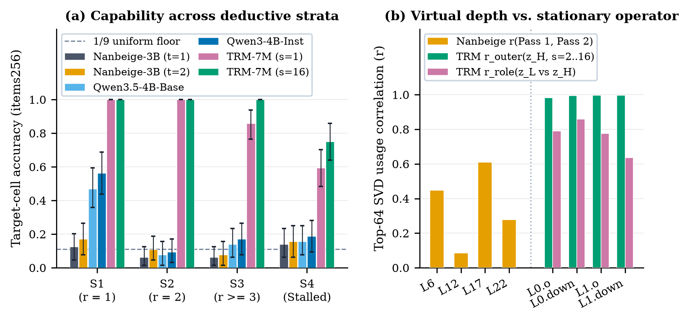
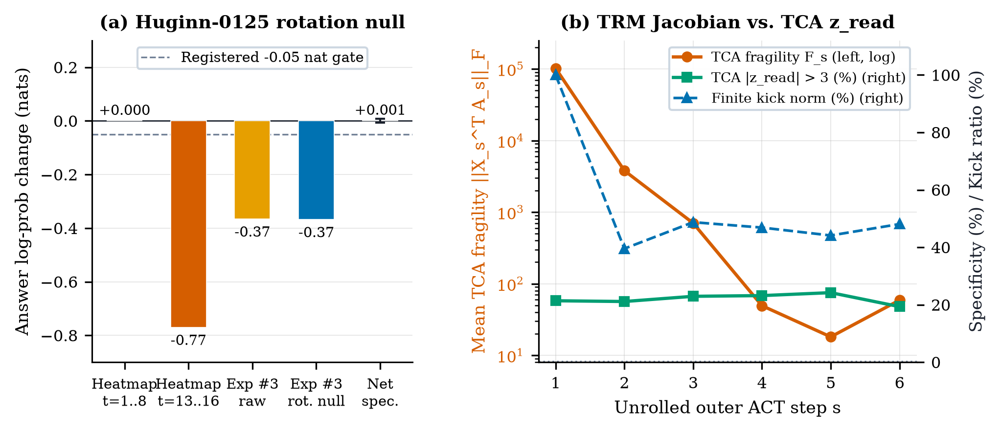
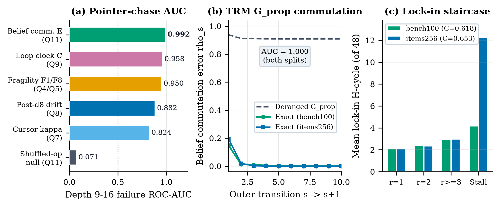
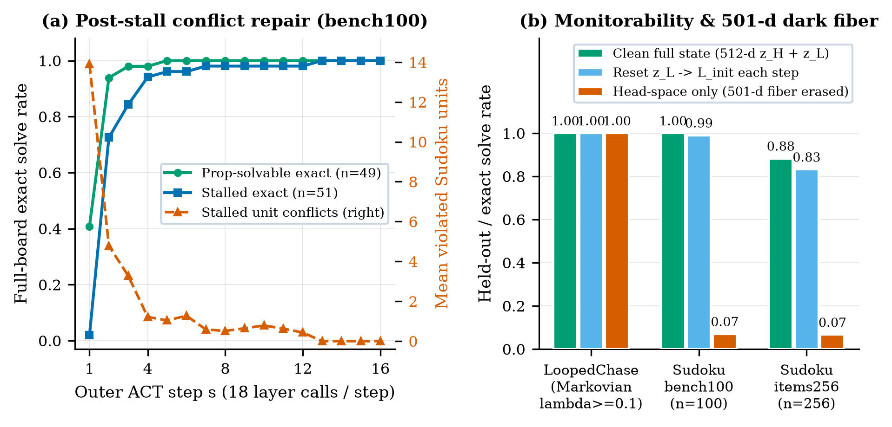

# From Shared Weights to Dark Fibers: Virtual Depth, Head-Readable Staircases, and Unmonitored Search in Looped Transformers

**Patrick Dugan** · November 2026  
*Unified manuscript synthesizing `VPD` (Sept 2026), `HUG-CAL-02`, `RMP` (Paper II), `LOOPSCOPE-01`, `ARG-02`, and `LOOPSCOPE-02`*

- **Compiled PDF:** [`paper.pdf`](paper.pdf)
- **LaTeX Source & BibTeX:** [`main.tex`](main.tex), [`references.bib`](references.bib)
- **Deterministic Figure Builder:** [`build_figures.py`](build_figures.py)

---

## Abstract

Weight-tied transformers reuse identical parameters across sequential passes, yet parameter sharing conflates distinct computational regimes whose capability gains, failure modes, and latent-state monitorability differ sharply. Synthesizing four experimental programs across pretrained looped language models (`Nanbeige4.2-3B`, `Huginn-0125`), controlled algorithmic loopers (`LOOP-T`, `LoopedChase`, `Lean-CGRT`), untied baselines (`FF-U`, `Qwen3.5-4B-Base`, `Qwen3-4B-Instruct`), and 7M-parameter convergent Tiny Recursive Models (`TRM`), we separate weight sharing into three mechanistic regimes:

1. **Fixed-pass virtual depth (`Regime I`):** `Nanbeige4.2-3B` routes through layer-selectively distinct singular subspaces across passes ($\bar{r}=0.355$; $r=0.085$ at `L12`) and shifts downstream perturbation geometry when loop-boundary states are carried rather than reset, while top-$k$ sparse autoencoder support switching limits intervention-change fidelity ($F_\Delta > 0$ in `1/12` second-pass `L22` conditions despite Muon raising held-out state explained variance from `-0.180` to `0.453`). Across pointer chasing, algebraic group composition (`ARG-02`), and deductively stratified 9×9 Sudoku (`LOOPSCOPE-02`), two-pass reuse yields no out-of-distribution loop scaling and trails untied 4B baselines (`0.129` vs. `0.211`, McNemar $p=0.0031$).
2. **Dynamical settling and head-readable staircases (`Regime II`):** Activation-matched input-read rotations on `Huginn-0125` (`HUG-CAL-02`) eliminate apparent late-iteration SVD factor specialization ($\pm 0.0065$ nats across 8 frozen factors), motivating **Transported Component Attribution (`TCA`)**, which separates dynamical fragility from closed-form directional specificity in one backward pass ($\rho=0.75$ across 480 ablations) and exposes a Lyapunov dichotomy between BPTT and 1-step detached ACT ($F_1/F_6 = 1,808.4$ despite $0.303\times$ finite kick contraction, alongside `22.04%` read-specific components). On Markovian pointer chains, intermediate supervision ($\lambda \ge 0.1$) achieves `1.00` depth-9–16 extrapolation and `1.00` head readability with zero capability trade-off, while own-head belief commutation predicts extrapolation at `AUC = 0.992`.
3. **Stationary attractor search with dark-fiber memory (`Regime III`):** On 9×9 Sudoku, a 7M `TRM` solves `88.3%` of stratified boards and `100%` of `bench100` (`51/51` deductively stalled boards): its visible beliefs commute with exact constraint propagation before stall (`AUC = 1.000`), yet erasing the **501-dimensional `lm_head` nullspace** of $z_H$ while preserving step-$s$ digit logits collapses exact solve from `1.000` to `0.070` ($p=2.02\times 10^{-28}$). Head-level monitoring suffices for Markovian propagation; non-monotone constraint search requires unmonitored dark-fiber state.

---

## 1. Three Mechanistic Regimes & Positioning Against Concurrent 2026 Studies

| Concurrent study | Principal contribution | Unresolved gap addressed in this synthesis |
| :--- | :--- | :--- |
| **Blayney et al. (`arXiv:2604.11791`)** | Fixed-point convergence and feedforward stage emulation in looped LMs | Contrasts non-convergent 2-pass LMs (`Nanbeige-3B`) against contractive 336-pass `TRM`s on identical Sudoku strata |
| **Kaissis et al. (`SDI`, ICML 2026)** | Per-step gradient–activation outer products $\sum \delta_t \otimes a_t$ for data influence | Shows detached-ACT Jacobians inflate step-1 norms by `6,400×`; `TCA` cancels $\|A_s\|$ via exact rotation nulls |
| **Wu, Hu & Zhang (`arXiv:2609.39892`)** | Jacobian steering shows cross-loop routing to distinct linear operators | Shows cross-pass SVD multiplexing in `Nanbeige` ($\bar{r}=0.355$) yields zero multi-step gain over untied `Qwen-4B` |
| **Sesodia et al. (`arXiv:2610.24135`)** | Iteration-budget staircases on depth-bound algorithmic benchmarks | Proves visible beliefs commute with exact $G_{\text{prop}}$ (`AUC = 1.000`) before stall and require a 501-d dark fiber past stall |
| **Olszowiec et al. (`arXiv:2610.18127`)** | Stability regimes and hidden-state trajectories in looped LMs | Establishes the exact monitorability regime boundary via `lm_head` row-space projection (`1.000 -> 0.070`) |

---

## 2. Regime I: Two-Pass Virtual Depth, SAE Support Switching, and Non-Extrapolation (`Nanbeige4.2-3B`)

### 2.1 Terminal Pass Divergence, Muon SAEs, and State-Carry Direction Shift (`VPD` Sept 2026)
- **Terminal pass divergence:** Across `ARC-AGI-1`, `ARC-AGI-2`, and `INTELLECT-3` logic & math (`18` trajectories), Pass-1 vs. Pass-2 residual cosine stays aligned at physical layer `L12` (`0.799–0.869`) and drops sharply at final physical layer `L22` (`0.230–0.307`; `0.184–0.229` post-loop-norm), already inside the prompt suffix before generation.
- **Muon rescues state EV, not intervention change fidelity ($F_\Delta$):** Replacing AdamW with Muon-hybrid on shared 6,144-feature Top-32 SAEs lifts `L22` Pass-2 held-out state explained variance from **`-0.180` to `+0.453`** on Q4 trajectories (`-0.535` to `+0.312` on BF16 baselines; Pass 1: `0.830 -> 0.918` and `0.763 -> 0.942`). Under exact accounting $\Delta h = \Delta \hat{h} + (e(h_1)-e(h_0))$, Muon improves `L22` Pass-2 $F_\Delta$ in `12/12` conditions, yet only `1/12` crosses `0` (`+0.030`). Discrete Top-32 encoder support switches at `1–3` of `80` positions explain `93.3%–99.6%` of mismatch energy (`-52.367 -> -0.000543` when baseline active support is frozen).
- **44-layer embedding-reset control:** Resetting loop-boundary states to token embeddings before Pass 2 matches 22-layer one-pass states bit-for-bit across `150` pairs. Under matched-norm `L12` VPD writes (`0.1, 1, 10`), propagated `L12 -> L22` Muon $F_\Delta$ is positive under reset (`+0.047` to `+0.572`) and negative under carry (`-0.300` to `-0.046`); offline baseline × unit-direction crossing confirms state carry rotates the downstream response direction (`0.059/0.051` carry direction vs. `0.354/0.377` reset direction).

### 2.2 Cross-Benchmark Capability Triangulation
- **Pointer chasing (`Silico Stage 1`):** `79.2%` at 1 hop (`chance = 6.25%`), collapsing to **`6.55%` (`131/2,000`)** at depths 3–6.
- **Algebraic group programs (`ARG-02` Extension N1, `N=168`):** Loop `1/2/4/8` `future@12` = `44 / 65 / 76 / 71` vs. single-pass `Qwen3.5-0.8B` (`68`) and `Qwen3.5-2B` (`79`). Registered gate `H2a` not met (open-loop `55` vs `71`, $p=0.097$); donor-shuffled Pass-2 displacements score `69` vs `65`; `0.25·RMS` kicks amplify `2.8× -> 3.9× -> 6.9×`.
- **Stratified 9×9 Sudoku (`LOOPSCOPE-02`, `N=256`):**

| Model / Pass setting | Params | Overall | `S1` ($r=1$) | `S2` ($r=2$) | `S3` ($r\ge 3$) | `S4` (Stall) | Operator signature |
| :--- | ---: | ---: | ---: | ---: | ---: | ---: | :--- |
| `Nanbeige4.2-3B` ($t=1$) | 3.0B | `0.098` | `0.125` | `0.062` | `0.062` | `0.141` | Half virtual pipeline (22L) |
| `Nanbeige4.2-3B` ($t=2$, native) | 3.0B | `0.129` | `0.172` | `0.109` | `0.078` | `0.156` | Multiplexed SVD ($\bar{r}=0.355$) |
| `Nanbeige4.2-3B` ($t=8$, OOD) | 3.0B | `0.090` | `0.047` | `0.156` | `0.062` | `0.094` | Non-contractive ($\|\Delta h\|/\|h\|=0.71$) |
| `Qwen3.5-4B-Base` (untied) | 4.0B | `0.211` | `0.469` | `0.078` | `0.141` | `0.156` | Untied 36L; mid-lens `L18` = `0.109` |
| `Qwen3-4B-Instruct` (SDPA) | 4.0B | `0.254` | `0.562` | `0.094` | `0.172` | `0.188` | Untied 36L pure-SDPA control |
| **`TRM-7M` ($s=1$: 18 passes)** | 7.0M | `0.863` | `1.000` | `1.000` | `0.859` | `0.594` | Inner sweep; exact board = `0.082` |
| **`TRM-7M` ($s=16$: 336 passes)** | 7.0M | **`0.938`** | **`1.000`** | **`1.000`** | **`1.000`** | **`0.750`** | Stationary ($\bar{r}=0.992$); board = **`0.883`** |

---

## 3. Separating Dynamical Fragility from Component Specificity (`HUG-CAL-02` & `TCA`)

- **`HUG-CAL-02` (`Huginn-0125`, Silico Experiment #3):** Uncontrolled late-window SVD ablations (`t=13..16`) cost `-0.77` nats vs. `0.00` in `t=1..8`. Under activation-distribution-matched orthogonal input-read rotations across `240` clean-correct 2-hop programs × `3` seeds and `8` frozen factors, `core3 f1` costs **`-0.366` nats raw vs. `-0.368` nats matched rotation (`+0.0007` net specificity)**; all 8 factors lie within **`±0.0065` nats** (`0/4` nominations pass `-0.05` nats).
- **Transported Component Attribution (`TCA`):** From one forward+backward pass, $\Delta_{l,t}(u,v) = -\sigma v^\top (X_{l,t}^\top A_{l,t}) u$ separates dynamical fragility $F_{l,t} = \|X_{l,t}^\top A_{l,t}\|_F$ from closed-form orthogonal rotation specificity $z_{\text{read}}, z_{\text{write}}$. Validated across 480 `Huginn` conditions (`Spearman 0.75`, `93%` sign agreement for $|\text{meas}|\ge 0.05$).
- **Detached-ACT vs. BPTT Lyapunov Dichotomy (`LOOPSCOPE-02` `P4`):** Unrolled 6-step float32 `TCA` (`105` core calls) on `TRM` yields **`F_1 / F_6 = 1,808.4`** (`6,400×` swing on `L0.down_proj`) despite `0.303×` finite kick contraction, because 1-step detached ACT leaves infinitesimal tangent Jacobians mildly expansive ($\approx 1.074^{105}$) inside `Post-RMSNorm` nonlinear basins. While raw `SDI` outer products suffer `6,400×` step-1 inflation, `TCA` cancels $\|A_s\|$ identically to reveal a flat **`22.04%` read-specific circuit (`81.6×` above the `0.27%` $3\sigma$ Gaussian null)**.

---

## 4. Regime II: Closed-Loop Dictionaries, Mediated Variables, and Head-Readable Staircases (`RMP` & `LOOPSCOPE-01`)

- **Closed-loop sparse surrogates (`RMP` Paper II):** Shared TopK SAEs retain `0.923, 0.910, 0.900` of clean deep EM across 8 visits in `LOOP-T` (`faithful_state` met in `3/3` seeds) vs. `0.688` in untied `FF-U s3` (below matched PCA `0.796` and equal-norm isotropic noise `0.778`). Shared MLP-only transcoders with live attention retain `0.940–0.996` across 9 models (`3.5×` lower latent bit-rate than untied).
- **Mediated variables & probe-vs-patch gap:** Answer-token probes decode early hops (`0.76–1.00`) while answer patches fail (`<= 0.22`); query+answer block patches transfer early hops in `5/6` tied seeds (`IIA 0.67–1.00`, start-copy `<= 4.5%`), and `<= 32` shared-dictionary features transfer $\operatorname{cur\_node}(s)$ on `1,000` collision-free pairs in `4/5` eligible tied seeds (`0.605–1.000`) and `0/2` untied (`0.277, 0.386`).
- **Zero monitorability trade-off & Compactification-Theory B1 (`LOOPSCOPE-01`):** Across 24 depth-8 `LoopedChase` models, $\lambda \ge 0.1$ achieves `1.00` depth-9–16 extrapolation and `1.00` own-head/probe readability. Own-head belief commutation error $\hat{E}$ over training loops 4–7 achieves **`AUC = 0.992`** (`17/17` simulation bound satisfaction, phase obstruction $\Phi$ flags `5/5` deadline-desynchronized failures, shuffled-op null `0.071`), corroborated by `SEM-ECHO-01` (`7/7` failures flagged, $\rho = 0.92$).

---

## 5. Regime III: Stationary Attractor Search and the 501-Dimensional Dark Fiber (`LOOPSCOPE-02` `TRM`)

- **Two-timescale convergence & perturbation repair:** Step `s=1` (`18` inner passes) solves `86.3%` of single target cells (`0.082` exact board), while outer steps `2..16` drive exact full-board solve to **`0.883` (`+0.801`) on `items256`** and **`1.000` (`100/100`) on `bench100`** (`0.920` replication), repairing 10-cell donor corruptions from **`0.000 -> 0.887`** ($p = 9.27\times 10^{-69}$).
- **Exact $G_{\text{prop}}$ commutation before stall (`P5`, `Supported 5/5`):** Visible cell beliefs commute with exact synchronous propagation ($\rho_{\text{clean}} \to 0.000$, **`AUC = 1.000`**) along the 48-$H$-cycle deductive lock-in staircase (`2.14 < 2.35 < 2.97 < 12.22` on `items256`, concordance `0.6531` vs `0.4947` null).
- **Post-stall conflict repair & the 501-dimensional dark fiber:** `TRM` solves `100%` (`51/51`) of stalled `bench100` boards (`83.6%` on `items256`), traversing explicit unit conflicts on `98.0%–99.3%` (`13.9 -> 0.0`) with non-monotone cell flips on `100%` (`107.8–128.0` flips). Resetting $z_L \leftarrow L_{\text{init}}$ between outer steps costs only `1.0` pp on `bench100` (`0.990`) and `5.1` pp on `items256` (`0.832`), whereas projecting $z_H$ onto the **11-dimensional row space of `lm_head`** (preserving step-$s$ digit logits to `< 10^{-5}` while erasing the **501-dimensional orthogonal dark fiber**) **collapses exact solve from `1.000 -> 0.070` (`-93.0` pp, $p=2.02\times 10^{-28}$) on `bench100` and `0.883 -> 0.066` (`-81.6` pp, $p=2.43\times 10^{-63}$) on `items256`**.

---

## 6. Synthesis: The Monitorability Regime Boundary & Prospective `ARC-AGI-2` Test

- **Markovian propagation regimes** (`LoopedChase`, `Lean S-loop`, pre-stall Sudoku rounds $r\ge 1$) admit head-readable compactifications ($\rho_t \to 0$) at **zero capability cost**.
- **Non-monotone NP search regimes** (post-stall Sudoku) cannot factor through instantaneous per-cell logits: coordinating multi-cell conflict repair without revisiting refuted assignments requires unmonitored state orthogonal to `lm_head`—the 501-dimensional dark fiber $(I - P_{\text{head}})z_H$.
- **Zero-code-change prospective `ARC-AGI-2` test:** Because `ARC-AGI-2` `TRM` checkpoints share the identical $d=512$ stream and 11-token color head (`rank(P_head) <= 11`, 501-d orthogonal fiber), `reset_zL` vs. `fiber_erased` transfers directly to test dark-fiber necessity across cellular vs. hypothesis-revision `ARC-AGI-2` tasks.
