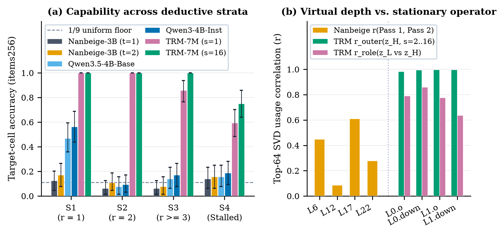
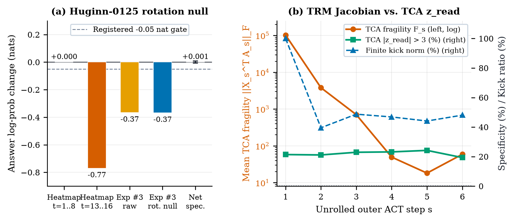
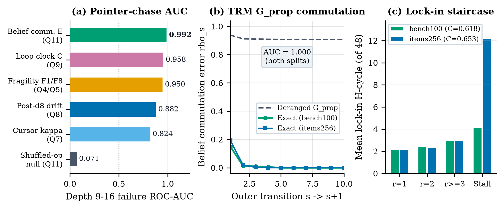
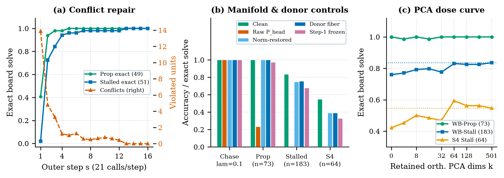

# From Shared Weights to Head-Orthogonal Fibers: Virtual Depth, Head-Readable Staircases, and Post-Stall Search in Looped Transformers

**Patrick Dugan**  
*November 2026 — Unified synthesis across six studies: `VPD`, `HUG-CAL-02`, `RMP`, `LOOPSCOPE-01`, `ARG-02`, and `LOOPSCOPE-02`*

---

## Abstract

Weight-tied transformers reuse identical parameters across sequential passes, yet parameter sharing spans distinct computational regimes whose capability gains, failure modes, and latent-state monitorability differ sharply. Synthesizing six studies across four experimental arcs—pretrained looped language models (`Nanbeige4.2-3B`, `Huginn-0125`), controlled algorithmic loopers (`LOOP-T`, `LoopedChase`, `Lean-CGRT`), untied baselines (`FF-U`, `Qwen3.5-4B-Base`, `Qwen3-4B-Instruct`), and 7M-parameter convergent Tiny Recursive Models (`TRM`)—we separate weight sharing into three mechanistic regimes.

First, two-pass language models implement *fixed-pass virtual depth*: `Nanbeige4.2-3B` routes SwiGLU inputs through layer-selectively distinct singular subspaces across passes (mean top-64 SVD usage correlation $\bar{r}=0.355$; $r=0.085$ at `L12.mlp.down_proj`) and rotates downstream perturbation directions when loop-boundary state is carried rather than reset, while discrete Top-32 sparse autoencoder support switches limit intervention-change fidelity ($F_\Delta > 0$ in `1/12` second-pass `L22` edits despite Muon lifting state explained variance from `-0.180` to `+0.453`). Across pointer chasing, 168-case finite-group composition (`ARG-02`: `65/168 = 38.7%` at native $t=2$, `76/168 = 45.2%` at $t=4$ [$p=0.080$], `71/168 = 42.3%` at $d^*=8$ [$p=0.61$]), and deductively stratified 9×9 Sudoku (`LOOPSCOPE-02`), `Nanbeige4.2-3B` fails its registered recurrent gate (`H2a` $p=0.097$) and trails untied `Qwen3.5-4B-Base` on immediate single-cell elimination (`S1`: `11/64` vs. `30/64`; overall `0.129` vs. `0.211`, $p=0.0031$) while both sit near the $1/9 \approx 0.111$ uniform floor on multi-step strata (`S2–S4`).

Second, multi-iteration BPTT loopers exhibit *dynamical settling and head-readable staircases*: activation-matched input rotations on `Huginn-0125` (`HUG-CAL-02`) eliminate apparent late-iteration SVD specialization (`±0.0065` nats), motivating *Transported Component Attribution* (`TCA`), which separates dynamical fragility from closed-form directional specificity in one backward pass ($\rho=0.75$ across 480 `Huginn` conditions) and exposes an observational Lyapunov contrast between BPTT and 1-step detached ACT ($F_1/F_6 = 1{,}808.4$ across 126 core calls despite `0.303×` finite kick contraction, alongside `22.04%` read-specific components). On Markovian pointer chains, $\lambda \ge 0.1$ achieves `1.00` depth-9–16 extrapolation and `1.00` head readability, own-head commutation predicts extrapolation at `AUC = 0.992`, and projecting the carried cursor onto the 16-d readout row space ($P_{\text{head}}$) at $\lambda=0.1$ retains `1.000` extrapolation.

Third, on 9×9 Sudoku, a 7M `TRM` (16 outer steps × 21 core calls = 336 passes) solves `88.3%` (`226/256`) of `items256` and `100%` (`100/100`) of `bench100` (`92/100 = 92.0%` on an independent replication checkpoint), including `51/51` (`bench100`) and `153/183 = 83.6%` (`items256`) whole-board deductively stalled puzzles. Visible beliefs commute with exact propagation before stall (`AUC = 1.000`). While naive unnormalized projection onto the 11-d `lm_head` row space collapses solve (`1.000 -> 0.050–0.070`) via off-manifold norm loss, restoring per-cell L2 norm, train-mean offset, or donor fibers preserves `100%` (`73/73`) of propagation-solvable boards and `74.9%–76.0%` of stalled `items256` boards via continuous $81\times 11$ logit fields, isolating a selective `-7.7` to `-8.7` pp deficit on stalled boards ($p \le 0.0043$; `-15.6` pp on round-0 stalled `S4`, `-21.9` pp under step-1 fiber freeze, $p=1.08\times 10^{-6}$) that recovers completely with the top $k=64$ orthogonal PCA directions ($p=1.00$) and remains linearly probe-decodable (`97.1%–97.8%` step-1 candidate masks; `93.5%–100%` step-16 digits).

---

## 1. Introduction: Three Regimes of Weight Sharing

A weight-tied transformer applies identical block parameters $\theta$ across $T$ sequential passes [7–13]. Because parameter identity no longer indexes computational depth, two questions govern capability and interpretability in recurrent-depth architectures:

1. **Capability triangulation:** When does reusing $\theta$ across passes yield multi-step algorithmic or combinatorial reasoning beyond an untied transformer, and what dynamical invariants separate fixed-pass stage pipelines from convergent recursive solvers?
2. **Latent monitorability:** When can intermediate computation be audited directly through the output readout head $P_{\text{head}}$, when does state orthogonal to the readout ($\ker(\text{lm\_head})$) carry causal search information, and is that head-orthogonal state opaque to linear probes or merely invisible to token logits?

Our September 2026 study of the pretrained two-pass language model `Nanbeige4.2-3B` [1, 14] examined shared MLP matrices via multipass vector parameter decomposition (`VPD`) [20] and shared Top-32 sparse autoencoders (`SAE`s) [16, 17] across `ARC-AGI-1`, `ARC-AGI-2`, and Prime Intellect's `INTELLECT-3` public reinforcement-learning logic and mathematics reasoning corpus [15]. That study found sharp terminal-layer pass divergence, showed that Muon-hybrid optimization [6, 21] rescues second-pass state reconstruction without rescuing intervention-change fidelity, and proved via a 44-layer embedding-reset control that carrying loop-boundary state rotates downstream perturbation directions. Yet it left open whether two-pass reuse buys multi-step deduction, whether per-iteration weight-ablation asymmetries reflect specialized factors or dynamical sensitivity, and where the boundary lies between head-readable iteration and head-orthogonal state.

Over the subsequent ten weeks, five concurrent looped-transformer interpretability papers established key properties of recurrent computation while leaving these questions open (Table 1):

- **Blayney et al. (2026) [22]:** analyzed cyclic fixed points and the stabilizing roles of input injection and normalization in looped language models.
- **Kaissis et al. (2026) [23]:** introduced Step-Decomposed Influence (`SDI`) to decompose TracIn training-data influence across BPTT iterations via gradient–activation outer products $\sum \delta_s \otimes a_s$.
- **Wu, Hu, & Zhang (2026) [24]:** introduced `J`-steering—learning a linear map $J$ on the incoming hidden state of a frozen loop—and observed that loop predictions advance by uneven per-step distances or stall.
- **Sesodia et al. (2026) [25]:** demonstrated that weight-tied transformers outperform identically trained untied models of equal effective depth on depth-bound tasks while forming iteration-budget staircases.
- **Olszowiec et al. (2026) [26]:** compared eight looped language models, showing that hidden-state stability and latent reasoning depend strongly on whether input embeddings are re-injected at each loop iteration.

| Concurrent study | Principal contribution | Complementary contribution in this synthesis |
|---|---|---|
| Blayney et al. [22] (`arXiv:2604.11791`, [repo PDF](https://github.com/MoralityLabAI/LoopedTransformers/blob/main/papers/shared_weights_dark_fibers/literature/2604.11791_blayney2026_mechanistic_analysis_looped_lms.pdf)) | Cyclic fixed points and normalization / injection effects in looped LMs | Contrasts non-contractive 2-pass LMs (`Nanbeige-3B`) against basin-contractive 336-call `TRM`s on identical Sudoku strata |
| Kaissis et al. (`SDI`) [23] (`arXiv:2602.10097`, [repo PDF](https://github.com/MoralityLabAI/LoopedTransformers/blob/main/papers/shared_weights_dark_fibers/literature/2602.10097_kaissis2026_step_resolved_data_attribution.pdf)) | Decomposes TracIn data influence across BPTT loops via $\sum \delta_s \otimes a_s$ | Analytical caution: detached-ACT tangent Jacobians inflate step-1 norms by `1,808×` (`6,400×` max); `TCA` cancels $\|A_s\|$ via rotation nulls |
| Wu, Hu & Zhang [24] (`arXiv:2609.39892`, [repo PDF](https://github.com/MoralityLabAI/LoopedTransformers/blob/main/papers/shared_weights_dark_fibers/literature/2609.39892_wu2026_shared_weights_selected_computations.pdf)) | Learned linear `J`-steering of frozen loops; uneven per-step logit progress | Quantifies cross-pass SVD input multiplexing ($\bar{r}=0.355$) vs. stationary `TRM` reuse ($\bar{r}=0.992$) and 48-cycle lock-in staircases |
| Sesodia et al. [25] (`arXiv:2610.24135`, [repo PDF](https://github.com/MoralityLabAI/LoopedTransformers/blob/main/papers/shared_weights_dark_fibers/literature/2610.24135_sesodia2026_inside_the_loop.pdf)) | Weight-tied beats matched untied training; iteration-budget staircases | Replicates matched-training advantage in `LOOP-T` vs. `FF-U`; shows $G_{\text{prop}}$ belief commutation (`AUC = 1.000`) before deductive stall |
| Olszowiec et al. [26] (`arXiv:2610.18127`, [repo PDF](https://github.com/MoralityLabAI/LoopedTransformers/blob/main/papers/shared_weights_dark_fibers/literature/2610.18127_olszowiec2026_monitoring_latent_reasoning.pdf)) | Prompt re-injection governs trajectory stability across 8 looped LMs | Audits input re-injection across all 6 model families and isolates on-manifold $P_{\text{head}}$ vs. head-orthogonal search residuals |

*Table 1: Positioning relative to concurrent 2026 looped-transformer interpretability studies.*

Synthesizing six studies across four experimental arcs—September `VPD` [1], registered `Huginn-0125` calibration (`HUG-CAL-02` [3]), controlled closed-loop mediation and compactification (`RMP` [2], `LOOPSCOPE-01` [5], `ARG-02` [4]), and stratified 9×9 Sudoku triangulation with head-orthogonal manifold controls (`LOOPSCOPE-02`)—we establish three mechanistic regimes:

- **Regime I — Fixed-Pass Virtual Depth (§2):** Without input re-injection, fixed $T=2$ `Nanbeige4.2-3B` routes nonlinear MLP activations through pass-divergent singular subspaces ($\bar{r}=0.355$) as a compressed 44-layer pipeline, failing to contract perturbations (`6.9×` amplification) or clear multi-step deductive strata.
- **Regime II — Dynamical Settling and Head-Readable Staircases (§3–§4):** In multi-step BPTT loopers, apparent late-loop SVD specialization on `Huginn-0125` vanishes under activation-matched input rotations (`HUG-CAL-02`), formalized in one pass by `TCA`. On Markovian chains (`LoopedChase`), per-loop supervision ($\lambda=0.1$) yields `1.000` OOD extrapolation, `AUC = 0.992` belief commutation, and `1.000` retention when `240` of `256` cursor dimensions orthogonal to $P_{\text{head}}$ are erased every loop.
- **Regime III — Stationary Attractor Search and Head-Orthogonal Residual Memory (§5):** A 7M Sudoku `TRM` (336 core calls with input re-injection) iterates a stationary outer operator ($\bar{r}_{\text{outer}}=0.992$) that contracts finite kicks (`0.303×`) and repairs 10-cell corruptions (`0.000 -> 0.887`). Controlling for off-manifold L2 norm loss—which confounded unnormalized $P_{\text{head}}$ erasure—proves that `100%` of propagation-solvable boards and `~75%` of stalled boards solve via the continuous $81\times 11$ head-space logit field alone, while a linearly decodable, top-64 PCA subspace inside the 501-d head-orthogonal complement $\ker(\text{lm\_head})$ supplies the remaining `+7.7` to `+8.7` pp on stalled boards (`+15.6` pp on round-0 stalled `S4`).

**Provenance and archival discipline.** Pre-registered decision rules and post-hoc controls are kept strictly distinct: all composite verdicts that returned `Not supported` or `Weak` (`HUG-CAL-02`, `ARG-02` `H2a`, and `LOOPSCOPE-02` `P1–P4`) are reported verbatim alongside their sub-metrics, and our post-hoc manifold/PCA controls on `P5` explicitly correct an unnormalized projection confound in archival snapshot `v009` while leaving `VPD` `v001–v010` and `papers/rmp_looped_mechinterp` unmodified.

---

## 2. Regime I: Two-Pass Virtual Depth, Support Switching, and SVD Multiplexing

We first examine `Nanbeige/Nanbeige4.2-3B` [14] (revision `451ed48c`), a pretrained decoder executing 22 shared transformer layers twice per forward pass ($T=2$, 44 executed layers) with a loop-boundary `RMSNorm` and *no* re-injection of token embeddings before Pass 2.

### 2.1 Terminal Pass Divergence and the Muon SAE Fidelity Gap

In [1], a 64-component multipass `VPD` decomposition (`prime-20260906T204058Z-561`, capturing `~2.2%` of squared weight norm at `mlp.down_proj` of physical layers 12 and 22) and shared 6,144-latent Top-32 `SAE`s were evaluated on 18 reasoning trajectories (8 calibration, 10 held-out across 8 task groups) from `ARC-AGI-1`, `ARC-AGI-2`, and `INTELLECT-3` logic and mathematics [15]. Residual-stream cosine similarity between Pass 1 and Pass 2 stays high at physical mid-layer `L12` (`0.799–0.869`) but drops sharply at terminal physical layer `L22` to `0.230–0.307` (`0.184–0.229` post-loop-norm), already within the prompt suffix before generation.

Fitting one shared Top-32 `SAE` across both passes under AdamW yielded negative held-out `L22` Pass-2 state explained variance (`EV = -0.180` on Q4 trajectories; `-0.535` on BF16 intervention baselines, vs. `+0.830` and `+0.763` on Pass 1). Switching matrix parameters to Muon [6, 21] rescued static reconstruction (`EV = +0.453` Q4, `+0.312` BF16 on Pass 2; `0.918` and `0.942` on Pass 1), yet failed to rescue *intervention-change fidelity* for true shift $\Delta h = h_1 - h_0$ and reconstructed shift $\Delta \hat{h} = \hat{h}_1 - \hat{h}_0$ ($e(h)=h-\hat{h}$):

$$
F_\Delta \;=\; 1 - \frac{\|\Delta h - \Delta \hat{h}\|_2^2}{\|\Delta h\|_2^2} \;=\; 1 - \frac{\|e(h_1) - e(h_0)\|_2^2}{\|\Delta h\|_2^2}.
$$

Muon improved `L22` Pass-2 $F_\Delta$ in `12/12` conditions (`18/20` nonzero `L22` conditions overall), but only `1/12` exceeded zero (`+0.030`). Discrete Top-32 encoder support switches at `1–3` of `80` positions caused `93.3%–99.6%` of change-mismatch energy; freezing baseline active support reduced a unit-write mismatch from `-52.367` to `-0.000543`. A 44-layer *embedding-reset control* replacing Pass-1 output with token embeddings matched 22-layer one-pass states bit-for-bit across 150 pairs and kept propagated `L12 -> L22` Muon $F_\Delta$ positive (`+0.047` to `+0.572`) versus negative under state carry (`-0.300` to `-0.046`); crossing baselines with unit response directions confirmed that state carry rotates downstream Jacobian directions (`0.059 / 0.051` carry vs. `0.354 / 0.377` reset).

### 2.2 Triangulating Pretrained Capability Across Pointer Chasing, Algebra, and Sudoku

Unlike matched-training studies where weight-tied models outperform depth-matched untied baselines trained on the same corpus [25] (replicated in our controlled `LOOP-T` vs. `FF-U` experiments in §4.1), comparing pretrained `Nanbeige4.2-3B` against untied `Qwen` checkpoints is observational across model families, parameter counts, and pretraining mixtures; it tests whether `Nanbeige`'s two-pass reuse exhibits iterative scaling at inference (Figure 1, Table 2):

1. **Pointer chasing (`Silico Stage 1`):** On 3-shot 16-node chains, `Nanbeige4.2-3B` scores `79.2%` at 1 hop (chance `6.25%`) and `6.55%` (`131/2,000`) across depths 3–6, with Pass-1-only sensitivity on top `L22` `VPD` factors `(19, 9, 43)` (`-0.060` to `-0.098` nats on Pass 1; `0.000` on Pass 2).
2. **Finite-group composition (`ARG-02` Extension N1 [4]):** On $N=168$ held-out group trace items (`future@12`, dev-selected budget $d^*=8$ from 132 dev items), `Nanbeige4.2-3B` solves `44/168` (`26.2%`) at $t=1$, `65/168` (`38.7%`) at native $t=2$ (`+21` items, McNemar $p=0.040$), `76/168` (`45.2%`) at OOD $t=4$ (`+11` over $t=2$, $p=0.080$), and `71/168` (`42.3%`) at $d^*=8$ (`+6` over $t=2$, $p=0.61$), compared with single-pass `Qwen3.5-0.8B` (`68/168 = 40.5%`) and `Qwen3.5-2B` (`79/168 = 47.0%`). Thus OOD loops $t=4,8$ show positive point-estimate gains over $t=2$ that do not reach statistical significance. Pre-registered recurrent mechanism gate `H2a`—requiring closed-loop $d^*=8$ (`71/168`) to significantly beat linear open-loop extrapolation $h_{\text{open}}(t) = h(1) + (t-1)(h(1)-x)$ (`55/168 = 32.7%` at both $t=2$ and $t=8$)—failed (`+16` items, $p=0.097$); donor-shuffled Pass-2 displacements scored `69/168` (`41.1%`, differing from clean $t=2$ on `6/168` items), and $0.25\cdot\text{RMS}$ kicks amplified by `2.8× -> 3.9× -> 6.9×` across loops `2, 4, 8`.
3. **Stratified 9×9 Sudoku (`LOOPSCOPE-02`):** Across 256 held-out `sudoku-extreme` boards stratified into $n=64$ per deductive round class of exact synchronous naked- plus hidden-single propagation $G_{\text{prop}}$—`S1_naked1` ($r=1$), `S2_prop2` ($r=2$), `S3_prop3plus` ($r\ge 3$), and `S4_stalled` (zero singles anywhere on the board at round 0)—single-target-cell 3-shot accuracy is `25/256` (`0.098`) at $t=1$, `33/256` (`0.129`) at $t=2$ ($p=0.341$), and `23/256` (`0.090`) at $t=8$ ($p=0.220$). Crucially, uniform digit guessing gives $1/9 \approx 0.111$ (`±0.077` two-SE sampling band at $n=64$): every `Nanbeige` stratum and the `S2–S4` strata of both `Qwen` models lie within sampling noise of this floor, so absence of loop scaling cannot be inferred from `S2–S4` alone. Instead, the entire advantage of untied `Qwen3.5-4B-Base` (`54/256 = 0.211`, McNemar $p=0.0031$) and pure-SDPA `Qwen3-4B-Instruct` (`65/256 = 0.254`) over `Nanbeige` ($t=2$) resides in immediate 1-round elimination `S1_naked1` (`30/64 = 0.469` and `36/64 = 0.562` vs. `11/64 = 0.172`; on `S2–S4` combined, `24/192 = 0.125` vs. `22/192 = 0.115`, $p=0.824$).

*Figure 1: (a) Target-cell accuracy on `items256` ($n=64$/stratum; 2,000-resample bootstrap 95% CIs). `Qwen` models beat `Nanbeige` strictly on `S1` ($r=1$), while all three 3B–4B LMs sit near the $1/9 \approx 0.111$ floor on `S2–S4`; the 7M `TRM` reaches `1.000` on `S1–S3` and `0.750` target-cell (`0.547` exact board) on round-0 stalled `S4`. (b) Top-64 SVD input-usage correlations $r$: `Nanbeige` multiplexes nonlinear MLP inputs across passes ($\bar{r}=0.355$, $r=0.085$ at `L12`), whereas `TRM` iterates a stationary outer operator ($\bar{r}_{\text{outer}}=0.992$) while splitting inner $z_L$ vs. $z_H$ calls ($\bar{r}_{\text{role}}=0.765$).*

| Model / Pass setting | Params | Overall | `S1` ($r{=}1$) | `S2` ($r{=}2$) | `S3` ($r{\ge}3$) | `S4` (Stall) | Loop / operator signature |
|---|---:|---:|---:|---:|---:|---:|---|
| `Nanbeige4.2-3B` ($t=1$) | 3.0B | 0.098 | 0.125 | 0.062 | 0.062 | 0.141 | Half virtual pipeline (22L) |
| `Nanbeige4.2-3B` ($t=2$, native) | 3.0B | 0.129 | 0.172 | 0.109 | 0.078 | 0.156 | Multiplexed SVD ($\bar{r}=0.355$) |
| `Nanbeige4.2-3B` ($t=8$, OOD) | 3.0B | 0.090 | 0.047 | 0.156 | 0.062 | 0.094 | Non-contractive ($\|\Delta h\|/\|h\|=0.71$) |
| `Qwen3.5-4B-Base` (untied) | 4.0B | 0.211 | 0.469 | 0.078 | 0.141 | 0.156 | Advantage strictly on `S1` (`30/64`) |
| `Qwen3-4B-Instruct` (SDPA) | 4.0B | 0.254 | 0.562 | 0.094 | 0.172 | 0.188 | Untied 36L pure-SDPA control |
| `TRM-7M` ($s=1$: 21 core calls) | 7.0M | 0.863 | 1.000 | 1.000 | 0.859 | 0.594 | Inner sweep; exact board `= 0.082` |
| `TRM-7M` ($s=16$: 336 core calls) | 7.0M | **0.938** | **1.000** | **1.000** | **1.000** | **0.750** | Stationary ($\bar{r}=0.992$); board **`= 0.883`** |

*Table 2: Stratified 9×9 Sudoku target-cell accuracy on `items256` ($N=256$, 64 boards/stratum; uniform chance $= 1/9 \approx 0.111$). Note that `S4` here denotes boards with **zero singles anywhere at round 0** ($n=64$, where `TRM` $s=16$ target-cell accuracy is `48/64 = 0.750` and exact 81-cell board solve is `35/64 = 0.547`), distinct from the broader set of `183` `items256` boards where whole-board propagation eventually stalls (`153/183 = 0.836` exact board solve; Table 5).*

### 2.3 SVD Input-Subspace Multiplexing and Reconciling `L12` Residual Alignment

To quantify whether shared matrices execute the same linear sub-operations across passes, let $W_l = \sum_j \sigma_{l,j} u_{l,j} v_{l,j}^\top$ be the exact SVD of a shared projection matrix (`mlp.down_proj` in `Nanbeige`; `o_proj` and `down_proj` in `TRM`), and define the invocation-$p$ rank-one input-usage profile over top $K=64$ singular directions:

$$
u_{l,p}(j) \;=\; \sigma_{l,j}\,\mathbb{E}_{x \in \mathcal{D}}\bigl[\,|\langle x_{l,p},\, v_{l,j}\rangle|\,\bigr], \qquad r_l(p,q) \;=\; \operatorname{corr}_{j=1\dots 64}\!\bigl(u_{l,p}(j),\, u_{l,q}(j)\bigr),
$$

with $\bar{r}$ denoting the arithmetic mean of $r_l(p,q)$ across audited matrices $l$ (and across outer step pairs $2\le p < q \le 16$ for $\bar{r}_{\text{outer}}$). Across `Nanbeige` physical layers `(L6, L12, L17, L22)`, cross-pass correlation averages $\bar{r} = 0.355$ ($r_{\text{L6}}=0.448$, $r_{\text{L12}}=0.085$, $r_{\text{L17}}=0.610$, $r_{\text{L22}}=0.277$; Figure 1b).

At first glance, near-zero SVD input correlation at `L12` ($r=0.085$) appears to conflict with high `L12` residual-stream cosine similarity (`0.799–0.869`). The two measurements probe different sites around a nonlinear gate: residual state $h_{12}^{(p)} = h_0^{(p)} + \sum_{\ell \le 12}\Delta_\ell^{(p)}$ is dominated by the shared skip-connection sum accumulated over earlier layers, whereas $x_{\text{L12},p}$ entering `mlp.down_proj` is the post-`RMSNorm` *SwiGLU intermediate activation* $\operatorname{SiLU}(W_{\text{gate}}\tilde{h}_{12}^{(p)}) \odot (W_{\text{up}}\tilde{h}_{12}^{(p)})$ in $\mathbb{R}^{d_{\text{ff}}}$. Moderate pass differences in $\tilde{h}_{12}^{(p)}$ switch which multiplicative SwiGLU gates open, routing Pass 1 and Pass 2 into nearly uncorrelated singular input subspaces of `mlp.down_proj` even while the ambient residual stream remains macroscopically aligned.

---

## 3. Separating Dynamical Fragility from Component Specificity

### 3.1 The `HUG-CAL-02` Rotation Null on `Huginn-0125`

On 3-shot variable-binding chains, the 3.5B looped model `Huginn-0125` [10] (2-layer prelude, 4-layer tied core unrolled $r=16$ times with learned adapter input re-injection at every step, 2-layer coda) achieves `0.76` accuracy at 1 hop and `0.47` at 2 hops (`0.25–0.33` floor at 3–6 hops). Deleting top-16 SVD triplets of core `mlp.proj` in iterations 1–8 cost `0.00` nats versus `-0.77` nats in iterations 13–16. Yet in registered **Silico Experiment #3** (`HUG-CAL-02` [3]; 240 clean-correct 2-hop programs × 3 noise seeds, 8 frozen factors across `core0–core3`, 4 random orthogonal input-read rotations per factor matched to exact per-iteration projection RMS while fixing write vector $u$), **factor specialization disappeared**: `core3 f1` in iterations 9–16 cost `-0.366` nats raw versus `-0.368` nats under matched rotation (`+0.0007` nats net; all 8 factors within `±0.0065` nats; Figure 2a). Early ablations are masked by downstream attractor repair; late ablations leave no repair steps before readout.

*Figure 2: (a) Registered `HUG-CAL-02` (`Huginn-0125`, $r=16$): late-window SVD ablation loss (`-0.366` nats) is matched within `±0.0065` nats by RMS-matched orthogonal read rotations (`-0.368` nats). (b) Unrolled 6-step `TCA` on Sudoku `TRM` (126 core calls; 105 calls between $s=1$ and $s=6$ commits): detached-ACT tangent Jacobians inflate $F_1/F_6 = 1{,}808.4$ while finite $0.25\cdot\text{RMS}$ kicks contract to `30.3%`; `TCA`'s rotation $z$-score cancels $\|A_s\|$, isolating a flat `22.04%` read-specific circuit.*

### 3.2 Transported Component Attribution (`TCA`) and the Detached-ACT Lyapunov Contrast

To avoid running multi-pass empirical rotation sweeps per factor, **Transported Component Attribution (`TCA`)** (`LOOPSCOPE-01` [5]) computes both fragility and exact Haar-rotation specificity in *one forward and backward pass*. For input activations $X_{l,t} \in \mathbb{R}^{P \times d_{\text{in}}}$ to $W_l \in \mathbb{R}^{d_{\text{out}} \times d_{\text{in}}}$ at call $t$ and backpropagated readout gradient $A_{l,t} = \partial y / \partial (X_{l,t} W_l^\top) \in \mathbb{R}^{P \times d_{\text{out}}}$, deleting rank-one term $\sigma u v^\top$ has first-order effect $\Delta_{l,t}(u,v) = -\sigma v^\top (X_{l,t}^\top A_{l,t}) u$, pure **dynamical fragility** $F_{l,t} = \|X_{l,t}^\top A_{l,t}\|_F$, and exact Haar-orthogonal read/write $z$-scores:

$$
z_{\text{read}}(u,v) \;=\; \frac{\Delta_{l,t}(u,v)}{\sigma \|v\|_2 \, \|X_{l,t}^\top A_{l,t} u\|_2 / \sqrt{d_{\text{in}}}}, \qquad z_{\text{write}}(u,v) \;=\; \frac{\Delta_{l,t}(u,v)}{\sigma \|u\|_2 \, \|A_{l,t}^\top X_{l,t} v\|_2 / \sqrt{d_{\text{out}}}}.
$$

We validated `TCA` in two complementary regimes. First, on `Huginn-0125` (`LOOPSCOPE-01` `Q1–Q2`), summing $\Delta_{l,t}$ across **480 measured multi-iteration ablation conditions**—`(16 top SVD + 8 random directions) × 4 core layers × 5 iteration windows`—achieved Spearman $\rho = 0.75$ and `93%` sign agreement for $|\text{measured}| \ge 0.05$ nats, validating first-order $\Delta_{l,t}$ transport on a model where true specificity is null ($|z_{\text{read}}| \le 1.8$ on top `core3` factors; `8.6%` of `4,096` cells above $3\sigma$). Second, directional specificity $z_{\text{read}}$ itself was validated against exact central finite differences ($r > 0.9999$), 2,000-sample Monte Carlo Haar rotations, and ground-truth edge-slot circuits in `LoopedChase`.

In `LOOPSCOPE-02`, each outer ACT step of the 2-layer Sudoku `TRM` executes `3 H-cycles × (6 inner z_L calls + 1 commit z_H call) = 21` `L_level` core calls (`42` transformer layers), totaling `16 × 21 = 336` core calls at $s=16$. Unrolled 6-step `TCA` in float32 executes `6 × 21 = 126` core calls, with **`5 × 21 = 105`** intermediate core calls separating the $s=1$ commit call (`#21`) from the $s=6$ commit call (`#126`). This prospectively falsified pre-registered gate `P4` ($\bar{F}_1/\bar{F}_6 \le 0.25$) in the opposite direction, revealing an observational **Detached-ACT vs. BPTT Lyapunov Contrast** across our model suite (Table 3; note this is a cross-architecture comparison rather than a controlled retraining of `TRM` under 336-call BPTT):

- **End-to-end BPTT loopers** (`Huginn-0125`, `Lean S-loop`, extrapolating `LoopedChase`) differentiate through all unrolled iterations during training, penalizing positive tangent Lyapunov exponents and yielding $F_1 / F_{\text{late}} < 1$ (`0.43` on `Huginn`; `0.007` on `Lean` log-$p$).
- **1-step detached ACT (`TRM` [11])** detaches $(z_H, z_L)$ between outer steps and runs the first `2` of `3` $H$-cycles (`14` of `21` core calls/step) under `torch.no_grad()`. Nonlinear `Post-RMSNorm` dynamics contract *finite* $0.25\cdot\text{RMS}$ kicks monotonically (`1.000 -> 0.303` by $s=16$), yet unpenalized 105-call tangent Jacobians expand at `~1.074×` per core call ($1.074^{105} \approx 1.8\times 10^3$), giving mean $\bar{F}_1/\bar{F}_6 = \mathbf{1{,}808.4}$ (and a single-matrix maximum swing of `6,400×–7,048×` on `L0.down_proj`: `148,723` at $s=1$ vs. `21.1` at $s=5$).

While Kaissis et al. [23] formulated `SDI` to decompose TracIn training-data influence inside BPTT-trained loopers (we did not run TracIn), our Jacobian result provides an analytical transfer caution: applying unnormalized $\sum \delta_s \otimes a_s$ step outer products to detached-ACT checkpoints would weight step 1 over step 6 by three orders of magnitude from tangent expansion alone. Because $\|A_s\|$ cancels identically in $z_{\text{read}}$, `TCA` recovers a step-invariant **`22.04%`** share of $|z_{\text{read}}| > 3$ components (`81.6×` the `0.27%` Gaussian null) and `12.37%` write-specific components.

| Model | Training gradient | Re-inject? | $F_1 / F_{\text{late}}$ | $|z_{\text{read}}|{>}3$ | Kick | Mechanistic regime |
|---|---|---|---:|---:|---:|---|
| `Nanbeige4.2-3B` | 2-pass BPTT | No | `0.42–2.00` | `0.9%–8.4%` | `6.90×` | Virtual depth; non-contractive |
| `Qwen3.5-4B-Base` | Untied 36L | — | — | `0.2%–19.9%` | — | Specific at final `L32` (`19.9%`) |
| `Huginn-0125` ($r{=}16$) | Multi-step BPTT | Yes (adapter) | `0.43` | `8.6%` | Contr. | Settling; `HUG-CAL-02` null |
| `LOOP-T` ($T{=}8$, `RMP`) | 8-step BPTT | No (prompt) | `< 1` | Sparse | Contr. | Closed-loop SAE/DAS transfer |
| `Lean S-loop` ($T{=}32$) | Multi-step BPTT | Yes | `0.007` | `5%–11%` | Contr. | Attractor masking (`150×`) |
| `LoopedChase` (24 arms) | 8-step BPTT | Yes (`LN + e`) | `0.08–0.36` | Edge slots | Contr. | Head-readable ($\lambda{\ge}0.1$: `1.00`) |
| `TRM-7M` (Sudoku) | Detached ACT | Yes ($z_H + x$) | **`1,808.4`** | **`22.04%`** | **`0.303×`** | Basin-contractive, tangent-exp. |

*Table 3: Summary of training regime, prompt/input re-injection [26], `TCA` fragility ratio, read specificity share ($3\sigma$ Gaussian null `= 0.27%`), and macroscopic kick response across all studied model families.*

---

## 4. Regime II: Closed-Loop Dictionaries, Mediated Variables, and Head-Readable Staircases

### 4.1 Matched Tied vs. Untied Training and Closed-Loop Surrogates (`RMP`)

Consistent with Sesodia et al. [25], training matched $d=128$ transformers across four reference-trace tasks in `RMP` [2] showed `LOOP-T` (1 block × 8 loops, 0.46M params, no explicit re-injection beyond non-cursor prompt tokens) passing the $G_0 = 0.98$ `EM` gate in `6/6` seeds versus `3/6` in untied `FF-U` (8 blocks, 1.84M params). Closed-loop insertion of a single shared TopK `SAE` after all 8 visits retained `0.923, 0.910, 0.900` of clean deep `EM` in `LOOP-T` seeds 1–3 versus `0.688` in untied `FF-U` seed 3 (below matched PCA `0.796` and equal-norm isotropic Gaussian noise `0.778`); shared MLP-only transcoders [18] with live attention retained `0.940–0.996` across 9 models at `3.5×` lower active coding rate (`342` vs. `1,213` bits). While answer-token probes decoded $\operatorname{cur\_node}(s)$ (`0.76–1.00`) without causal patch effect (`IIA <= 0.22`) [19, 27], patching the query+answer block transferred early hops (`IIA = 0.67–1.00`, start-copy `<= 4.5%`), and `<= 32` shared-dictionary features mediated $\operatorname{cur\_node}(s)$ on `1,000` collision-free pairs in `4/5` tied seeds (`0.605–1.000`) vs. `0/2` untied (`0.277, 0.386`).

### 4.2 Monitorability Frontier and Contrast Projection (`LOOPSCOPE-01`)

On `Lean-CGRT` (`Q3`, `Q6`), `S-loop` scaled certified proof rate from `48.6%` ($T=8$) to `65.0%` ($T=32$) while decoding final tactics via its unmodified head at `94%–99%` by $T/2$. Across 24 depth-8 `LoopedChase` models (12 `Q4` discovery + 12 `Q5` prospective, $\lambda \in \{0, 0.01, 0.1, 1\}$), $\lambda \ge 0.1$ achieved `1.00` depth-9–16 extrapolation and `1.00` head readability. Notice how this refines Olszowiec et al. [26]: every `LoopedChase` arm re-injects prompt embeddings via $h \leftarrow \operatorname{LN}(h) + e$, yet `5/9` $\lambda=0$ arms still fail OOD extrapolation via deadline schedule desynchronization, whereas `LOOP-T` succeeds without explicit re-injection by preserving prompt tokens in context. Thus input re-injection stabilizes deep state carry without alone enforcing time-invariant operator simulation; training-depth own-head belief commutation error $\hat{E}$ (`Q11`) diagnoses true operator simulation at **`AUC = 0.992`** (Figure 3a; corroborated by `SEM-ECHO-01`, $\rho=0.92$).

*Figure 3: (a) ROC-AUC predicting depth-9–16 failure across 24 `LoopedChase` arms (`Q11` belief commutation $\hat{E}$ reaches `AUC = 0.992`). (b) Sudoku `TRM` visible beliefs commute with exact $G_{\text{prop}}$ ($\rho_{\text{clean}} \to 0.000$ by $s=4$; `AUC = 1.000` vs. deranged clues on both splits). (c) Mean lock-in $H$-cycle (of 48) follows $r=1 < r=2 < r\ge 3 < \text{stalled}$ ($C_{\text{stair}} = 0.653$ vs. `0.495` null on `items256`).*

**The Markovian contrast control for $P_{\text{head}}$ projection.** To test whether erasing head-orthogonal state harms a Regime II model, we projected the 256-d carried cursor $h_{t,\text{cursor}}$ of all 24 `LoopedChase` checkpoints onto the 16-d effective row space $P_{\text{head}}$ of $\text{head}\circ\text{ln\_f}$ (removing `240/256` dimensions after every loop `1..16`; Figure 4b). At $\lambda = 0.1$, **all `3/3` seeds retained `1.000` depth-1–8 and `1.000` held-out depth-9–16 accuracy** under raw $P_{\text{head}}$ projection, LayerNorm-moment-preserved projection, donor-swapped orthogonal fiber, and step-1 frozen fiber (and `8/9` extrapolating $\lambda \in \{0.01, 0.1\}$ seeds across `Q4`+`Q5` retained `0.982–1.000`). At $\lambda = 1.0$, `2/3` seeds likewise stayed at `1.000` while seed 1 dropped to `0.129` (even with LayerNorm statistics restored, indicating an auxiliary phase coordinate in that single seed; mean `0.710`). Projecting non-cursor edge-table tokens (`all_tokens_fiber_erased`) collapsed accuracy to `0.177`, as expected because `head` reads node IDs rather than $(u,v)$ edge bindings. Thus for the carried state variable of a Markovian chain, head-orthogonal cursor dimensions are completely dispensable (`1.000 -> 1.000` at $\lambda=0.1$).

---

## 5. Regime III: Stationary Attractor Search and Head-Orthogonal Controls

We now turn to the frozen 7M-parameter, 2-layer Attention-`TRM` (`gaoxin492/TinyRecursiveModels-Sudoku-Extreme-att`, `step_21700`, $d=512$, 16 outer steps × 21 core calls = 336 passes; replicated on independent checkpoint `yagizdevre/trm-sudoku-extreme-att` [11]) across `items256` (`73` whole-board $G_{\text{prop}}$-solvable [`WB-Prop`], `183` eventually stalling [`WB-Stall`]) and `bench100` (`49` `WB-Prop`, `51` `WB-Stall`).

### 5.1 Two-Timescale Convergence, Corruption Repair, and $G_{\text{prop}}$ Commutation (`P1–P5`)

As audited in Table 4, `TRM` factors Sudoku across two timescales:

1. **Inner 21-call sweep ($s=1$) vs. outer steps $s=2\dots 16$:** Step $s=1$ already reaches `0.863` target-cell accuracy (`1.000` on `S1–S2`) but only `0.082` (`21/256`) exact full-board solve. Outer steps `2..16` drive exact board solve to **`0.883`** (`226/256`) on `items256` and **`1.000`** (`100/100`) on `bench100` (**`0.920`**, `92/100`, on the `yagizdevre` replication checkpoint). Corrupting 10 empty cells of $z_H(1)$ with donor states drops $s=1$ exact board solve to `0.000` (`0/256`) and self-repairs by $s=16$ to **`0.887`** (`227/256`, $p=9.27\times 10^{-69}$)—exceeding clean `0.883` (`226/256`) by one board because all `226` clean-solved boards recover while the step-1 perturbation dislodges one marginally stalled board into the valid basin.
2. **Pre-stall $G_{\text{prop}}$ commutation and post-stall conflict flips:** Visible `lm_head` probabilities commute with exact $G_{\text{prop}}$ on `WB-Prop` boards ($\rho_s \to 0.000$ by $s=4$, `AUC = 1.000`; Figure 3b), and lock-in times across all 48 $H$-cycles obey `2.14 < 2.35 < 2.97 < 12.22` on `items256` ($C_{\text{stair}}=0.6531$ vs. `0.4947` null; engaging Wu et al.'s [24] observation of uneven step progress by tying commit timing directly to deductive round $r(i)$). Past stall, `TRM` solves `51/51` (`100%`) of `bench100` `WB-Stall` boards and `153/183` (`83.6%`) of `items256` `WB-Stall` boards (including `35/64 = 54.7%` exact board solve and `48/64 = 75.0%` target-cell accuracy on strict round-0 zero-single `S4_stalled`), traversing explicit Sudoku unit violations on `98.0%–99.3%` of solved stalled boards (`13.90 -> 0.00` violated units on `bench100`; Figure 4a) via `107.8–128.0` non-monotone cell flips.

| Hypothesis | Verdict | Registered threshold behavior | Structural mechanism isolated (with follow-up controls) |
|---|---|---|---|
| `P1` Triangulation | Not supported | `3/4` met; single-cell $\Delta_{1\to 16} = +0.074 < 0.25$ | $s{=}1$ (21 core calls) reaches `0.863` target-cell; $s{=}2..16$ drives full-board exact solve `0.082 -> 0.883` (`+0.801`) |
| `P2` Attractor vs. VD | Not supported | Repair & `NB` drift met; single-cell open drop `0.074 < 0.30` | 10-cell donor corruption collapses $s{=}1$ board solve to `0.000` and repairs to `0.887` (`227/256`); kicks contract `0.303×` |
| `P3` SVD geometry | Weak | `TRM` $\bar{r}_{\text{outer}}=0.992$, $\bar{r}_{\text{role}}=0.765$; `NB` $\bar{r}=0.355 \in [0.3, 0.4)$ | `Nanbeige` SwiGLU multiplexing (`L12` `0.085`) vs. `TRM` stationary outer operator + inner $z_L/z_H$ role split |
| `P4` Unrolled `TCA` | Not supported | Specificity `22.04% >> 1.35%`; $F_1/F_6 = 1{,}808.4 \gg 0.25$ | Detached-ACT tangent expansion (105 calls between $s{=}1,6$ commits) coexists with `0.303×` basin contraction |
| `P5` Compactification | **Supported** | **5/5 sub-criteria met** ($p \le 2\times 10^{-28}$) | $G_{\text{prop}}$ commutation (`AUC = 1.000`); manifold controls split raw $P_{\text{head}}$ drop into L2-norm loss + stalled-only 64-PCA residual |

*Table 4: Pre-registered `LOOPSCOPE-02` verdicts and calibrated mechanistic findings.*

### 5.2 Dissecting Head-Orthogonal Projection: Off-Manifold Norm Loss vs. Stalled-Board Residual

Because `TRM`'s vocabulary has size `11`, `lm_head.weight` $\in \mathbb{R}^{11 \times 512}$ has exact rank `11`, defining an 11-d readout row space $P_{\text{head}}$ and a **501-dimensional head-orthogonal fiber** $(I - P_{\text{head}})\mathbb{R}^{512} = \ker(\text{lm\_head})$. In pre-registered test `P5`, resetting $z_L \leftarrow L_{\text{init}}$ between outer steps preserved `99/100` (`0.990`) on `bench100` and `213/256` (`0.832`) on `items256`, whereas raw `fiber_erased` ($z_H^{\text{board}} \leftarrow z_H^{\text{board}}P_{\text{head}} + H_{\text{init}}(I-P_{\text{head}})$ plus `reset_zL`) collapsed solve to `0.070` (`7/100` at batch-size 50; `5/100 = 0.050` under float64 SVD at batch-size 64) on `bench100`, `0.000` (`0/100`) on `yagizdevre` replication, and `0.066` (`17/256`) on `items256`.

However, inspecting `fiber_erased` *by stratum* exposes a critical confound (Table 5): raw `fiber_erased` (and `zH_fiber_only_erased`, which keeps $z_L$ live: `0.060` on `bench100`, `0.070` on `items256`) destroys **propagation-solvable boards too** (`5/49` on `bench100`; `17/73 = 0.233` on `items256`, even while single target cells in `S1`/`S2` stay at `0.984/0.969`). Why did raw $P_{\text{head}}$ projection break `TRM` propagation when it left `LoopedChase` ($\lambda=0.1$) at `1.000`? In `LoopedChase`, $h \leftarrow \operatorname{LN}(h) + e$ re-normalizes the projected vector before input addition; in `TRM`, `run_l_level` feeds $z_H + x_{\text{emb}}$ *without normalization*, so zeroing `501/512` coordinates collapses $\|z_H\|_2$ against $\sqrt{512}$-scaled $x_{\text{emb}}$ and strips the trained `Post-RMSNorm` affine carrier offset.

*Figure 4: (a) On `bench100`, `TRM` solves `49/49` `WB-Prop` and `51/51` `WB-Stall` boards, driving violated Sudoku units from `13.9 -> 0.0`. (b) Separating off-manifold norm loss from regime-selective fiber dependence: raw $P_{\text{head}}$ fails on `TRM Prop` (`0.233`) via unnormalized $\|z_H\|_2$ shrinkage, whereas restoring cell L2 norm or grafting donor fibers preserves `1.000` on both `LoopedChase` ($\lambda=0.1$) and `TRM Prop` (`73/73`), isolating a selective drop on `WB-Stall` (`0.836 -> 0.749`, $p=8.6\times 10^{-4}$) and `S4` (`0.547 -> 0.391`; `0.328` under step-1 freeze). (c) Top-$k$ orthogonal PCA dose curve (fitted strictly on `train.csv`): $k=64$ (`86.6%` variance) recovers full clean solve (`0.831` vs. `0.836`, $p=1.00$).*

| Inter-step condition ($s \ge 1$) | `bench100` Prop (49) | `bench100` Stall (51) | `items256` Prop (73) | `items256` Stall (183) | `S1` (64) Board [Cell] | `S2` (64) Board [Cell] | `S3` (64) Board [Cell] | `S4` (64) Board [Cell] | $p_{\text{McNemar}}$ (`WB-Stall`) |
|---|---:|---:|---:|---:|---:|---:|---:|---:|---:|
| Clean $s=16$ (full 512-d) | 1.00 (0.92) | 1.00 (0.92) | **1.000** | **0.836** | 1.00 [1.00] | 0.98 [1.00] | 1.00 [1.00] | **0.55** [0.75] | — |
| `reset_zL` ($z_L \leftarrow L_{\text{init}}$) | 1.00 (0.92) | 0.98 (0.84) | 1.000 | 0.765 | 0.97 [1.00] | 0.95 [1.00] | 0.95 [1.00] | 0.45 [0.72] | $2.4\times 10^{-4}$ |
| Raw `fiber_erased` (`P5`) | 0.10 (0.00) | 0.00 (0.00) | 0.233 | 0.000 | 0.16 [0.98] | 0.02 [0.97] | 0.09 [0.83] | 0.00 [0.50] | $1.8\times 10^{-46}$ |
| `zH_fiber_only_erased` | 0.12 (0.00) | 0.00 (0.00) | 0.247 | 0.000 | 0.16 [1.00] | 0.06 [0.98] | 0.06 [0.78] | 0.00 [0.56] | $1.8\times 10^{-46}$ |
| `fiber_norm_restored` ($k{=}0$) | 1.00 (0.98) | 1.00 (0.88) | **1.000** | **0.749** | 0.97 [1.00] | 0.97 [1.00] | 0.95 [1.00] | **0.39** [0.67] | $8.6\times 10^{-4}$ |
| `fiber_train_mean_filled` | 1.00 (0.96) | 1.00 (0.96) | **1.000** | **0.760** | 0.98 [1.00] | 0.95 [1.00] | 0.97 [1.00] | **0.41** [0.73] | $4.3\times 10^{-3}$ |
| `fiber_donor_swapped` | 1.00 (0.92) | 1.00 (0.92) | **1.000** | **0.754** | 0.97 [1.00] | 0.95 [1.00] | 0.98 [1.00] | **0.39** [0.69] | $1.5\times 10^{-3}$ |
| `fiber_step1_frozen` | 0.98 (0.98) | 0.92 (0.94) | 0.973 | **0.678** | 0.94 [1.00] | 0.91 [1.00] | 0.88 [0.98] | **0.33** [0.66] | $1.1\times 10^{-6}$ |
| Orth. PCA $k=16$ (`49.9%` var) | 1.00 (0.82) | 1.00 (0.90) | 0.986 | 0.798 | 0.97 [1.00] | 0.97 [1.00] | 0.98 [1.00] | 0.48 [0.77] | $0.118$ |
| Orth. PCA $k=64$ (`86.6%` var) | 1.00 (0.90) | 1.00 (0.78) | **1.000** | **0.831** | 1.00 [1.00] | 0.94 [1.00] | 0.98 [1.00] | **0.59** [0.83] | $1.000$ |
| Orth. PCA $k=501$ (`100%` var) | 1.00 (0.92) | 1.00 (0.92) | **1.000** | **0.836** | 1.00 [1.00] | 0.98 [1.00] | 1.00 [1.00] | **0.55** [0.75] | $1.000$ |

*Table 5: Per-stratum exact 81-cell board solve (with `yagizdevre` replication in parentheses on `bench100`, and single target-cell accuracy in brackets on `items256` `S1–S4`) across manifold, donor, and train-split orthogonal-fiber PCA controls. Note: on `WB-Prop` ($n=73$), $p_{\text{McNemar}} = 1.000$ for every manifold-preserving control (`73/73` solved).*

We therefore ran five manifold-preserving and dose-response controls (fitted strictly on `200` `train.csv` boards with zero test leakage; Table 5, Figure 4b–c), establishing three exact results:

1. **Propagation-solvable boards require zero head-orthogonal information:** Simply rescaling the 11-d projection $z_H^{\text{board}}P_{\text{head}}$ to each cell's pre-projection L2 norm (`fiber_norm_restored`, carrying *zero* orthogonal dimensions), filling $(I-P_{\text{head}})z_H$ with step-$s$ `train.csv` means (`fiber_train_mean_filled`), or grafting a *foreign donor board's* live 501-d fiber (`fiber_donor_swapped`) restores **`49/49` (`100%`) on `bench100` `WB-Prop` (`45–48/49` on `yagizdevre`) and `73/73` (`100%`, McNemar $p=1.000$) on `items256` `WB-Prop`**.
2. **Continuous $81\times 11$ logit fields solve most stalled boards, while a 64-PCA head-orthogonal residual supplies `+7.7` to `+8.7` pp on hard stalled search:** Because each outer step feeds the entire $81\times 11$ continuous logit field through 21 fresh inner `L_level` calls with live $z_L$ and clues $x_{\text{emb}}$, norm-restored 11-d head state alone already solves `51/51` (`100%`) of `bench100` stalled boards (`45/51 = 0.882` on `yagizdevre`) and `137/183` (`74.9%`) of `items256` `WB-Stall` boards. Yet on `items256` `WB-Stall`, *every* manifold-preserving erasure leaves a significant, regime-selective deficit relative to clean `153/183` (`0.836`): `fiber_norm_restored` drops to `137/183` (`0.749`, `-8.7` pp, $p=8.55\times 10^{-4}$), `fiber_train_mean_filled` and `pca_k0` to `139/183` (`0.760`, `-7.7` pp, $p=0.0043$), `fiber_donor_swapped` to `138/183` (`0.754`, `-8.2` pp, $p=0.0015$), and `fiber_step1_frozen` to `124/183` (`0.678`, `-15.8` pp, $p=1.08\times 10^{-6}$—worse than neutral mean fill because stale step-1 conflict state misleads later outer steps). On round-0 stalled `S4_stalled` ($n=64$), board-exact solve drops from `35/64` (`0.547`) to `25/64` (`0.391`, `-15.6` pp) under norm-restored/donor controls and `21/64` (`0.328`, `-21.9` pp) under step-1 freeze. Retaining top-$k$ train-PCA orthogonal directions recovers stalled performance monotonically (`0.760 -> 0.770` at $k=4$ `-> 0.792` at $k=8$ `-> 0.798` at $k=16$ `->` **`0.831`** [`152/183`, $p=1.000$] at $k=64$, `86.6%` variance; `S4` reaches `38/64 = 0.594` at $k=64$).
3. **Head-orthogonal, not probe-opaque:** Across held-out empty cells, $(I-P_{\text{head}})z_H(s)$ leaks `< 1.5e-5` max absolute logit into `lm_head`, yet linear ridge probes trained strictly on `train.csv` decode from $(I-P_{\text{head}})z_H(s)$: (i) initial clue-eliminated candidate masks at **`97.7%`** (`bench100`; `98.6%` on stalled) and **`97.1%`** (`items256`; `97.8%` on stalled) at $s=1$, (ii) current step-$s$ `lm_head` argmax digits at `97.4% -> 99.8% -> 100.0%` (`bench100`) and `95.6% -> 97.9% -> 98.8%` (`items256`) across $s \in \{1, 4, 16\}$, and (iii) ground-truth final digits at `80.8% -> 98.4% -> 100.0%` and `71.2% -> 88.7% -> 93.5%`, matching `lm_head`'s own accuracy within `0.2` pp.

---

## 6. Synthesis: Calibrated Monitorability Boundary and Outlook

**Two methodological lessons and a calibrated boundary.** Pairing `HUG-CAL-02` with our `LOOPSCOPE-02` manifold controls highlights a recurring pitfall in looped-model interpretability: just as uncalibrated SVD ablations conflate late-loop Jacobian fragility with factor specialization, unnormalized subspace projections conflate off-manifold scale collapse with hidden-channel necessity. Once controlled on-manifold:

- **Markovian propagation** (`LoopedChase` at $\lambda=0.1$, `WB-Prop` Sudoku) requires **zero** head-orthogonal state (`1.000` retention under $P_{\text{head}}$ norm-restored and donor controls), with $\hat{E}$ predicting extrapolation at `AUC = 0.992`.
- **Post-stall NP search** (`TRM` on `WB-Stall` / `S4` Sudoku) executes `~85%–90%` of its successful search directly through the re-injected $81\times 11$ continuous logit field (`74.9%` vs. `83.6%` stalled solve), while relying on a dynamically updated, `~64`-PCA-dimensional *head-orthogonal* ($\ker(\text{lm\_head})$) residual for the hardest `8.7` pp (`15.6` pp in `S4`). That residual is invisible to output-logit lenses yet linearly accessible to standard ridge probes (`97.8%` candidate-mask accuracy).

**Limitations and prospective `ARC-AGI-2` protocol.** Four scope boundaries apply:
1. Comparing pretrained `Nanbeige-3B` and `Qwen-4B` to puzzle-supervised 7M `TRM`s separates 3-shot LM inference from detached-ACT puzzle training rather than matched-training recurrence [25].
2. The Detached-ACT vs. BPTT Lyapunov contrast is observational without a 336-call BPTT-retrained `TRM`.
3. Whether continuous JumpReLU dictionaries avoid Top-$k$ support switching in `Nanbeige` remains open.
4. Testing universality beyond Sudoku requires running *norm-restored*, *donor-swapped*, and *top-$k$ PCA* $P_{\text{head}}$ controls on $d=512$, 11-color `ARC-AGI-2` `TRM` checkpoints [11] stratified by cellular propagation vs. hypothesis revision.

---

## References

*(Archive index of fetched looped-transformer & mechanistic interpretability PDFs: [`literature/README.md`](https://github.com/MoralityLabAI/LoopedTransformers/blob/main/papers/shared_weights_dark_fibers/literature/README.md) · [`VPD` mirror](https://github.com/MoralityLabAI/VPD/blob/main/output/literature/looped_mechinterp/README.md))*

1. **Dugan, P. (2026).** *Tracking Shared Parameter Effects Through Transformer Passes: Invocation Geometry, Reconstruction Quality and Intervention Fidelity.* Research manuscript, version 8, 12 September 2026 (earlier version 3 titled *Shared Weights, Different Roles: Mechanistic Interpretation Across Transformer Passes*, 9 September 2026). Repo PDF: https://github.com/MoralityLabAI/VPD/blob/main/output/paper_versions/v008_2026-09-12_monitorability_future_work/paper.pdf
2. **Dugan, P. (2026).** *Shared Weights, Different Roles II: Mechanistic Interpretation of a Tied Loop, from Feature Differences to Mediated Variables.* Technical note, October 2026. Repo PDF: https://github.com/MoralityLabAI/LoopedTransformers/blob/main/papers/rmp_looped_mechinterp/main.pdf
3. **Dugan, P. (2026).** *Late-Iteration Fragility, Not Factor Specialization: A Negative Result on Huginn-0125.* Registered technical note `HUG-CAL-02`, 9 November 2026. Repo artifacts: https://github.com/MoralityLabAI/LoopedTransformers/tree/main/experiments/recurrence_monitorability_v0
4. **Dugan, P. (2026).** *ARG-02 Extension N1: Counterfactual Loop Diagnostics on Nanbeige4.2-3B.* Registered evaluation report (gate `H2a`), 13 November 2026.
5. **Dugan, P. (2026).** *LOOPSCOPE-01: Transported Component Attribution, Monitorability Frontier, and Belief Compactification in Looped Transformers.* Registered experimental program, November 2026: https://github.com/MoralityLabAI/LoopedTransformers/blob/main/mechinterp/loopscope01/docs/registration.md
6. **Dugan, P. (2026).** *Late-Layer Feature Reweighting by a Constitutional Adapter: An Industrial Sparse Autoencoder Analysis.* https://www.moralitylab.xyz/papers/Late_Layer_Feature_Reweighting_by_a_Constitutional_Adapter_An_Industrial_Sparse_Autoencoder_Analysis.pdf
7. **Dehghani, M., Gouws, S., Vinyals, O., Uszkoreit, J., & Kaiser, Ł. (2019).** *Universal Transformers.* ICLR 2019 (`arXiv:1807.03819`). Repo PDF: https://github.com/MoralityLabAI/LoopedTransformers/blob/main/papers/shared_weights_dark_fibers/literature/1807.03819_dehghani2019_universal_transformers.pdf
8. **Giannou, A., Rajput, S., Sohn, J.-Y., Lee, K., Lee, J. D., & Papailiopoulos, D. (2023).** *Looped Transformers as Programmable Computers.* ICML 2023 (`arXiv:2301.13196`). Repo PDF: https://github.com/MoralityLabAI/LoopedTransformers/blob/main/papers/shared_weights_dark_fibers/literature/2301.13196_giannou2023_looped_transformers_programmable_computers.pdf
9. **Saunshi, N., Dikkala, N., Li, Z., Kumar, S., & Reddi, S. J. (2025).** *Reasoning with Latent Thoughts: On the Power of Looped Transformers.* ICLR 2025 (`arXiv:2502.17416`). Repo PDF: https://github.com/MoralityLabAI/LoopedTransformers/blob/main/papers/shared_weights_dark_fibers/literature/2502.17416_saunshi2025_reasoning_with_latent_thoughts.pdf
10. **Geiping, J., McLeish, S., Jain, N., Kirchenbauer, J., Singh, S., Bartoldson, B. R., Kailkhura, B., Bhatele, A., & Goldstein, T. (2025).** *Scaling up Test-Time Compute with Latent Reasoning: A Recurrent Depth Approach.* `arXiv:2502.05171`. Repo PDF: https://github.com/MoralityLabAI/LoopedTransformers/blob/main/papers/shared_weights_dark_fibers/literature/2502.05171_geiping2025_huginn_recurrent_depth.pdf
11. **Jolicoeur-Martineau, A. (2025).** *Less is More: Recursive Reasoning with Tiny Networks.* `arXiv:2510.04871`. Repo PDF: https://github.com/MoralityLabAI/LoopedTransformers/blob/main/papers/shared_weights_dark_fibers/literature/2510.04871_jolicoeur2025_trm_less_is_more.pdf
12. **Wang, G., Li, J., Sun, Y., Chen, X., Liu, C., Wu, Y., Lu, M., Song, S., & Abbasi Yadkori, Y. (2025).** *Hierarchical Reasoning Model.* `arXiv:2506.21734`. Repo PDF: https://github.com/MoralityLabAI/LoopedTransformers/blob/main/papers/shared_weights_dark_fibers/literature/2506.21734_wang2025_hierarchical_reasoning_model.pdf
13. **Li, S., Zhang, Y., Guo, J., Gu, Q., & Wang, M. (2026).** *DeepLoop: Depth Scaling for Looped Transformers.* `arXiv:2607.13491`. Repo PDF: https://github.com/MoralityLabAI/LoopedTransformers/blob/main/papers/shared_weights_dark_fibers/literature/2607.13491_li2026_deeploop.pdf
14. **Nanbeige Team (2026).** *Nanbeige4.2-3B: Shared-Layer Two-Pass Language Model Checkpoint and Modeling Implementation.* Hugging Face repository revision `451ed48c3273ecef7ea8faaa43c31ce529763bb1`. https://huggingface.co/Nanbeige/Nanbeige4.2-3B/tree/451ed48c3273ecef7ea8faaa43c31ce529763bb1
15. **Prime Intellect Team (2025).** *INTELLECT-3: Public Reinforcement-Learning Logic and Mathematics Reasoning Corpus.* Public RL training and reasoning dataset used in `VPD` invocation-geometry cohorts.
16. **Bricken, T., Templeton, A., Batson, J., et al. (2023).** *Towards Monosemanticity: Decomposing Language Models With Dictionary Learning.* Transformer Circuits Thread. https://transformer-circuits.pub/2023/monosemantic-features/index.html
17. **Gao, L., Dupré la Tour, T., Tillman, H., Goh, G., Troll, R., Radford, A., Sutskever, I., Leike, J., & Wu, J. (2025).** *Scaling and Evaluating Sparse Autoencoders.* ICLR 2025 (`arXiv:2406.04093`).
18. **Dunefsky, J., Chlenski, P., & Nanda, N. (2024).** *Transcoders Find Interpretable LLM Feature Circuits.* NeurIPS 37 (`arXiv:2406.11944`).
19. **Geiger, A., Wu, Z., Potts, C., Icard, T., & Goodman, N. D. (2024).** *Finding Alignments Between Interpretable Causal Variables and Distributed Neural Representations.* CLeaR 2024 (`arXiv:2303.02536`).
20. **Braun, D., Bushnaq, L., Heimersheim, S., Mendel, J., & Sharkey, L. (2025).** *Interpretability in Parameter Space: Minimizing Mechanistic Description Length with Attribution-based Parameter Decomposition.* `arXiv:2501.14926`.
21. **Jordan, K., Jin, Y., Boza, V., You, J., Cesista, F., Newhouse, L., & Bernstein, J. (2024).** *Muon: An Optimizer for Hidden Layers in Neural Networks.* https://kellerjordan.github.io/posts/muon/
22. **Blayney, H., Arroyo, Á., Obando-Ceron, J., Castro, P. S., Courville, A., Bronstein, M. M., & Dong, X. (2026).** *A Mechanistic Analysis of Looped Reasoning Language Models.* `arXiv:2604.11791`. Repo PDF: https://github.com/MoralityLabAI/LoopedTransformers/blob/main/papers/shared_weights_dark_fibers/literature/2604.11791_blayney2026_mechanistic_analysis_looped_lms.pdf (VPD mirror: https://github.com/MoralityLabAI/VPD/blob/main/output/literature/looped_mechinterp/2604.11791_blayney2026_mechanistic_analysis_looped_lms.pdf)
23. **Kaissis, G., Mildenberger, D., Gomez, J. F., Menten, M. J., & Triantafillou, E. (2026).** *Step-Resolved Data Attribution for Looped Transformers.* `arXiv:2602.10097`. Repo PDF: https://github.com/MoralityLabAI/LoopedTransformers/blob/main/papers/shared_weights_dark_fibers/literature/2602.10097_kaissis2026_step_resolved_data_attribution.pdf (VPD mirror: https://github.com/MoralityLabAI/VPD/blob/main/output/literature/looped_mechinterp/2602.10097_kaissis2026_step_resolved_data_attribution.pdf)
24. **Wu, J., Hu, Y., & Zhang, M. (2026).** *Shared Weights, Selected Computations: How Looped Transformers Route What Each Loop Does.* `arXiv:2609.39892`. Repo PDF: https://github.com/MoralityLabAI/LoopedTransformers/blob/main/papers/shared_weights_dark_fibers/literature/2609.39892_wu2026_shared_weights_selected_computations.pdf (VPD mirror: https://github.com/MoralityLabAI/VPD/blob/main/output/literature/looped_mechinterp/2609.39892_wu2026_shared_weights_selected_computations.pdf)
25. **Sesodia, M., Sock, J., Torr, P., & Schroeder de Witt, C. (2026).** *Inside the Loop: A Mechanistic Study of Weight-Tied Transformers on Depth-Bound Algorithmic Tasks.* NeurIPS 2026 (`arXiv:2610.24135`). Repo PDF: https://github.com/MoralityLabAI/LoopedTransformers/blob/main/papers/shared_weights_dark_fibers/literature/2610.24135_sesodia2026_inside_the_loop.pdf (VPD mirror: https://github.com/MoralityLabAI/VPD/blob/main/output/literature/looped_mechinterp/2610.24135_sesodia2026_inside_the_loop.pdf)
26. **Olszowiec, P., Tomaszewska, P., Żelaszczyk, M., Byra, M., & Chung, N. C. (2026).** *Monitoring Latent Reasoning in Looped Language Models.* `arXiv:2610.18127`. Repo PDF: https://github.com/MoralityLabAI/LoopedTransformers/blob/main/papers/shared_weights_dark_fibers/literature/2610.18127_olszowiec2026_monitoring_latent_reasoning.pdf (VPD mirror: https://github.com/MoralityLabAI/VPD/blob/main/output/literature/looped_mechinterp/2610.18127_olszowiec2026_monitoring_latent_reasoning.pdf)
27. **Makelov, A., Lange, G., Geiger, A., & Nanda, N. (2024).** *Is This the Subspace You Are Looking for? An Interpretability Illusion for Subspace Activation Patching.* ICLR 2024 (`arXiv:2311.17030`).
