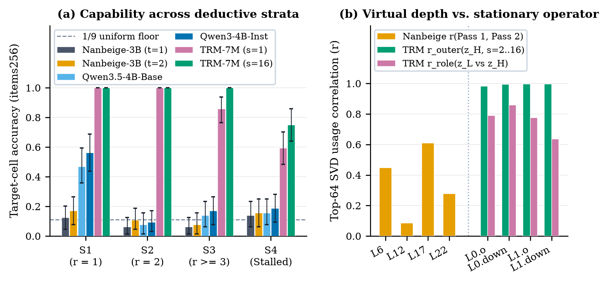
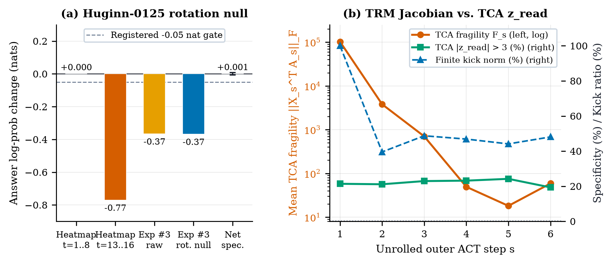
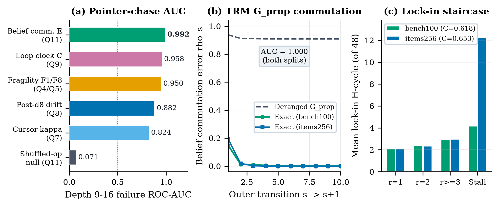
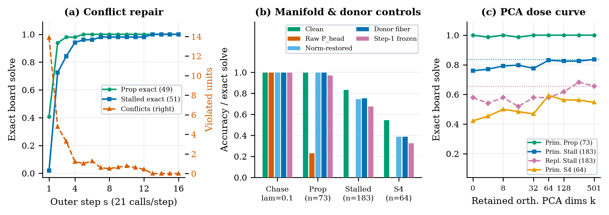
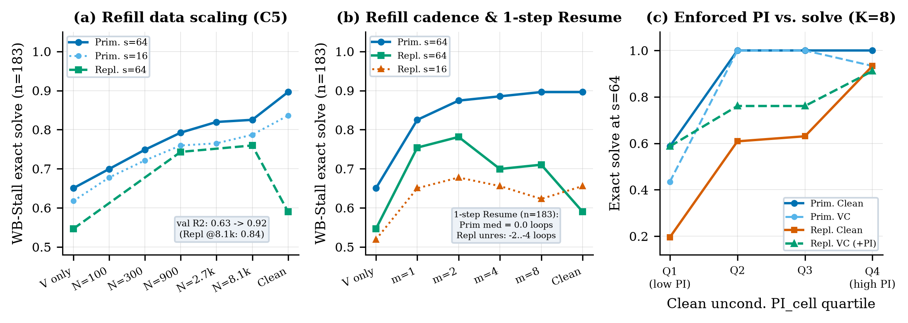

# From Shared Weights to Head-Orthogonal Fibers: Virtual Depth, Head-Readable Staircases, and Post-Stall Search in Looped Transformers

**Patrick Dugan**  
*November 2026 — Unified synthesis across seven studies: `VPD`, `HUG-CAL-02`, `RMP`, `LOOPSCOPE-01`, `ARG-02`, `LOOPSCOPE-02`, and `LOOPSCOPE-03`*

---

## Abstract

Weight-tied transformers reuse identical parameters across sequential passes, yet parameter sharing spans distinct computational regimes whose capability gains, failure modes, and latent-state monitorability differ sharply. Synthesizing seven studies across five experimental arcs—pretrained looped language models (`Nanbeige4.2-3B`, `Huginn-0125`), controlled algorithmic loopers (`LOOP-T`, `LoopedChase`, `Lean-CGRT`), untied baselines (`FF-U`, `Qwen3.5-4B-Base`, `Qwen3-4B-Instruct`), and 7M-parameter convergent Tiny Recursive Models (`TRM`)—we separate weight sharing into three mechanistic regimes and audit hidden-state computation via conditional refill, state-transplant `Resume` tests, and enforced path independence.

First, two-pass language models implement *fixed-pass virtual depth*: `Nanbeige4.2-3B` routes SwiGLU inputs through layer-selectively distinct singular subspaces across passes (mean top-64 SVD usage correlation $\bar{r}=0.355$; $r=0.085$ at `L12.mlp.down_proj`) and rotates downstream perturbation directions when loop-boundary state is carried rather than reset, while discrete Top-32 sparse autoencoder support switches limit intervention-change fidelity ($F_\Delta > 0$ in `1/12` second-pass `L22` edits despite Muon lifting state explained variance from `-0.180` to `+0.453`). Across pointer chasing, 168-case finite-group composition (`ARG-02`: `65/168 = 38.7%` at native $t=2$, `76/168 = 45.2%` at $t=4$ [$p=0.080$], `71/168 = 42.3%` at $d^*=8$ [$p=0.61$]), and deductively stratified 9×9 Sudoku (`LOOPSCOPE-02`), `Nanbeige4.2-3B` fails its registered recurrent gate (`H2a` $p=0.097$) and trails untied `Qwen3.5-4B-Base` on immediate single-cell elimination (`S1`: `11/64` vs. `30/64`; overall `0.129` vs. `0.211`, $p=0.0031$) while both sit near the $1/9 \approx 0.111$ uniform floor on multi-step strata (`S2–S4`).

Second, multi-iteration and truncated-BPTT loopers exhibit *dynamical settling and cache-dominated staircases—subject to a readout blind spot*: activation-matched input rotations on `Huginn-0125` (`HUG-CAL-02`; trained with random-init warmup and $k=8$ truncated BPTT [10]) eliminate apparent late-iteration SVD specialization (`±0.0065` nats), motivating *Transported Component Attribution* (`TCA`), which separates dynamical fragility from closed-form directional specificity in one backward pass ($\rho=0.75$ across 480 `Huginn` conditions) and exposes an observational Lyapunov contrast between multi-step BPTT and 1-step detached equilibrium gradients ($F_1/F_6 = 1{,}808.4$ across 126 core calls despite `0.303×` finite kick contraction, alongside `22.04%` read-specific components). On Markovian pointer chains, moderate intermediate supervision ($\lambda = 0.1$) achieves `1.000` depth-9–16 extrapolation with `0.00` trajectory-residual loops across `3/3` seeds, whereas dense supervision ($\lambda = 1.0$) still routes `+3.06` and `+5.46` loops of active hop state through $\ker(\text{lm\_head})$ in `2/3` seeds—instantiating Sharma and Vu's [30] readout blind spot.

Third, building on `HRM`/`TRM`'s coupled $(z_H, z_L)$ proposal-and-scratchpad design [11, 12], a 7M Sudoku `TRM` (336 core calls) solves `88.3%` (`226/256`) of `items256` and `100%` (`100/100`) of `bench100` (`71.9%` [`184/256`] and `92.0%` [`92/100`] on an independent replication checkpoint), commuting with exact propagation before stall (`AUC = 1.000`), while differential linear probes show $(I-P_{\text{head}})z_H(s)$ tracks cell-flip and conflict-resolution history (`0.65–0.82` AUC vs. `0.58–0.71` from visible logits plus clues) rather than a hidden tabu list (runner-up visible logits beat $\ker(\text{lm\_head})$ at recovering just-refuted digits).

Finally, decomposing full carried state into head-readable $V_t$, $(x,V_t)$-predictable cache $C_t = \hat{H}_\theta(x,V_t)$ across both $(I-P_{\text{head}})z_H$ and $z_L$, and trajectory residual $R_t = H_t - C_t$ (`LOOPSCOPE-03`) shows that joint $V$-only erasure drops stalled solve to `0.617` and `0.519` (`33.3%–44.8%` exact periodic limit cycles at $s=64$), propagation boards are pure cache (`73/73` on both checkpoints), and *$R_t$ is causally active—with checkpoint-dependent sign—only on stalled boards*. Scaling `C5` training data `9×` ($N=100 \to 8{,}100$ disjoint boards) raises held-out $R^2$ from `0.844 -> 0.915` (`0.689 -> 0.837` replication), narrowing every-step ($m=1$) closed-loop primary stalled loss to `-4.9` pp ($s=16$) and `-7.1` pp ($s=64$) while boosting replication `+16.9` pp above clean (`0.590 -> 0.760`); refilling every $m \ge 2$ steps (`0.874–0.896`, $p \ge 0.289$) or single-transplant `Resume` on clean states yields `0.0` median loop delay across unselected mutual solvers on primary ($\Delta\text{NeverLock} \le +2.2$ pp) versus `-2.0` to `-4.0` median loops ($p \le 0.0014$) and `-10.5` pp `NeverLock` ($p=0.017$) on unresolved replication boards (while our registered flip-correlation gate failed at $\rho=0.198 < 0.25$). Scoring *unconditional* fork agreement across $K=8$ starts (avoiding unique-Sudoku solved-only tautology) explains why replicating Kubo et al.'s [29] `C-voting` lifts stalled solve (`0.836 -> 0.940`; `0.656 -> 0.858`) and confirms Anil et al. [28]: conditional refill enforces path independence ($\text{PI}_{\text{cell}}(64)$: `0.603 -> 0.937` at $\sigma=1.0$), rescuing the path-dependent checkpoint (`+39.1` pp in the lowest-PI quartile) while slightly hurting the already path-independent one only under every-step closed-loop drift.

---

## 1. Introduction: Three Regimes of Weight Sharing

A weight-tied transformer applies identical block parameters $\theta$ across $T$ sequential passes [7–13]. Because parameter identity no longer indexes computational depth, two questions govern capability and interpretability in recurrent-depth architectures:

1. **Capability triangulation:** When does reusing $\theta$ across passes yield multi-step algorithmic or combinatorial reasoning beyond an untied transformer, and what dynamical invariants separate fixed-pass stage pipelines from convergent recursive solvers?
2. **Latent monitorability:** When can intermediate computation be audited directly through the output readout head $P_{\text{head}}$, when does state orthogonal to the readout ($\ker(\text{lm\_head})$) carry causal search information, and is that head-orthogonal state opaque to linear probes or merely invisible to token logits?

Our September 2026 study of the pretrained two-pass language model `Nanbeige4.2-3B` [1, 14] examined shared MLP matrices via multipass vector parameter decomposition (`VPD`) [20] and shared Top-32 sparse autoencoders (`SAE`s) [16, 17] across `ARC-AGI-1`, `ARC-AGI-2`, and the `logic` and `math` subsets of `PrimeIntellect/INTELLECT-3-RL` [15]. That study found sharp terminal-layer pass divergence, showed that Muon-hybrid optimization [6, 21] rescues second-pass state reconstruction without rescuing intervention-change fidelity, and proved via a 44-layer embedding-reset control that carrying loop-boundary state rotates downstream perturbation directions. Yet it left open whether two-pass reuse buys multi-step deduction, whether per-iteration weight-ablation asymmetries reflect specialized factors or dynamical sensitivity, and where the boundary lies between head-readable iteration and head-orthogonal state.

Over the subsequent ten weeks, foundational equilibrium-model priors and concurrent 2026 looped-transformer studies established key properties of recurrent computation while leaving these questions open (Table 1):

- **Anil et al. (2022) [28] & Kubo, Kamiya et al. (2026) [29]:** Anil et al. tied out-of-distribution iteration scaling in equilibrium models to *path independence* (convergence to the same fixed point from arbitrary initializations, whereas path-dependent models degrade once test iterations exceed the training count), while Kubo et al. introduced confidence-based voting (`C-voting`) across randomly initialized latent runs at test time, exploiting outcome variance across initializations.
- **Wang et al. (`HRM`, 2025) [12] & Jolicoeur-Martineau (`TRM`, 2025) [11]:** introduced coupled dual-state recurrence $(z_H, z_L)$—designating $z_H$ ($y$) as the current proposed solution and $z_L$ ($z$) as a latent reasoning scratchpad trained with 1-step equilibrium gradients—to support iterative backtracking on combinatorial puzzles.
- **Sharma & Vu (2026) [30]:** identified the *readout blind spot* in looped language models, showing that even dense per-step intermediate logit supervision leaves $\ker(\text{lm\_head})$ unconstrained, permitting active off-axis computation and a visibility–activity mismatch.
- **Blayney et al. (2026) [22]:** analyzed cyclic fixed points and the stabilizing roles of input injection and normalization in looped language models.
- **Kaissis et al. (2026) [23]:** introduced Step-Decomposed Influence (`SDI`) to decompose TracIn training-data influence across BPTT iterations via gradient–activation outer products $\sum \delta_s \otimes a_s$.
- **Wu, Hu, & Zhang (2026) [24] & Sesodia et al. (2026) [25]:** introduced linear `J`-steering on frozen loops [24] and demonstrated matched-training advantages and iteration-budget staircases in weight-tied transformers [25].
- **Geiping et al. (`Huginn-0125`, 2025) [10] & Olszowiec et al. (2026) [26]:** trained `Huginn-0125` from random Gaussian starts with gradient-free warmup and *truncated backpropagation through the final $k=8$ steps* [10], and showed across eight looped LMs that trajectory stability depends strongly on per-step input re-injection [26].

| Prior / concurrent study | Principal contribution | Complementary contribution in this synthesis |
|---|---|---|
| Anil et al. [28] (`arXiv:2211.09961`, CC BY 4.0, [repo PDF](https://github.com/MoralityLabAI/VPD/blob/main/output/literature/looped_mechinterp/2211.09961_anil2022_path_independent_equilibrium_models.pdf)); Kubo et al. [29] (`arXiv:2604.13521`, CC BY 4.0, [repo PDF](https://github.com/MoralityLabAI/VPD/blob/main/output/literature/looped_mechinterp/2604.13521_kubo2026_cvoting_confidence_based_voting.pdf)) | Path independence governs OOD iteration scaling; `C-voting` selects confident multi-init runs | Replicates `C-voting` on `TRM` (`0.836 -> 0.940`; `0.656 -> 0.858`); shows conditional refill enforces path independence ($\text{PI}_{\text{cell}}$: `0.603 -> 0.937`) and rescues OOD scaling |
| Wang et al. (`HRM`) [12] (`arXiv:2506.21734`, CC BY 4.0, [repo PDF](https://github.com/MoralityLabAI/VPD/blob/main/output/literature/looped_mechinterp/2506.21734_wang2025_hierarchical_reasoning_model.pdf)); `TRM` [11] (`arXiv:2510.04871`, [arXiv PDF](https://arxiv.org/pdf/2510.04871.pdf)) | Dual $(z_H, z_L)$ proposal + scratchpad states, 1-step equilibrium gradients, puzzle backtracking | Isolates $z_H \times z_L$ mutual backup (`33%–45%` limit cycles under joint $V$-only erasure) and `1,808×` detached-ACT tangent inflation |
| Sharma & Vu [30] (`arXiv:2606.24898`, CC BY 4.0, [repo PDF](https://github.com/MoralityLabAI/VPD/blob/main/output/literature/looped_mechinterp/2606.24898_sharma2026_readout_blind_spot.pdf)) | Dense logit supervision leaves $\ker(\text{lm\_head})$ readout blind spot | Instantiates blind spot on $\lambda{=}1.0$ `LoopedChase` (`+3.06, +5.46` off-axis loops vs. `0.00` at $\lambda{=}0.1$) and `Post-RMSNorm` radial norms |
| Blayney et al. [22] (`arXiv:2604.11791`, CC BY 4.0, [repo PDF](https://github.com/MoralityLabAI/VPD/blob/main/output/literature/looped_mechinterp/2604.11791_blayney2026_mechanistic_analysis_looped_lms.pdf)) | Cyclic fixed points and normalization / injection effects in looped LMs | Isolates `33.3%–44.8%` periodic visible-board limit cycles under $V$-only erasure and `25.1%` clean limit cycles halved by cache refill |
| Kaissis et al. (`SDI`) [23] (`arXiv:2602.10097`, CC BY 4.0, [repo PDF](https://github.com/MoralityLabAI/VPD/blob/main/output/literature/looped_mechinterp/2602.10097_kaissis2026_step_resolved_data_attribution.pdf)) | Decomposes TracIn data influence across BPTT loops via $\sum \delta_s \otimes a_s$ | Analytical caution: detached-ACT tangent Jacobians inflate step-1 norms by `1,808×` (`6,400×` max); `TCA` cancels $\|A_s\|$ via rotation nulls |
| Wu, Hu & Zhang [24] ([repo PDF](https://github.com/MoralityLabAI/VPD/blob/main/output/literature/looped_mechinterp/2609.39892_wu2026_shared_weights_selected_computations.pdf)); Sesodia et al. [25] ([repo PDF](https://github.com/MoralityLabAI/VPD/blob/main/output/literature/looped_mechinterp/2610.24135_sesodia2026_inside_the_loop.pdf)) | Linear `J`-steering, uneven logit steps, matched-training staircases | Quantifies SVD multiplexing ($\bar{r}{=}0.355$) vs. stationary reuse ($\bar{r}{=}0.992$), `LOOP-T` vs. `FF-U`, and covariate-shift-free `Resume` delays |
| Geiping et al. [10] ([arXiv PDF](https://arxiv.org/pdf/2502.05171.pdf)); Olszowiec et al. [26] ([arXiv PDF](https://arxiv.org/pdf/2610.18127.pdf)) | Random-init warmup + $k{=}8$ trunc. BPTT (`Huginn`); re-injection stability | Splits hidden state into $(x,V_t)$-predictable cache $C_t$ (`99.94%` in `Huginn` at $t{=}32$; $R^2{=}0.915$ in `TRM` at $N{=}8{,}100$) vs. residual $R_t$ |

*Table 1: Positioning relative to equilibrium path-independence theory, `HRM`/`TRM` state-role priors, and concurrent 2026 looped-transformer studies.*

Synthesizing seven studies across five experimental arcs—September `VPD` [1], registered `Huginn-0125` calibration (`HUG-CAL-02` [3]), controlled closed-loop mediation and compactification (`RMP` [2], `LOOPSCOPE-01` [5], `ARG-02` [4]), stratified 9×9 Sudoku triangulation with head-orthogonal manifold controls (`LOOPSCOPE-02`), and three-ledger conditional refill, `Resume`, and enforced path-independence controls (`LOOPSCOPE-03` [5])—we establish three mechanistic regimes:

- **Regime I — Fixed-Pass Virtual Depth (§2):** Without input re-injection, fixed $T=2$ `Nanbeige4.2-3B` routes nonlinear MLP activations through pass-divergent singular subspaces ($\bar{r}=0.355$) as a compressed 44-layer pipeline, failing stationarity admission for state-transplant tests and failing to contract perturbations (`6.9×` amplification) or clear multi-step deductive strata (note that in pretrained LMs, fixed $T=2$ depth and absence of input re-injection remain confounded because `Nanbeige4.2-3B` is both our sole Regime I model and our sole pretrained checkpoint without re-injection).
- **Regime II — Dynamical Settling and Cache-Dominated Staircases with a Readout Blind Spot (§3–§4, §6):** In multi-step and truncated-BPTT loopers, apparent late-loop SVD specialization on `Huginn-0125` (trained with random-init warmup and $k=8$ truncated BPTT [10]) vanishes under activation-matched input rotations (`HUG-CAL-02`), formalized in one pass by `TCA`, while path-dependent hidden variance contracts to `0.06%` (`99.94%` input-conditioned cache) by $t=32$. On Markovian chains (`LoopedChase`), moderate per-loop supervision ($\lambda = 0.1$) yields `1.000` OOD extrapolation, `AUC = 0.992` belief commutation, `1.000` all-token conditional-cache sufficiency, and `0.00` residual loops across `3/3` seeds—whereas dense $\lambda=1.0$ supervision routes `+3.06` and `+5.46` active loops through $\ker(\text{lm\_head})$ in `2/3` seeds, instantiating Sharma and Vu's [30] readout blind spot.
- **Regime III — Stationary Attractor Search and Enforced Path Independence (§5–§6):** Building on `HRM`/`TRM`'s $(z_H, z_L)$ architecture [11, 12], a 7M Sudoku `TRM` (336 core calls with input re-injection) iterates a stationary outer operator ($\bar{r}_{\text{outer}}=0.992$) that contracts finite kicks (`0.303×`) and splits state into head-readable $V_t$, $(x,V_t)$-predictable cache $C_t$, and trajectory residual $R_t$. Joint $V$-only erasure traps `33.3%–44.8%` of stalled boards in periodic visible-board limit cycles at $s=64$, while propagation boards are pure cache (`73/73` on both checkpoints). Across two checkpoints, $R_t$ is causally active—with opposite sign—strictly on stalled boards: scaling `C5` to $N=8{,}100$ disjoint boards ($R^2 = 0.915$ primary, `0.837` replication) narrows every-step closed-loop primary loss to `-4.9` pp ($s=16$) and `-7.1` pp ($s=64$) (with `0.0` median loop delay under single-step `Resume` and full recovery by periodic cadence $m \ge 2$) while lifting the strongly path-dependent replication checkpoint `+16.9` pp above clean (`+19.1` pp at $m=2$) by enforcing hidden-state path independence [28].

**Provenance and archival discipline.** Pre-registered decision rules and post-hoc controls are kept strictly distinct: all pre-registered gates that returned `Not supported`, `Weak`, `Partially supported`, or failed sub-thresholds (`HUG-CAL-02`, `ARG-02` `H2a`, `LOOPSCOPE-02` `P1–P4`, and `LOOPSCOPE-03` `H3.3`'s failed $\rho = 0.198 < 0.25$ flip-correlation gate) are reported plainly without metric substitution. Because our development repository is private, all pre-registration files, verbatim registration commit patches (`1f205d67` and `b1ec7755`), evaluation reports, scripts, and JSON receipts for `LOOPSCOPE-02` and `LOOPSCOPE-03` are publicly mirrored in https://github.com/MoralityLabAI/VPD/tree/main/output/supplements, and archival snapshots `VPD` `v001–v013` and `papers/rmp_looped_mechinterp` remain unmodified.

---

## 2. Regime I: Two-Pass Virtual Depth, Support Switching, and SVD Multiplexing

We first examine `Nanbeige/Nanbeige4.2-3B` [14] (revision `451ed48c`), a pretrained decoder executing 22 shared transformer layers twice per forward pass ($T=2$, 44 executed layers) with a loop-boundary `RMSNorm` and *no* re-injection of token embeddings before Pass 2 (making $T=2$ training depth and absence of re-injection co-occurring properties of this checkpoint; §7).

### 2.1 Terminal Pass Divergence and the Muon SAE Fidelity Gap

In [1], a 64-component multipass `VPD` decomposition (`prime-20260906T204058Z-561`, capturing `~2.2%` of squared weight norm at `mlp.down_proj` of physical layers 12 and 22) and shared 6,144-latent Top-32 `SAE`s were evaluated on 18 reasoning trajectories (8 calibration, 10 held-out across 8 task groups) from `ARC-AGI-1`, `ARC-AGI-2`, and `PrimeIntellect/INTELLECT-3-RL` (`logic` and `math` subsets) [15]. Residual-stream cosine similarity between Pass 1 and Pass 2 stays high at physical mid-layer `L12` (`0.799–0.869`) but drops sharply at terminal physical layer `L22` to `0.230–0.307` (`0.184–0.229` post-loop-norm), already within the prompt suffix before generation.

Fitting one shared Top-32 `SAE` across both passes under AdamW yielded negative held-out `L22` Pass-2 state explained variance (`EV = -0.180` on Q4 trajectories; `-0.535` on BF16 intervention baselines, vs. `+0.830` and `+0.763` on Pass 1). Switching matrix parameters to Muon [6, 21] rescued static reconstruction (`EV = +0.453` Q4, `+0.312` BF16 on Pass 2; `0.918` and `0.942` on Pass 1), yet failed to rescue *intervention-change fidelity* for true shift $\Delta h = h_1 - h_0$ and reconstructed shift $\Delta \hat{h} = \hat{h}_1 - \hat{h}_0$ ($e(h)=h-\hat{h}$):

$$
F_\Delta \;=\; 1 - \frac{\|\Delta h - \Delta \hat{h}\|_2^2}{\|\Delta h\|_2^2} \;=\; 1 - \frac{\|e(h_1) - e(h_0)\|_2^2}{\|\Delta h\|_2^2}.
$$

Muon improved `L22` Pass-2 $F_\Delta$ in `12/12` conditions (`18/20` nonzero `L22` conditions overall), but only `1/12` exceeded zero (`+0.030`). Discrete Top-32 encoder support switches at `1–3` of `80` positions caused `93.3%–99.6%` of change-mismatch energy; freezing baseline active support reduced a unit-write mismatch from `-52.367` to `-0.000543`. A 44-layer *embedding-reset control* replacing Pass-1 output with token embeddings matched 22-layer one-pass states bit-for-bit across 150 pairs and kept propagated `L12 -> L22` Muon $F_\Delta$ positive (`+0.047` to `+0.572`) versus negative under state carry (`-0.300` to `-0.046`); crossing baselines with unit response directions confirmed that state carry rotates downstream Jacobian directions (`0.059 / 0.051` carry vs. `0.354 / 0.377` reset).

### 2.2 Triangulating Pretrained Capability Across Pointer Chasing, Algebra, and Sudoku

Unlike matched-training studies where weight-tied models outperform depth-matched untied baselines trained on the same corpus [25] (replicated in our controlled `LOOP-T` vs. `FF-U` experiments in §4.1), comparing pretrained `Nanbeige4.2-3B` against untied `Qwen` checkpoints is observational across model families, parameter counts, and pretraining mixtures; it tests whether `Nanbeige`'s two-pass reuse exhibits iterative scaling at inference (Figure 1, Table 2):

1. **Pointer chasing (`Silico Stage 1`):** On 3-shot 16-node chains, `Nanbeige4.2-3B` scores `79.2%` at 1 hop (chance `6.25%`) and `6.55%` (`131/2,000`) across depths 3–6, with Pass-1-only sensitivity on top `L22` `VPD` factors `(19, 9, 43)` (`-0.060` to `-0.098` nats on Pass 1; `0.000` on Pass 2).
2. **Finite-group composition (`ARG-02` Extension N1 [4]):** On $N=168$ held-out group trace items (`future@12`, dev-selected budget $d^*=8$ from 132 dev items), `Nanbeige4.2-3B` solves `44/168` (`26.2%`) at $t=1$, `65/168` (`38.7%`) at native $t=2$ (`+21` items, McNemar $p=0.040$), `76/168` (`45.2%`) at OOD $t=4$ (`+11` over $t=2$, $p=0.080$), and `71/168` (`42.3%`) at $d^*=8$ (`+6` over $t=2$, $p=0.61$), compared with single-pass `Qwen3.5-0.8B` (`68/168 = 40.5%`) and `Qwen3.5-2B` (`79/168 = 47.0%`). Thus OOD loops $t=4,8$ show positive point-estimate gains over $t=2$ that do not reach statistical significance. Pre-registered recurrent mechanism gate `H2a`—requiring closed-loop $d^*=8$ (`71/168`) to significantly beat linear open-loop extrapolation $h_{\text{open}}(t) = h(1) + (t-1)(h(1)-x)$ (`55/168 = 32.7%` at both $t=2$ and $t=8$)—failed (`+16` items, $p=0.097$); donor-shuffled Pass-2 displacements scored `69/168` (`41.1%`, differing from clean $t=2$ on `6/168` items), and $0.25\cdot\text{RMS}$ kicks amplified by `2.8× -> 3.9× -> 6.9×` across loops `2, 4, 8`.
3. **Stratified 9×9 Sudoku (`LOOPSCOPE-02`):** Across 256 held-out `sudoku-extreme` boards stratified into $n=64$ per deductive round class of exact synchronous naked- plus hidden-single propagation $G_{\text{prop}}$—`S1_naked1` ($r=1$), `S2_prop2` ($r=2$), `S3_prop3plus` ($r\ge 3$), and `S4_stalled` (zero singles anywhere on the board at round 0)—single-target-cell 3-shot accuracy is `25/256` (`0.098`) at $t=1$, `33/256` (`0.129`) at $t=2$ ($p=0.341$), and `23/256` (`0.090`) at $t=8$ ($p=0.220$). Crucially, uniform digit guessing gives $1/9 \approx 0.111$ (`±0.077` two-SE sampling band at $n=64$): every `Nanbeige` stratum and the `S2–S4` strata of both `Qwen` models lie within sampling noise of this floor, so absence of loop scaling cannot be inferred from `S2–S4` alone. Instead, the entire advantage of untied `Qwen3.5-4B-Base` (`54/256 = 0.211`, McNemar $p=0.0031$) and pure-SDPA `Qwen3-4B-Instruct` (`65/256 = 0.254`) over `Nanbeige` ($t=2$) resides in immediate 1-round elimination `S1_naked1` (`30/64 = 0.469` and `36/64 = 0.562` vs. `11/64 = 0.172`; on `S2–S4` combined, `24/192 = 0.125` vs. `22/192 = 0.115`, $p=0.824$).

*Figure 1: (a) Target-cell accuracy on `items256` ($n=64$/stratum; 2,000-resample bootstrap 95% CIs). `Qwen` models beat `Nanbeige` strictly on `S1` ($r=1$), while all three 3B–4B LMs sit near the $1/9 \approx 0.111$ floor on `S2–S4`; the 7M `TRM` reaches `1.000` on `S1–S3` and `0.750` target-cell (`0.547` exact board) on round-0 stalled `S4`. (b) Top-64 SVD input-usage correlations $r$: `Nanbeige` multiplexes nonlinear MLP inputs across passes ($\bar{r}=0.355$, $r=0.085$ at `L12`), whereas `TRM` iterates a stationary outer operator ($\bar{r}_{\text{outer}}=0.992$) while splitting inner $z_L$ vs. $z_H$ calls ($\bar{r}_{\text{role}}=0.765$).*

| Model / Pass setting | Params | Overall | `S1` ($r{=}1$) | `S2` ($r{=}2$) | `S3` ($r{\ge}3$) | `S4` (Stall) | Loop / operator signature |
|---|---:|---:|---:|---:|---:|---:|---|
| `Nanbeige4.2-3B` ($t=1$) | 3.0B | 0.098 | 0.125 | 0.062 | 0.062 | 0.141 | Half virtual pipeline (22L) |
| `Nanbeige4.2-3B` ($t=2$, native) | 3.0B | 0.129 | 0.172 | 0.109 | 0.078 | 0.156 | Multiplexed SVD ($\bar{r}=0.355$) |
| `Nanbeige4.2-3B` ($t=8$, OOD) | 3.0B | 0.090 | 0.047 | 0.156 | 0.062 | 0.094 | Non-contractive ($\|\Delta h\|/\|h\|=0.71$) |
| `Qwen3.5-4B-Base` (untied) | 4.0B | 0.211 | 0.469 | 0.078 | 0.141 | 0.156 | Advantage strictly on `S1` (`30/64`) |
| `Qwen3-4B-Instruct` (SDPA) | 4.0B | 0.254 | 0.562 | 0.094 | 0.172 | 0.188 | Untied 36L pure-SDPA control |
| `TRM-7M` ($s=1$: 21 core calls) | 7.0M | 0.863 | 1.000 | 1.000 | 0.859 | 0.594 | Inner sweep; exact board `= 0.082` |
| `TRM-7M` ($s=16$: 336 core calls) | 7.0M | **0.938** | **1.000** | **1.000** | **1.000** | **0.750** | Stationary ($\bar{r}=0.992$); board **`= 0.883`** |

*Table 2: Stratified 9×9 Sudoku target-cell accuracy on `items256` ($N=256$, 64 boards/stratum; uniform chance $= 1/9 \approx 0.111$). Note that `S4` here denotes boards with **zero singles anywhere at round 0** ($n=64$, where `TRM` $s=16$ target-cell accuracy is `48/64 = 0.750` and exact 81-cell board solve is `35/64 = 0.547`), distinct from the broader set of `183` `items256` boards where whole-board propagation eventually stalls (`153/183 = 0.836` exact board solve; Table 5).*

### 2.3 SVD Input-Subspace Multiplexing and Reconciling `L12` Residual Alignment

To quantify whether shared matrices execute the same linear sub-operations across passes, let $W_l = \sum_j \sigma_{l,j} u_{l,j} v_{l,j}^\top$ be the exact SVD of a shared projection matrix (`mlp.down_proj` in `Nanbeige`; `o_proj` and `down_proj` in `TRM`), and define the invocation-$p$ rank-one input-usage profile over top $K=64$ singular directions:

$$
u_{l,p}(j) \;=\; \sigma_{l,j}\,\mathbb{E}_{x \in \mathcal{D}}\bigl[\,|\langle x_{l,p},\, v_{l,j}\rangle|\,\bigr], \qquad r_l(p,q) \;=\; \operatorname{corr}_{j=1\dots 64}\!\bigl(u_{l,p}(j),\, u_{l,q}(j)\bigr),
$$

with $\bar{r}$ denoting the arithmetic mean of $r_l(p,q)$ across audited matrices $l$ (and across outer step pairs $2\le p < q \le 16$ for $\bar{r}_{\text{outer}}$). Across `Nanbeige` physical layers `(L6, L12, L17, L22)`, cross-pass correlation averages $\bar{r} = 0.355$ ($r_{\text{L6}}=0.448$, $r_{\text{L12}}=0.085$, $r_{\text{L17}}=0.610$, $r_{\text{L22}}=0.277$; Figure 1b).

At first glance, near-zero SVD input correlation at `L12` ($r=0.085$) appears to conflict with high `L12` residual-stream cosine similarity (`0.799–0.869`). The two measurements probe different sites around a nonlinear gate: residual state $h_{12}^{(p)} = h_0^{(p)} + \sum_{\ell \le 12}\Delta_\ell^{(p)}$ is dominated by the shared skip-connection sum accumulated over earlier layers, whereas $x_{\text{L12},p}$ entering `mlp.down_proj` is the post-`RMSNorm` *SwiGLU intermediate activation* $\operatorname{SiLU}(W_{\text{gate}}\tilde{h}_{12}^{(p)}) \odot (W_{\text{up}}\tilde{h}_{12}^{(p)})$ in $\mathbb{R}^{d_{\text{ff}}}$. Moderate pass differences in $\tilde{h}_{12}^{(p)}$ switch which multiplicative SwiGLU gates open, routing Pass 1 and Pass 2 into nearly uncorrelated singular input subspaces of `mlp.down_proj` even while the ambient residual stream remains macroscopically aligned.

---

## 3. Separating Dynamical Fragility from Component Specificity

### 3.1 The `HUG-CAL-02` Rotation Null on `Huginn-0125`

On 3-shot variable-binding chains, the 3.5B looped model `Huginn-0125` [10] (2-layer prelude, 4-layer tied core with learned adapter input re-injection at every step, 2-layer coda; trained from random Gaussian latent initializations using gradient-free warmup iterations followed by *truncated backpropagation through only the final $k=8$ steps*, and evaluated here at $r=16$) achieves `0.76` accuracy at 1 hop and `0.47` at 2 hops (`0.25–0.33` floor at 3–6 hops). Deleting top-16 SVD triplets of core `mlp.proj` in iterations 1–8 cost `0.00` nats versus `-0.77` nats in iterations 13–16. Yet in registered **Silico Experiment #3** (`HUG-CAL-02` [3]; 240 clean-correct 2-hop programs × 3 noise seeds, 8 frozen factors across `core0–core3`, 4 random orthogonal input-read rotations per factor matched to exact per-iteration projection RMS while fixing write vector $u$), **factor specialization disappeared**: `core3 f1` in iterations 9–16 cost `-0.366` nats raw versus `-0.368` nats under matched rotation (`+0.0007` nats net; all 8 factors within `±0.0065` nats; Figure 2a). Early ablations are masked by downstream attractor repair; late ablations leave no repair steps before readout.

*Figure 2: (a) Registered `HUG-CAL-02` (`Huginn-0125`, $r=16$): late-window SVD ablation loss (`-0.366` nats) is matched within `±0.0065` nats by RMS-matched orthogonal read rotations (`-0.368` nats). (b) Unrolled 6-step `TCA` on Sudoku `TRM` (126 core calls; 105 calls between $s=1$ and $s=6$ commits): detached-ACT tangent Jacobians inflate $F_1/F_6 = 1{,}808.4$ while finite $0.25\cdot\text{RMS}$ kicks contract to `30.3%`; `TCA`'s rotation $z$-score cancels $\|A_s\|$, isolating a flat `22.04%` read-specific circuit.*

### 3.2 Transported Component Attribution (`TCA`) and the Detached-ACT Lyapunov Contrast

To avoid running multi-pass empirical rotation sweeps per factor, **Transported Component Attribution (`TCA`)** (`LOOPSCOPE-01` [5]) computes both fragility and exact Haar-rotation specificity in *one forward and backward pass*. For input activations $X_{l,t} \in \mathbb{R}^{P \times d_{\text{in}}}$ to $W_l \in \mathbb{R}^{d_{\text{out}} \times d_{\text{in}}}$ at call $t$ and backpropagated readout gradient $A_{l,t} = \partial y / \partial (X_{l,t} W_l^\top) \in \mathbb{R}^{P \times d_{\text{out}}}$, deleting rank-one term $\sigma u v^\top$ has first-order effect $\Delta_{l,t}(u,v) = -\sigma v^\top (X_{l,t}^\top A_{l,t}) u$, pure **dynamical fragility** $F_{l,t} = \|X_{l,t}^\top A_{l,t}\|_F$, and exact Haar-orthogonal read/write $z$-scores:

$$
z_{\text{read}}(u,v) \;=\; \frac{\Delta_{l,t}(u,v)}{\sigma \|v\|_2 \, \|X_{l,t}^\top A_{l,t} u\|_2 / \sqrt{d_{\text{in}}}}, \qquad z_{\text{write}}(u,v) \;=\; \frac{\Delta_{l,t}(u,v)}{\sigma \|u\|_2 \, \|A_{l,t}^\top X_{l,t} v\|_2 / \sqrt{d_{\text{out}}}}.
$$

We validated `TCA` in two complementary regimes. First, on `Huginn-0125` (`LOOPSCOPE-01` `Q1–Q2`), summing $\Delta_{l,t}$ across **480 measured multi-iteration ablation conditions**—`(16 top SVD + 8 random directions) × 4 core layers × 5 iteration windows`—achieved Spearman $\rho = 0.75$ and `93%` sign agreement for $|\text{measured}| \ge 0.05$ nats, validating first-order $\Delta_{l,t}$ transport on a model where true specificity is null ($|z_{\text{read}}| \le 1.8$ on top `core3` factors; `8.6%` of `4,096` cells above $3\sigma$). Second, directional specificity $z_{\text{read}}$ itself was validated against exact central finite differences ($r > 0.9999$), 2,000-sample Monte Carlo Haar rotations, and ground-truth edge-slot circuits in `LoopedChase`.

In `LOOPSCOPE-02`, each outer ACT step of the 2-layer Sudoku `TRM` executes `3 H-cycles × (6 inner z_L calls + 1 commit z_H call) = 21` `L_level` core calls (`42` transformer layers), totaling `16 × 21 = 336` core calls at $s=16$. Unrolled 6-step `TCA` in float32 executes `6 × 21 = 126` core calls, with **`5 × 21 = 105`** intermediate core calls separating the $s=1$ commit call (`#21`) from the $s=6$ commit call (`#126`). This prospectively falsified pre-registered gate `P4` ($\bar{F}_1/\bar{F}_6 \le 0.25$) in the opposite direction, revealing an observational **Detached-ACT vs. BPTT Lyapunov Contrast** across our model suite (Table 3; note this is a cross-architecture comparison rather than a controlled retraining of `TRM` under 336-call BPTT):

- **Multi-step and truncated BPTT loopers** differentiate across multiple consecutive recurrent steps during training—either end-to-end (`Lean S-loop`, extrapolating `LoopedChase`) or via truncated BPTT over the final $k=8$ recurrent steps after gradient-free warmup from random Gaussian starts (`Huginn-0125` [10])—penalizing positive multi-step tangent Lyapunov exponents and yielding $F_1 / F_{\text{late}} < 1$ (`0.43` on `Huginn`; `0.007` on `Lean` log-$p$).
- **1-step detached ACT (`HRM`/`TRM` [11, 12])** inherits `HRM`'s 1-step gradient approximation: `TRM` detaches $(z_H, z_L)$ between outer steps and runs the first `2` of `3` $H$-cycles (`14` of `21` core calls/step) under `torch.no_grad()`, backpropagating through only a single 7-call $H$-cycle per outer step. Nonlinear `Post-RMSNorm` dynamics contract *finite* $0.25\cdot\text{RMS}$ kicks monotonically (`1.000 -> 0.303` by $s=16$), yet unpenalized 105-call tangent Jacobians expand at `~1.074×` per core call ($1.074^{105} \approx 1.8\times 10^3$), giving mean $\bar{F}_1/\bar{F}_6 = \mathbf{1{,}808.4}$ (and a single-matrix maximum swing of `6,400×–7,048×` on `L0.down_proj`: `148,723` at $s=1$ vs. `21.1` at $s=5$).

While Kaissis et al. [23] formulated `SDI` to decompose TracIn training-data influence inside BPTT-trained loopers (we did not run TracIn), our Jacobian result provides an analytical transfer caution: applying unnormalized $\sum \delta_s \otimes a_s$ step outer products to detached-ACT checkpoints would weight step 1 over step 6 by three orders of magnitude from tangent expansion alone. Because $\|A_s\|$ cancels identically in $z_{\text{read}}$, `TCA` recovers a step-invariant **`22.04%`** share of $|z_{\text{read}}| > 3$ components (`81.6×` the `0.27%` Gaussian null) and `12.37%` write-specific components.

| Model | Training gradient | Re-inject? | $F_1 / F_{\text{late}}$ | $|z_{\text{read}}|{>}3$ | Kick | Mechanistic regime |
|---|---|---|---:|---:|---:|---|
| `Nanbeige4.2-3B` | 2-pass BPTT | No | `0.42–2.00` | `0.9%–8.4%` | `6.90×` | Virtual depth; non-contractive |
| `Qwen3.5-4B-Base` | Untied 36L | — | — | `0.2%–19.9%` | — | Specific at final `L32` (`19.9%`) |
| `Huginn-0125` ($r{=}16$) | Trunc. BPTT ($k{=}8$) | Yes (adapter) | `0.43` | `8.6%` | Contr. | Random-init warmup; `HUG-CAL-02` null |
| `LOOP-T` ($T{=}8$, `RMP`) | 8-step BPTT | No (prompt) | `< 1` | Sparse | Contr. | Closed-loop SAE/DAS transfer |
| `Lean S-loop` ($T{=}32$) | Multi-step BPTT | Yes | `0.007` | `5%–11%` | Contr. | Attractor masking (`150×`) |
| `LoopedChase` (24 arms) | 8-step BPTT | Yes (`LN + e`) | `0.08–0.36` | Edge slots | Contr. | Head-readable ($\lambda{\ge}0.1$: `1.00`) |
| `TRM-7M` (Sudoku) | Detached ACT | Yes ($z_H + x$) | **`1,808.4`** | **`22.04%`** | **`0.303×`** | Basin-contractive, tangent-exp. |

*Table 3: Summary of training regime, prompt/input re-injection [26], `TCA` fragility ratio, read specificity share ($3\sigma$ Gaussian null `= 0.27%`), and macroscopic kick response across all studied model families.*

---

## 4. Regime II: Closed-Loop Dictionaries, Mediated Variables, and Head-Readable Staircases

### 4.1 Matched Tied vs. Untied Training and Closed-Loop Surrogates (`RMP`)

Consistent with Sesodia et al. [25], training matched $d=128$ transformers across four reference-trace tasks in `RMP` [2] showed `LOOP-T` (1 block × 8 loops, 0.46M params, no explicit re-injection beyond non-cursor prompt tokens) passing the $G_0 = 0.98$ `EM` gate in `6/6` seeds versus `3/6` in untied `FF-U` (8 blocks, 1.84M params). Closed-loop insertion of a single shared TopK `SAE` after all 8 visits retained `0.923, 0.910, 0.900` of clean deep `EM` in `LOOP-T` seeds 1–3 versus `0.688` in untied `FF-U` seed 3 (below matched PCA `0.796` and equal-norm isotropic Gaussian noise `0.778`); shared MLP-only transcoders [18] with live attention retained `0.940–0.996` across 9 models at `3.5×` lower active coding rate (`342` vs. `1,213` bits). While answer-token probes decoded $\operatorname{cur\_node}(s)$ (`0.76–1.00`) without causal patch effect (`IIA <= 0.22`) [19, 27], patching the query+answer block transferred early hops (`IIA = 0.67–1.00`, start-copy `<= 4.5%`), and `<= 32` shared-dictionary features mediated $\operatorname{cur\_node}(s)$ on `1,000` collision-free pairs in `4/5` tied seeds (`0.605–1.000`) vs. `0/2` untied (`0.277, 0.386`).

### 4.2 Monitorability Frontier and Contrast Projection (`LOOPSCOPE-01`)

On `Lean-CGRT` (`Q3`, `Q6`), `S-loop` scaled certified proof rate from `48.6%` ($T=8$) to `65.0%` ($T=32$) while decoding final tactics via its unmodified head at `94%–99%` by $T/2$. Across 24 depth-8 `LoopedChase` models (12 `Q4` discovery + 12 `Q5` prospective, $\lambda \in \{0, 0.01, 0.1, 1\}$), $\lambda \ge 0.1$ achieved `1.00` depth-9–16 extrapolation and `1.00` head readability. Notice how this refines Olszowiec et al. [26]: every `LoopedChase` arm re-injects prompt embeddings via $h \leftarrow \operatorname{LN}(h) + e$, yet `5/9` $\lambda=0$ arms still fail OOD extrapolation via deadline schedule desynchronization, whereas `LOOP-T` succeeds without explicit re-injection by preserving prompt tokens in context. Thus input re-injection stabilizes deep state carry without alone enforcing time-invariant operator simulation; training-depth own-head belief commutation error $\hat{E}$ (`Q11`) diagnoses true operator simulation at **`AUC = 0.992`** (Figure 3a; corroborated by `SEM-ECHO-01`, $\rho=0.92$).

*Figure 3: (a) ROC-AUC predicting depth-9–16 failure across 24 `LoopedChase` arms (`Q11` belief commutation $\hat{E}$ reaches `AUC = 0.992`). (b) Sudoku `TRM` visible beliefs commute with exact $G_{\text{prop}}$ ($\rho_{\text{clean}} \to 0.000$ by $s=4$; `AUC = 1.000` vs. deranged clues on both splits). (c) Mean lock-in $H$-cycle (of 48) follows $r=1 < r=2 < r\ge 3 < \text{stalled}$ ($C_{\text{stair}} = 0.653$ vs. `0.495` null on `items256`).*

**The Markovian contrast control and the readout blind spot.** To test whether erasing head-orthogonal state harms a Regime II model, we projected the 256-d carried cursor $h_{t,\text{cursor}}$ of all 24 `LoopedChase` checkpoints onto the 16-d effective row space $P_{\text{head}}$ of $\text{head}\circ\text{ln\_f}$ (removing `240/256` dimensions after every loop `1..16`; Figure 4b). At $\lambda = 0.1$, **all `3/3` seeds retained `1.000` depth-1–8 and `1.000` held-out depth-9–16 accuracy** under raw $P_{\text{head}}$ projection, LayerNorm-moment-preserved projection, donor-swapped orthogonal fiber, and step-1 frozen fiber (and `8/9` extrapolating $\lambda \in \{0.01, 0.1\}$ seeds across `Q4`+`Q5` retained `0.982–1.000`). At $\lambda = 1.0$, however, seed 1 collapsed to `0.129` under cursor $P_{\text{head}}$ projection even with LayerNorm statistics restored (mean `0.710`), and our `Resume` audit in §6.2 reveals that *two* of the three $\lambda=1.0$ seeds rely on trajectory-dependent hidden state ($\text{Price}(R_4) = +3.06$ and $+5.46$ loops in seeds 1–2, vs. `0.00` across all `3/3` $\lambda=0.1$ seeds). This directly instantiates Sharma and Vu's [30] **readout blind spot (visibility–activity mismatch)**: dense per-loop cross-entropy supervises only readout-visible coordinates ($P_{\text{head}}$) at each step without penalizing computation routed through $\ker(\text{head}\circ\text{ln\_f})$ across steps, so maximal intermediate supervision ($\lambda=1.0$) does *not* enforce head-only reasoning and here leaves more dark state than moderate $\lambda=0.1$. Projecting non-cursor edge-table tokens (`all_tokens_fiber_erased`) collapsed accuracy to `0.177` because `head` reads node IDs rather than $(u,v)$ edge bindings. Thus Markovian chain propagation *admits* zero-dark-memory solutions (`3/3` seeds at $\lambda=0.1$) without dense readout supervision guaranteeing them (`1/3` pure head-readable seeds at $\lambda=1.0$).

---

## 5. Regime III: Stationary Attractor Search and Head-Orthogonal Controls

We now turn to the frozen 7M-parameter, 2-layer Attention-`TRM` (`gaoxin492/TinyRecursiveModels-Sudoku-Extreme-att`, `step_21700`, $d=512$, 16 outer steps × 21 core calls = 336 passes; replicated on independent checkpoint `yagizdevre/trm-sudoku-extreme-att` [11]) across `items256` (`73` whole-board $G_{\text{prop}}$-solvable [`WB-Prop`], `183` eventually stalling [`WB-Stall`]) and `bench100` (`49` `WB-Prop`, `51` `WB-Stall`). Architectural credit for the dual-state design and backtracking hypothesis belongs to Wang et al. [12] (`HRM`) and Jolicoeur-Martineau [11] (`TRM`): `HRM` introduced coupled high- and low-level states $(z_H, z_L)$ trained under 1-step equilibrium gradients from a fixed initial state, qualitatively observing depth-first-like Sudoku backtracking ([12], Fig. 7) and higher participation dimensionality in $z_H$ than $z_L$ ([12], Fig. 8), while `TRM` collapsed `HRM` into one shared 2-layer network and interpreted $z_H$ ($y$ in [11]) as the embedded current proposed solution and $z_L$ ($z$ in [11]) as a latent reasoning scratchpad enabling multi-step backtracking. Building on those priors, we test pre-stall $G_{\text{prop}}$ commutation quantitatively and intervene causally on $(I-P_{\text{head}})z_H$ and $z_L$ separately and jointly.

### 5.1 Two-Timescale Convergence, Corruption Repair, and $G_{\text{prop}}$ Commutation (`P1–P5`)

As audited in Table 4, `TRM` factors Sudoku across two timescales:

1. **Inner 21-call sweep ($s=1$) vs. outer steps $s=2\dots 16$:** Step $s=1$ already reaches `0.863` target-cell accuracy (`1.000` on `S1–S2`) but only `0.082` (`21/256`) exact full-board solve. Outer steps `2..16` drive exact board solve to **`0.883`** (`226/256`) on `items256` and **`1.000`** (`100/100`) on `bench100` (**`0.719`** [`184/256`] on `items256` and **`0.920`** [`92/100`] on `bench100` on the independent `yagizdevre` replication checkpoint). Corrupting 10 empty cells of $z_H(1)$ with donor states drops $s=1$ exact board solve to `0.000` (`0/256`) and self-repairs by $s=16$ to **`0.887`** (`227/256`, $p=9.27\times 10^{-69}$)—exceeding clean `0.883` (`226/256`) by one board because all `226` clean-solved boards recover while the step-1 perturbation dislodges one marginally stalled board into the valid basin.
2. **Pre-stall $G_{\text{prop}}$ commutation and post-stall conflict flips:** Visible `lm_head` probabilities commute with exact $G_{\text{prop}}$ on `WB-Prop` boards ($\rho_s \to 0.000$ by $s=4$, `AUC = 1.000`; Figure 3b), and lock-in times across all 48 $H$-cycles obey `2.14 < 2.35 < 2.97 < 12.22` on `items256` ($C_{\text{stair}}=0.6531$ vs. `0.4947` null; engaging Wu et al.'s [24] observation of uneven step progress by tying commit timing directly to deductive round $r(i)$). Past stall, `TRM` solves `51/51` (`100%`) of `bench100` `WB-Stall` boards and `153/183` (`83.6%`) of `items256` `WB-Stall` boards (including `35/64 = 54.7%` exact board solve and `48/64 = 75.0%` target-cell accuracy on strict round-0 zero-single `S4_stalled`), traversing explicit Sudoku unit violations on `98.0%–99.3%` of solved stalled boards (`13.90 -> 0.00` violated units on `bench100`; Figure 4a) via `107.8–128.0` non-monotone cell flips.

| Hypothesis | Verdict | Registered threshold behavior | Structural mechanism isolated (with follow-up controls) |
|---|---|---|---|
| `P1` Triangulation | Not supported | `3/4` met; single-cell $\Delta_{1\to 16} = +0.074 < 0.25$ | $s{=}1$ (21 core calls) reaches `0.863` target-cell; $s{=}2..16$ drives full-board exact solve `0.082 -> 0.883` (`+0.801`) |
| `P2` Attractor vs. VD | Not supported | Repair & `NB` drift met; single-cell open drop `0.074 < 0.30` | 10-cell donor corruption collapses $s{=}1$ board solve to `0.000` and repairs to `0.887` (`227/256`); kicks contract `0.303×` |
| `P3` SVD geometry | Weak | `TRM` $\bar{r}_{\text{outer}}=0.992$, $\bar{r}_{\text{role}}=0.765$; `NB` $\bar{r}=0.355 \in [0.3, 0.4)$ | `Nanbeige` SwiGLU multiplexing (`L12` `0.085`) vs. `TRM` stationary outer operator + inner $z_L/z_H$ role split |
| `P4` Unrolled `TCA` | Not supported | Specificity `22.04% >> 1.35%`; $F_1/F_6 = 1{,}808.4 \gg 0.25$ | Detached-ACT tangent expansion (105 calls between $s{=}1,6$ commits) coexists with `0.303×` basin contraction |
| `P5` Compactification | **Supported** | **5/5 sub-criteria met** ($p \le 2\times 10^{-28}$) | $G_{\text{prop}}$ commutation (`AUC = 1.000`); manifold + replication controls separate off-manifold norm loss from stalled-search transition dynamics |

*Table 4: Pre-registered `LOOPSCOPE-02` verdicts and calibrated mechanistic findings.*

### 5.2 Dissecting Head-Orthogonal Projection: Norm Collapse, Checkpoint Replication, and History Probes

Because `TRM`'s vocabulary has size `11`, `lm_head.weight` $\in \mathbb{R}^{11 \times 512}$ has exact rank `11`, defining an 11-d readout row space $P_{\text{head}}$ and a **501-dimensional head-orthogonal fiber** $(I - P_{\text{head}})\mathbb{R}^{512} = \ker(\text{lm\_head})$. In pre-registered test `P5`, resetting $z_L \leftarrow L_{\text{init}}$ between outer steps preserved `99/100` (`0.990`) on `bench100` and `213/256` (`0.832`) on `items256`, whereas raw `fiber_erased` ($z_H^{\text{board}} \leftarrow z_H^{\text{board}}P_{\text{head}} + H_{\text{init}}(I-P_{\text{head}})$ plus `reset_zL`) collapsed solve to `0.070` (`7/100`) on `bench100` (`0/100` on `yagizdevre` replication) and `0.066` (`17/256`; `0/256` replication) on `items256`. Auditing batch size (`bsz in {1, 50, 64, 100}`), arithmetic precision (`bfloat16` vs. `float32`), and projector SVD precision explains why raw `fiber_erased` scored `7/100` in `P5` (`bsz=50`, GPU `float32` SVD) versus `5/100` in our control runner (`bsz=64`, CPU `float64` SVD): at `bsz=64` in `bfloat16`, GPU `float32` vs. CPU `float64` SVD accounts for `7/100` vs. `5/100`, while `bfloat16` cuBLAS/SDPA batch-tile non-associativity across 336 recursive passes shifts borderline off-manifold trajectories between `4/100` and `7/100` across batch sizes (`6, 4, 5, 7` at `bsz = 1, 50, 64, 100` under `float64` SVD; `3–4/100` in `float32`). By contrast, on-manifold `clean` and `bfloat16` `fiber_norm_restored` are deterministically **`100/100` across all four batch sizes**.

Inspecting raw `fiber_erased` *by stratum* exposes why off-manifold projection was confounded (Table 5): raw `fiber_erased` (and `zH_fiber_only_erased`, which keeps $z_L$ live: `0.060` on `bench100`, `0.070` on `items256`) destroys **propagation-solvable boards too** (`5/49` on `bench100`; `17/73 = 0.233` primary and `0/73` replication on `items256`, even while single target cells in `S1`/`S2` stay at `0.984/0.969`). Whereas `LoopedChase` re-normalizes $h \leftarrow \operatorname{LN}(h) + e$ before input addition, `TRM`'s `run_l_level` feeds $z_H + x_{\text{emb}}$ *without normalization*: both radial norm $\|z_H\|_2$ and the 501-d subspace $\ker(\text{lm\_head})$ sit inside Sharma and Vu's [30] readout blind spot (unconstrained by single-step token cross-entropy yet active in the next block call), so zeroing `501/512` coordinates collapses $\|z_H\|_2$ against $\sqrt{512}$-scaled $x_{\text{emb}}$ and strips the trained `Post-RMSNorm` carrier offset.

*Figure 4: (a) On `bench100`, `TRM` solves `49/49` `WB-Prop` and `51/51` `WB-Stall` boards, driving violated Sudoku units from `13.9 -> 0.0`. (b) Separating off-manifold norm loss from stalled-search fiber sensitivity: raw $P_{\text{head}}$ fails on `TRM Prop` (`0.233`) via unnormalized $\|z_H\|_2$ shrinkage, whereas restoring cell L2 norm or grafting donor fibers preserves `1.000` on both `LoopedChase` ($\lambda=0.1$) and primary `TRM Prop` (`73/73`), leaving a `-8.7` pp drop on primary `WB-Stall` (`0.836 -> 0.749`, $p=8.6\times 10^{-4}$) and `-15.6` pp on `S4` (`0.547 -> 0.391`; `0.328` under step-1 freeze). (c) Top-$k$ orthogonal PCA dose curves on `items256` (fitted strictly on `train.csv`): primary `gaoxin492` recovers by $k=64$ (`0.831` vs. `0.836`, $p=1.00$), whereas replication `yagizdevre` (`Repl. Stall`, dashed) dips non-monotonically at intermediate $k \in [4, 64]$ (`0.519` at $k=16$) before recovering at $k \ge 128$.*

| Inter-step condition ($s \ge 1$) | `bench100` Prop (49) | `bench100` Stall (51) | `items256` Prop (73) | `items256` Stall (183) | `S1` | `S2` | `S3` | `S4` Prim. [Cell] | `S4` Repl. [Cell] | $p_{\text{McNemar}}$ (`WB-Stall` Prim. / Repl.) |
|---|---:|---:|---:|---:|---:|---:|---:|---:|---:|---:|
| Clean $s=16$ (full 512-d) | 1.00 (0.92) | 1.00 (0.92) | **1.000** (**0.877**) | **0.836** (**0.656**) | 1.00 | 0.98 | 1.00 | **0.55** [0.75] | **0.41** [0.70] | — / — |
| `reset_zL` ($z_L \leftarrow L_{\text{init}}$) | 1.00 (0.92) | 0.98 (0.84) | 1.000 (0.890) | 0.765 (0.628) | 0.97 | 0.95 | 0.95 | 0.45 [0.72] | 0.38 [0.75] | `2.4e-4` / `0.54` |
| Raw `fiber_erased` (`P5`) | 0.10 (0.00) | 0.00 (0.00) | 0.233 (0.000) | 0.000 (0.000) | 0.16 | 0.02 | 0.09 | 0.00 [0.50] | 0.00 [0.39] | `1.8e-46` / `1.5e-36` |
| `zH_fiber_only_erased` | 0.12 (0.00) | 0.00 (0.00) | 0.247 (0.000) | 0.000 (0.000) | 0.16 | 0.06 | 0.06 | 0.00 [0.56] | 0.00 [0.48] | `1.8e-46` / `1.5e-36` |
| `fiber_norm_restored` ($k{=}0$) | 1.00 (0.98) | 1.00 (0.88) | **1.000** (**0.973**) | **0.749** (0.590) | 0.97 | 0.97 | 0.95 | **0.39** [0.67] | **0.28** [0.64] | `8.6e-4` / `0.14` |
| `fiber_train_mean_filled` | 1.00 (0.96) | 1.00 (0.96) | **1.000** (**0.918**) | **0.760** (0.639) | 0.98 | 0.95 | 0.97 | **0.41** [0.73] | **0.28** [0.64] | `4.3e-3` / `0.78` |
| `fiber_donor_swapped` | 1.00 (0.92) | 1.00 (0.92) | **1.000** (**0.904**) | **0.754** (**0.557**) | 0.97 | 0.95 | 0.98 | **0.39** [0.69] | **0.19** [0.58] | `1.5e-3` / `0.022` |
| `fiber_step1_frozen` | 0.98 (0.98) | 0.92 (0.94) | 0.973 (**0.932**) | **0.678** (**0.486**) | 0.94 | 0.91 | 0.88 | **0.33** [0.66] | **0.27** [0.64] | `1.1e-6` / `3.7e-4` |
| Orth. PCA $k=0$ (`0%` var) | 1.00 (0.98) | 1.00 (0.90) | **1.000** (**0.932**) | **0.760** (0.579) | 0.97 | 0.95 | 0.97 | 0.42 [0.69] | 0.31 [0.67] | `4.3e-3` / `0.076` |
| Orth. PCA $k=16$ (`50%` var) | 1.00 (0.82) | 1.00 (0.90) | 0.986 (0.904) | 0.798 (**0.519**) | 0.97 | 0.97 | 0.98 | 0.48 [0.77] | 0.28 [0.66] | `0.12` / `1.6e-3` |
| Orth. PCA $k=64$ (`87%–90%` var) | 1.00 (0.90) | 1.00 (0.78) | **1.000** (0.877) | **0.831** (**0.579**) | 1.00 | 0.94 | 0.98 | **0.59** [0.83] | 0.33 [0.69] | `1.00` / `0.044` |
| Orth. PCA $k=128$ (`97%–99%` var) | 1.00 (0.88) | 1.00 (0.94) | **1.000** (0.877) | **0.825** (**0.617**) | 1.00 | 0.95 | 0.98 | 0.56 [0.83] | **0.41** [0.73] | `0.80` / `0.35` |
| Orth. PCA $k=501$ (`100%` var) | 1.00 (0.92) | 1.00 (0.92) | **1.000** (**0.877**) | **0.836** (**0.656**) | 1.00 | 0.98 | 1.00 | **0.55** [0.75] | **0.41** [0.70] | `1.00` / `1.00` |

*Table 5: Exact 81-cell board solve across both checkpoints—primary `gaoxin492` and `yagizdevre` replication in parentheses—on `bench100` and `items256` (`WB-Prop` $n=73$, `WB-Stall` $n=183$), plus primary `S1–S3` board solve (target-cell accuracy is `1.00` on all manifold/PCA rows except `S3` `step1_frozen = 0.98`; `0.98/0.97/0.83` on raw `fiber_erased`), two-checkpoint `S4` ($n=64$) board [target-cell] solve, and exact McNemar $p$ vs. clean on `items256` `WB-Stall`. On `WB-Prop`, no manifold-preserving control drops below clean on either checkpoint ($p=1.00$ primary; $p \ge 0.065$, all $\ge 66/73$ vs. `64/73` clean on replication).*

Pairing manifold-preserving, two-checkpoint PCA, and differential probe controls (all fitted strictly on `200` `train.csv` boards with zero test leakage; Tables 5–6, Figure 4b–c) yields four calibrated findings:

1. **Propagation-solvable boards show full interventional invariance across both checkpoints:** Rescaling $z_H^{\text{board}}P_{\text{head}}$ to each cell's pre-projection L2 norm (`fiber_norm_restored`), filling $(I-P_{\text{head}})z_H$ with step-$s$ `train.csv` means (`fiber_train_mean_filled`), or grafting a donor board's 501-d fiber (`fiber_donor_swapped`) preserves **`73/73` (`1.000`, $p=1.00$) on primary `items256` `WB-Prop` and `66–71/73` (`0.904–0.973`, exceeding clean `64/73 = 0.877`, $p \ge 0.065$) on `yagizdevre` replication** (`49/49` primary and `45–48/49` vs. `45/49` clean replication on `bench100`).
2. **Stalled-board dependence separates cross-checkpoint corruption sensitivity from checkpoint-dependent neutral erasure:** Under manifold-preserving $k=0$ interventions, the re-injected $81\times 11$ continuous logit field alone suffices to retain `89.5%–90.8%` of primary clean `items256` `WB-Stall` solves (`137–139` vs. `153/183`) and `88.3%–97.5%` of replication solves (`106–117` vs. `120/183`; and `51/51` primary, `45–49/51` vs. `47/51` clean replication on easier `bench100`). *Actively corrupting* $(I-P_{\text{head}})z_H$ with stale conflict state (`fiber_step1_frozen`) or foreign search state (`fiber_donor_swapped`) significantly degrades `items256` `WB-Stall` on **both** checkpoints: `-15.8` pp (`0.678`, $p=1.1\times 10^{-6}$) and `-8.2` pp (`0.754`, $p=0.0015$) on primary `gaoxin492`, and `-16.9` pp (`0.486`, `89/183`, $p=3.7\times 10^{-4}$) and `-9.8` pp (`0.557`, `102/183`, $p=0.022$) on `yagizdevre` (`S4` drops `0.406 -> 0.188`, `-21.9` pp, under donor swap). By contrast, *neutral* $k=0$ erasure produces a statistically significant `-7.7` to `-8.7` pp stalled deficit on the stronger primary checkpoint (`0.836 -> 0.749–0.760`, $p \le 0.0043$; `S4`: `0.547 -> 0.391–0.422`) whereas on weaker `yagizdevre` overall `WB-Stall` point drops do not reach significance (`0.656 -> 0.590` [$p=0.14$], `0.639` [$p=0.78$], `0.579` [$p=0.076$], although round-0 stalled `S4` drops `0.406 -> 0.281–0.312`).
3. **Variance-ordered PCA is not a monotone causal basis across checkpoints:** On primary `gaoxin492` `items256` `WB-Stall`, retaining top-$k$ train-PCA orthogonal directions recovers clean solve by $k=64$ (`0.760 -> 0.770 -> 0.792 -> 0.798` at $k=0,4,8,16$, `0.776` at $k=32$, and **`0.831`** [`152/183`, $p=1.00$] at $k=64$, `86.6%` variance). On `yagizdevre`, however, the PCA dose curve is **non-monotone**: `items256` `WB-Stall` dips below $k=0$ (`0.579`) at intermediate $k \in [4, 64]$ (`0.541` at $k=4$ [$p=0.0065$], `0.519` at $k=16$ [$p=0.0016$], `0.579` at $k=64$ [$p=0.044$]) before recovering only at $k \ge 128$ (`0.617` at $k=128$ [$p=0.35$], `0.683` at $k=256$ [$p=0.51$], `0.656` at $k=501$; `98.8%` variance at $k=128$), and `bench100` `Stall` likewise dips from `0.902` ($k=0$) to `0.784` ($k=64$) before recovering to `0.941` ($k=128$). Replacing global-mean centering with step-specific `step_mean_orth[s]` narrows but does not eliminate this interference dip on `yagizdevre` (`0.961 -> 0.804` at $k=16,64$ `-> 0.961` at $k=128$ on `bench100`; `0.639 -> 0.568` [$p=0.037$] at $k=8$ `-> 0.639` at $k=64$ on `items256`), showing that truncating correlated orthogonal coordinates at intermediate $k$ can perturb `yagizdevre` off its search trajectory more than neutral $k=0$ mean fill.
4. **Differential search-history probes vs. shuffled-label null:** Standard ridge probes confirm $(I-P_{\text{head}})z_H(s)$ is linearly decodable rather than probe-opaque (`< 1.5e-5` max logit leak into `lm_head`, yet `97.1%–97.8%` step-1 candidate masks and `93.5%–100%` step-16 digits), but those targets are already available in $P_{\text{head}}$ plus re-injected clues. To isolate what $(I-P_{\text{head}})z_H(s)$ carries *beyond* the visible channel, we trained ridge probes ($\lambda_{\text{ridge}}=25$) strictly on `train.csv` trajectories across `visible_plus_clues` (`[11-d P_head, 9-d probs, 9-d clue mask]`), `orth_top64`, `orth_full501`, `combined_vis_orth64`, and a **`shuffled_label_null`** baseline (`orth_top64` fit to permuted `train.csv` labels), alongside the parameter-free **2nd-highest visible `lm_head` logit**, evaluated on the `10,190` empty cells of `items256` `WB-Stall` across $s \in \{2, 4, 8, 12\}$ (Table 6). The shuffled-label null sits at chance across every step and task (`0.090–0.141` vs. $1/9=0.111$ 9-way; `0.445–0.564` vs. `0.500` binary AUC). Crucially, `TRM` does *not* store a hidden symbolic "tabu list" of refuted digits in $\ker(\text{lm\_head})$: on newly flipped cells ($\hat{y}_i(s) \neq \hat{y}_i(s-1)$), the runner-up visible `lm_head` logit alone recovers $\hat{y}_i(s-1)$ at **`61.8%–82.9%`** (and `visible_plus_clues` at `51.7%–70.3%`), outperforming `orth_top64` (`28.1%–40.8%`, though combining channels lifts $s=4$ accuracy from `0.596 -> 0.650` primary and `0.587 -> 0.631` replication), and similarly on cells where `lm_head` is currently wrong (`50.7%–59.2%` visible vs. `30.7%–43.9%` `orth_top64`). Instead, `orth_top64` (and `orth_full501`) outperforms `visible_plus_clues` at **every audited step $s \in \{2,4,8,12\}$ on both checkpoints** for predicting **cumulative cell-flip history** (`AUC =` **`0.757/0.756`** [`full501` **`0.809/0.815`**] vs. `0.629/0.710` at $s=2$; `0.645–0.655` vs. `0.577–0.584` primary and `0.655–0.713` vs. `0.598–0.611` replication across $s=4,8,12$) and **resolved unit-conflict history** on currently conflict-free cells (**`0.726/0.736`** [`full501` **`0.786/0.780`**] vs. `0.647/0.684` at $s=2$; `combined_vis_orth64` lifts $s=4$ AUC from `0.611 -> 0.660` primary and `0.611 -> 0.699` replication). Thus $(I-P_{\text{head}})z_H(s)$ encodes *search-transition and conflict-damping history* rather than hidden candidate identities.

| Feature view / baseline (`train.csv`-fit; `items256` `WB-Stall`) | Cum. flip AUC ($s{=}2$) | Cum. flip AUC ($s{=}8$) | Resolved conflict AUC ($s{=}2$) | Resolved conflict AUC ($s{=}8$) | Just-refuted digit acc. ($s{=}2$) | Just-refuted digit acc. ($s{=}8$) | True digit ($\hat{y}_s{\neq}y^*$, $s{=}2$) | True digit ($\hat{y}_s{\neq}y^*$, $s{=}8$) |
|---|---:|---:|---:|---:|---:|---:|---:|---:|
| `shuffled_label_null` (`orth_top64`) | 0.456 / 0.564 | 0.515 / 0.511 | 0.538 / 0.515 | 0.511 / 0.511 | 0.103 / 0.141 | 0.090 / 0.115 | 0.097 / 0.116 | 0.116 / 0.121 |
| Runner-up `lm_head` logit (0 params) | — | — | — | — | **0.618** / **0.620** | **0.768** / **0.821** | **0.581** / **0.592** | **0.533** / **0.600** |
| `visible_plus_clues` (29-d) | 0.629 / 0.710 | 0.584 / 0.607 | 0.647 / 0.684 | 0.617 / 0.636 | 0.517 / 0.572 | 0.591 / 0.703 | 0.574 / 0.570 | 0.516 / 0.560 |
| `orth_top64` (64-d in $\ker(\text{lm\_head})$) | **0.757** / **0.756** | **0.655** / **0.655** | **0.726** / **0.736** | **0.626** / **0.668** | 0.408 / 0.336 | 0.281 / 0.322 | 0.376 / 0.439 | 0.307 / 0.386 |
| `orth_full501` (501-d in $\ker(\text{lm\_head})$) | **0.809** / **0.815** | **0.676** / **0.683** | **0.786** / **0.780** | **0.653** / **0.674** | 0.605 / 0.634 | 0.324 / 0.597 | 0.380 / 0.446 | 0.316 / 0.393 |
| `combined_vis_orth64` (93-d) | **0.766** / **0.770** | **0.666** / **0.663** | **0.750** / **0.745** | **0.658** / **0.686** | 0.615 / 0.596 | 0.605 / 0.693 | 0.551 / 0.556 | 0.492 / 0.547 |

*Table 6: Differential search-history and refuted-digit probes on held-out `items256` `WB-Stall` empty cells (`10,190` cells across `183` stalled boards; entries show Primary `gaoxin492` / Replication `yagizdevre`; full $s \in \{2,4,8,12\}$ receipts in `fiber_replication_and_history_probes.json`). Binary tasks report ROC-AUC (chance `0.500`); 9-way tasks report accuracy (chance $1/9 \approx 0.111$).*

---

## 6. Three-Ledger Decomposition, Data Scaling, and Enforced Path Independence (`LOOPSCOPE-03`)

Fixed-budget state erasure at $s=16$ tests whether an erased channel can be *rebuilt in time* rather than where computation accrued: as §5 showed, stationary re-injected `TRM` loops repair 10-cell corruptions (`0.000 -> 0.887`) and tolerate single-buffer `reset_zL` (`0.836 -> 0.765`) when $(I-P_{\text{head}})z_H$ remains live. In pre-registered program `LOOPSCOPE-03` (commit `b1ec7755`, publicly archived with Stage 1–4 receipts in https://github.com/MoralityLabAI/VPD/tree/main/output/supplements/loopscope03), we decompose the full carried state $S_t = (z_H(t), z_L(t)) \in \mathbb{R}^{97\times 512} \times \mathbb{R}^{97\times 512}$ into three ledgers:

$$
S_t \;=\; V_t \;\oplus\; C_t \;\oplus\; R_t, \qquad V_t = z_H^{\text{board}}(t)P_{\text{head}}, \quad C_t = \hat{H}_\theta(x, V_t), \quad R_t = H_t - \hat{H}_\theta(x, V_t),
$$

where $V_t \in \mathbb{R}^{81\times 11}$ is the head-readable logit projection on the 81 board cells, $H_t = \bigl(z_H^{\text{board}}(t)(I-P_{\text{head}}),\, z_H^{\text{pref}}(t),\, z_L(t)\bigr)$ is the full head-orthogonal and scratchpad hidden state (including the 16 puzzle-prefix tokens), $C_t = \hat{H}_\theta(x, V_t)$ is the **Conditional Cache** predictable strictly from input clues $x$ and current visible board state $V_t$ (hence reconstructible by an external monitor), and $R_t$ is the **Trajectory Residual**, combining path-dependent history with any unmodeled refill error. Crucially, replacing $H_t \leftarrow \hat{H}_\theta(x, V_t)$ makes hidden state a deterministic function of $(x, V_t)$, *enforcing path independence* [28].

### 6.1 Data-Size Scaling, the $z_H \times z_L$ Backup Channel, and Closed-Loop Cadence (`H3.1–H3.3`)

Because `TRM`'s `Post-RMSNorm` places each 512-d token on the sphere $\|v\|_2 \approx \sqrt{512} = 22.627$, raw conditional-mean refill shrinks $\|z_{H,i}^\perp\|_2$ via Jensen's inequality and collapses `WB-Stall` solve (`0.612` primary, `0.415` replication), whereas projecting $\hat{z}_{H,i}^\perp$ onto $(I-P_{\text{head}})$ and rescaling to $\sqrt{512 - \|V_{t,i}\|_2^2}$ achieves `float32` `lm_head` parity (`2.29e-5` / `1.53e-5` max logit diff) and zero orthogonal leak (`1.49e-6` / `3.76e-6`). Sweeping six architectures `C1..C6` on `train.csv[0:900]` saturated in depth on held-out `val_100` (`0.844` `C5` vs. `0.863` `C6`; step-indexed `C5_stepclock = 0.822`), *yet $N=900$ was still data-limited*. Fitting `C5` (`2L-512`) across $N_{\text{train}} \in \{100, 300, 900, 2{,}700, 8{,}100\}$ puzzles disjoint from `val_100`, `items256`, and `bench100` up to canonical digit-relabelling isomorphism raises primary `val_100` joint $R^2$ steadily from `0.632 -> 0.754 -> 0.844 -> 0.889 ->` **`0.915`** (`0.952` on `WB-Prop`, `0.912` on `WB-Stall`) and raises replication $R^2$ from `0.689` ($N=900$) to **`0.837`** ($N=8{,}100$; Figure 5a, Table 7).

*Figure 5: **Data-scaled conditional refill, periodic cadence vs. 1-step `Resume`, and enforced path independence (`LOOPSCOPE-03`).** (a) Disjoint training-size scaling ($N=100 \to 8{,}100$) for `C5_tf_2L_512` on `items256` `WB-Stall` ($n=183$): primary held-out $R^2$ rises `0.632 -> 0.915`, narrowing every-step closed-loop loss to `-4.9` pp ($s=16$) and `-7.1` pp ($s=64$), while replication ($R^2=0.837$) climbs `+16.9` pp above clean (`0.590 -> 0.760` at $s=64$). (b) Closed-loop refill cadence $m \in \{1,2,4,8\}$ ($N=8{,}100$) vs. clean: allowing even one unprojected step ($m=2$) restores primary `WB-Stall` at $s=64$ to `0.874` ($p=0.289$; `0.896` at $m=8$, $p=1.00$) and peaks at `0.781` (`+19.1` pp, $p=1.2\times 10^{-6}$) on replication; covariate-shift-free 1-step `Resume` yields `0.0` median loop delay across unselected primary mutual solvers. (c) Per-board unconditional $\text{PI}_{\text{cell}}(64)$ quartiles ($K=8$ forks, $\sigma=0.35$) vs. $s=64$ solve: enforcing path independence via `VC` rescues low-PI replication boards (`Q1`: `0.196 -> 0.587`, `+39.1` pp) while leaving high-PI primary quartiles `Q2–Q3` at `1.000`.*

Evaluating closed-loop and periodic refill across $s \in \{16, 32, 64\}$ (Figure 5a–b, Table 7) establishes four findings:

1. **The $z_H \times z_L$ cross-channel backup (`H3.1 Supported`):** Single-buffer erasure leaves the partner buffer live to reconstruct search state (`gaoxin492` `WB-Stall` at $s=16 \to 64$: `0.749 -> 0.836` `mean_all_zH__live_zL`; `0.792 -> 0.852` `live_zH__mean_zL`). Joint $V$-only erasure of *both* $(I-P_{\text{head}})z_H$ (plus prefix) and $z_L$ collapses `WB-Stall` at $s=16$ to **`0.617`** (`-21.9` pp, $p=4.6\times 10^{-10}$) on `gaoxin492` and **`0.519`** (`-13.7` pp, $p=0.0035$) on `yagizdevre`, and `4×` extra steps ($s=64$) do not rescue it (`0.650` and `0.546`), trapping **`33.3%–36.6%`** (primary, vs. `1.6%` clean) and **`43.2%–44.8%`** (replication) of stalled runs in **exact periodic visible-board limit cycles**.
2. **Propagation boards are pure cache (`H3.2 Supported`):** Replacing all hidden buffers at every step with `VC_C5` retains **`1.000`** (`73/73`) on primary `items256` `WB-Prop` at $s=16, 32, 64$ ($N=900..8{,}100$) and `1.000` ($N=900$) / `0.973` ($N=8{,}100$, above `0.877` clean) on replication (`51/51` on primary and `50/51` on replication `bench100` `WB-Stall` at $N=8{,}100$).
3. **$R_t$ changes sign across checkpoints on stalled boards:** At $N=8{,}100$, every-step ($m=1$) closed-loop `VC_C5` narrows the primary `WB-Stall` deficit by `~35%` relative to $N=900$ (`-7.7 ->` **`-4.9` pp** at $s=16$, `0.787` vs. `0.836`; `-10.4 ->` **`-7.1` pp** at $s=64$, `0.825` vs. `0.896`, cycle rate `9.3% -> 5.5%`). Conversely, on `yagizdevre`—where clean `WB-Stall` *degrades* from `0.656` ($s=16$) to **`0.590`** ($s=64$) under `25.1%` oscillatory limit cycles despite `0.842` (`154/183`) visiting the solution at least once—`VC_C5` ($N=8{,}100$) lifts $s=64$ solve to **`0.760`** (**`+16.9` pp above clean**, cutting cycles to `13.1%`). With two checkpoints, what holds is calibrated: *$R_t$ is causally null on propagation boards and causally active—with checkpoint-dependent sign—only on stalled boards*.
4. **Closed-loop covariate shift vs. periodic refill ($m \in \{1,2,4,8\}$):** Because every-step closed-loop refill ($m=1$) feeds $\hat{H}_\theta$ rollouts outside the clean distribution it was trained on, approximation error and missing memory look identical on long stalled runs. Relaxing refill to every $m=2, 4, 8$ steps on primary `gaoxin492` ($N=8{,}100$; Figure 5b) immediately restores `WB-Stall` at $s=64$ to **`0.874`** ($p=0.289$, cycles `2.7%`), **`0.885`** ($p=0.688$, cycles `1.1%`), and **`0.896`** ($p=1.00$), while $m=2$ on `yagizdevre` reaches **`0.781`** (**`+19.1` pp above clean**, $p=1.2\times 10^{-6}$, cycles `9.8%`). Thus primary `gaoxin492` does not depend on multi-step dark tabu memory across `2–8` steps; its `-4.9` to `-7.1` pp gap arises specifically under $m=1$ closed-loop overwrite.

| Closed-loop / cadence arm (`items256`) | Prim. Prop@16 | Prim. Stall@16 | Prim. Stall@64 | Prim. Cycle@64 | Repl. Prop@16 | Repl. Stall@16 | Repl. Stall@64 | Repl. Cycle@64 |
|---|---:|---:|---:|---:|---:|---:|---:|---:|
| Clean full state $S_t = V_t \oplus C_t \oplus R_t$ ($m=\infty$) | **1.000** | **0.836** | **0.896** | 1.6% | 0.877 | 0.656 | 0.590 | 25.1% |
| Single-buffer `mean_all_zH__live_zL` / `live_zH__mean_zL` | 0.973 / 1.00 | 0.749 / 0.792 | 0.836 / 0.852 | 10.4 / 3.3% | 0.986 / 0.959 | 0.623 / 0.645 | 0.689 / 0.639 | 23.5 / 25.1% |
| Joint $V$-only (`V_only__mean_all`) | 0.932 | **0.617** | **0.650** | **33.3%** | 0.918 | **0.519** | **0.546** | **44.8%** |
| Uncalibrated raw MSE refill (`VC_C5_raw`, $N=900$) | 0.959 | 0.612 | 0.667 | 15.8% | 0.781 | 0.415 | 0.454 | 33.9% |
| `VC_C5` scaling: $N=100$ / $N=300$ ($m=1$) | 0.959 / 0.986 | 0.678 / 0.721 | 0.699 / 0.749 | 26.8 / 17.5% | — | — | — | — |
| `VC_C5` scaling: $N=900$ / $N=2{,}700$ ($m=1$) | **1.000** / **1.000** | 0.760 / 0.765 | 0.792 / 0.820 | 9.3 / 6.6% | **1.000** / — | 0.683 / — | 0.743 / — | 14.8% / — |
| **`VC_C5` scaling: $N=8{,}100$ ($m=1$, fp32)** | **1.000** | **0.787** | **0.825** | **5.5%** | **0.973** | **0.661** | **0.760** | **13.1%** |
| Periodic refill $m=2$ / $m=4$ ($N=8{,}100$, bf16) | **1.000** / **1.000** | 0.814 / 0.825 | **0.874** / **0.885** | 2.7 / 1.1% | 0.932 / 0.932 | 0.678 / 0.656 | **0.781** / 0.699 | **9.8%** / 16.9% |
| Periodic refill $m=8$ ($N=8{,}100$, bf16) | **1.000** | **0.842** | **0.896** | **1.1%** | 0.877 | 0.623 | **0.710** | 16.4% |

*Table 7: Closed-loop $z_H \times z_L$ cross, disjoint data-size scaling ($N=100\dots 8{,}100$; primary held-out $R^2: 0.844_{900} \to 0.915_{8.1\text{k}}$, replication $R^2: 0.689_{900} \to 0.837_{8.1\text{k}}$), and periodic refill cadence ($m \in \{1,2,4,8\}$) on `items256` (`WB-Prop` $n=73$, `WB-Stall` $n=183$; `Cycle@64`: exact periodic visible-board limit-cycle rate over $s=33\dots 64$). Full Stage 1–4 receipts are archived in https://github.com/MoralityLabAI/VPD/tree/main/output/supplements/loopscope03.*

### 6.2 Stationarity Admission and Uncapped Single-Transplant `Resume` Audit

Single-transplant `Resume` evaluates $\hat{H}_\theta(x,V_t)$ *once on exact clean states*, avoiding closed-loop covariate shift; it is well-defined only for a stationary operator, which `Nanbeige4.2-3B` fails ($\bar{r}=0.355$, loop-8 acc `0.090`) and `TRM` ($\bar{r}=0.9925$, $L_\infty=0.0$), `LoopedChase`, and `Huginn-0125` ($L_\infty=0.0$) pass. Letting $\tau_{\text{lock}}(\tilde{S}_t) \in [0, H]$ denote remaining steps to lock into exact solve within horizon $H=32$, the decomposition $\min(t,\tau_0) = [\tau_0 - \tau_{\text{lock}}(V_t)] + [\tau_{\text{lock}}(V_t) - \tau_{\text{lock}}(V_t \oplus C_t)] + [\tau_{\text{lock}}(V_t \oplus C_t) - \tau_{\text{lock}}(S_t)]$ is simply an additive accounting definition. On 12-hop `LoopedChase` ($t=4$), all-token $V$-only falls to `0.172`, `VC` restores `1.000` with `0.00` residual loops across all `3/3` $\lambda=0.1$ seeds (`+5.02` cache loops), whereas densely supervised $\lambda=1.0$ carries `+3.06` and `+5.46` residual loops on `2/3` seeds (`0.00` on seed 3)—confirming Sharma and Vu's [30] readout blind spot even at maximal intermediate supervision.

Crucially, capping non-locking runs at $H+1 = 33$ and conditioning post-hoc on $\tau_0 > t$ conflates failure to lock with loop delay: in Stage 2 ($N=900$, $t=8$), the $n=17$ active clean-locking subset ($\tau_0 > 8$) yielded a `33`-capped mean of `+7.65` loops solely because `3/17` (`17.6%`) `VC` runs failed to lock within $H=32$ (`4/17` at $N=8{,}100$, exact McNemar $p=0.125$), whereas **among the `14/17` (`13/17`) boards locking under both arms, the uncapped median delay is `0.0` loops** (mean `-0.71` and `-0.23` loops, $p \ge 0.82$). Reporting (a) `NeverLock` fraction within $H=32$ and (b) uncapped median/IQR delay among mutual lockers across unselected and unresolved cohorts ($N=8{,}100$; Table 8A) gives the clean result: on primary `gaoxin492`, single-step `VC` has `0.000` `NeverLock` and `0.0` delay on `WB-Prop` ($n=73$) and **`0.0` median loop delay across unselected `WB-Stall` ($n=183$) at every step $t \in \{1,2,4,8,12\}$** ($\Delta\text{NeverLock} \le +2.2$ pp, $p \ge 0.219$). On replication `yagizdevre`, single-step `VC` on unresolved `WB-Stall` reduces `NeverLock` by **`-10.5` pp at $t=8$** (`0.454 -> 0.349`, $p=0.0166$) and accelerates mutual lockers by a median of **`-2.0` loops at $t=4$** ($p=0.0014$) and **`-4.0` loops at $t=12$** ($p=0.0010$; `-8.0` median loops on `bench100` at $t=4$, $p=0.0004$). Finally, our pre-registered puzzle-level correlation gate between $\text{Price}(R_4)$ and clean cell flips ($\ge 0.25$) **failed** ($\rho = +0.198, p=0.011$ capped; $\rho = +0.053, p=0.508$ uncapped mutual lockers at $N=8{,}100$); we do not substitute $\|R_t\|_2^2 / \|H_t\|_2^2$ because prediction-error norm mechanically rises on harder search trajectories even if $R_t$ were inert.

| Checkpoint | Cohort & transplant step $t$ ($N=8{,}100$, $H=32$) | $n$ | `NL`(`V` / `VC` / `Full`) | McNemar $p$ | $n_{\text{both}}$ | Median `[IQR]` loops | Mean loops ($p$) |
|---|---|---:|---:|---:|---:|---:|---:|
| Primary `gaoxin492` | Unselected `WB-Prop` ($t=4,8$) | 73 | 0.000 / 0.000 / 0.000 | 1.00 | 73 | **+0.0** `[0.0, 0.0]` | +0.00 (1.00) |
| Primary `gaoxin492` | Unselected `WB-Stall` ($t=4$) | 183 | 0.137 / 0.148 / 0.126 | 0.219 | 155 | **+0.0** `[0.0, 0.0]` | +0.17 (0.71) |
| Primary `gaoxin492` | Unselected `WB-Stall` ($t=8$) | 183 | 0.109 / 0.126 / 0.115 | 0.754 | 156 | **+0.0** `[0.0, 0.0]` | −0.24 (0.24) |
| Primary `gaoxin492` | Unresolved-at-$t$ `WB-Stall` ($t=4$ / $8$) | 64 / 42 | .422/.359 ; .548/.500 (`VC`/`Full`) | .219 / .754 | 36 / 15 | **+0.0** / **+0.0** | +0.72 / −2.53 |
| Repl. `yagizdevre` | Unresolved-at-$t$ `WB-Stall` ($t=4$) | 155 | 0.368 / 0.394 / 0.387 | 1.00 | 73 | **−2.0** `[−14.0, +4.0]` | **−5.12 (0.0014)** |
| Repl. `yagizdevre` | Unresolved-at-$t$ `WB-Stall` ($t=8$) | 152 | **0.421 / 0.349 / 0.454** | **0.0166** | 71 | +1.0 `[−10.0, +9.0]` | −0.97 (0.54) |
| Repl. `yagizdevre` | Unresolved-at-$t$ `WB-Stall` ($t=12$) | 148 | 0.405 / 0.405 / 0.426 | 0.766 | 64 | **−4.0** `[−13.2, +2.0]` | **−5.03 (0.0010)** |

*Table 8A: Covariate-shift-free single-transplant `Resume` separating `NeverLock` (`NL`) within $H=32$ from uncapped mutual-solver delays (`VC` − `Full`, $N=8{,}100$ `C5`).*

| Checkpoint ($\sigma$) | Rollout mode ($K=8$ forks, `WB-Stall` $n=183$) | $\text{PI}_{\text{board}}@64$ | $\text{PI}_{\text{cell}}@16 / @64$ | $\text{Split}@64$ | Canon $@16{\to}64$ | Kubo `C-vote`@16 | `Q1` / `Q4` $@64$ |
|---|---|---:|---:|---:|---:|---:|---:|
| Primary ($\sigma{=}0.35$) | Clean / Enforced `VC` | 0.867 / 0.798 | .938/.957 ; .937/.948 | .137 / .137 | .836$\to$**.896** ; .792$\to$.842 | **0.940** / 0.874 | .587$\to$.435 / 1.00$\to$.933 |
| Repl. ($\sigma{=}0.35$) | Clean / Enforced `VC` | .457 / **.715** | .838/.839 ; **.911/.938** | .743 / **.240** | .656$\to$.590 ; **.667$\to$.754** | **0.847** / 0.842 | **.196$\to$.587** / .933$\to$.911 |
| Repl. ($\sigma{=}1.00$) | Clean / Enforced `VC` | .211 / **.713** | .591/.603 ; **.913/.937** | .847 / **.306** | .656$\to$.590 ; **.667$\to$.754** | **0.852** / 0.831 | .457$\to$**.717** / .800$\to$**.867** |

*Table 8B: Unconditional $K=8$ fork path independence ($\binom{8}{2}=28$ pairs/board; $\text{PI}_{\text{board}}$, $\text{PI}_{\text{cell}}$), outcome-split board fraction ($\text{Split}$), OOD scaling ($s=16\to 64$), replication of Kubo et al. [29] `C-voting`, and lowest/highest clean-$\text{PI}_{\text{cell}}(64)$ quartile solve (`Q1`/`Q4`: Clean$\to$`VC`).*

### 6.3 Asymptotic Path Dependence, Enforced Path Independence, and Causal $R_t$ Swaps (`H3.4–H3.5`)

Well-posed Sudoku puzzles have unique solutions, so `100%` agreement conditioned on *solved* forks is forced by task structure rather than equilibrium contractivity. Scoring *unconditional* agreement across all $\binom{8}{2}=28$ fork pairs per board (Figure 5c, Table 8B) tests Anil et al. [28] directly:

- **Asymptotic path dependence explains both Kubo et al.'s `C-voting` gain and OOD iteration degradation:** On `yagizdevre` `WB-Stall`, `74.3%` ($\sigma=0.35$) to `84.7%` ($\sigma=1.00$) of boards end solved from some starts and trapped from others ($\text{PI}_{\text{board}}(64) = 0.457$ and $0.211$; $\text{PI}_{\text{cell}}(64) = 0.839$ and $0.603$), and iterating past the training horizon ($s=16 \to 64$) *degrades* canonical solve (`0.656 -> 0.590`)—matching Anil et al.'s [28] signature of path-dependent models. Even primary `gaoxin492` exhibits residual path dependence on its hardest stalled boards ($\text{Split}@16 = 20.8\%$ at $\sigma=0.35$, $39.3\%$ at $\sigma=1.00$; $\text{PI}_{\text{board}}(64) = 0.867$ and $0.840$). Replicating Kubo et al.'s [29] label-free `C-voting` across the $K=8$ forks matches the $K=8$ oracle union `100%`, lifting `WB-Stall` at $s=16$ from **`0.836 -> 0.940`** ($\sigma=0.35$, $p=3.8\times 10^{-6}$; `0.962` at $\sigma=1.00$) on primary and **`0.656 -> 0.858`** (`+20.2` pp, $p=1.5\times 10^{-11}$; `100/100` on `bench100`) on replication precisely by harvesting these split trajectories.
- **Conditional refill enforces path independence and predicts board-level gain:** Across `WB-Stall` ($n=183$), per-board clean $\text{PI}_{\text{cell}}(16)$ strongly predicts clean fork solve ($\rho = +0.970$ primary, $+0.720$ [$\sigma=0.35$] / $+0.574$ [$\sigma=1.00$] replication, all $p=2\times 10^{-4}$). Enforcing $H_t \leftarrow \hat{H}_\theta(x,V_t)$ ($N=8{,}100$) on `yagizdevre` surges $\text{PI}_{\text{cell}}(64)$ by **`+9.9` pp** (`0.839 -> 0.938`) at $\sigma=0.35$ and **`+33.4` pp** (`0.603 -> 0.937`, both $p=2\times 10^{-4}$) at $\sigma=1.00$, lifts $\text{PI}_{\text{board}}(64)$ from `0.211 -> 0.713`, and *reverses OOD iteration degradation into monotonic scaling* (`0.667 -> 0.754`). Per-board clean $\text{PI}_{\text{cell}}(64)$ negatively predicts `VC` gain on `yagizdevre` ($\rho = -0.354$ at $\sigma=0.35$, $-0.408$ at $\sigma=1.00$, $p \le 4\times 10^{-4}$): in the lowest-PI quartile (`Q1`), `VC` lifts canonical $s=64$ solve from **`0.196 -> 0.587` (`+39.1` pp)** at $\sigma=0.35$ (mean-fork solve `0.269 -> 0.726`, `+45.7` pp at $\sigma=1.00$) versus `-2.2` pp in already path-independent `Q4` (`0.933 -> 0.911`). On `gaoxin492`, `Q2–Q3` already sit at `1.000` clean PI and `1.000` solve under both arms, while every-step closed-loop loss concentrates in `Q1` (`0.587 -> 0.435`).
- **Causal $R_t$ swaps and `Huginn-0125` contraction (`H3.5`):** Matched-step donor swaps (`Swap_R_B`) at $t \in \{3,5,8\}$ are null on `WB-Prop` ($p \ge 0.32$) and steer step-$(t+1)$ choices toward donor $B$ above `Zero_R` on `WB-Stall` (`+4.5, +3.7, +2.6` pp on primary, $p \le 0.014$ [vs. unrelated `Swap_R_C`: $p=0.059\text{--}0.38$]; `+13.5, +11.8, +10.6` pp vs. `Zero_R` and `+14.1, +12.3, +11.7` pp vs. `Swap_R_C` on replication, all $p=0.0002$), while stale `Rewind_R_A1` raises 9-cell unit revisits ($p \le 0.0056$). On `Huginn-0125` (32 prompts × $K=4$ Gaussian starts), path-dependent variance contracts to `0.029` ($t=8$) and **`0.00057`** ($t=32$, `99.94%` cache), matching Geiping et al.'s [10] random-init + $k=8$ truncated-BPTT design.

---

## 7. Synthesis: Enforced Path Independence, Readout Blind Spots, and Outlook

**Three methodological controls and a calibrated two-checkpoint synthesis.** Pairing `HUG-CAL-02`, `LOOPSCOPE-02`, and `LOOPSCOPE-03` isolates three recurring pitfalls in looped-model interpretability: (1) uncalibrated SVD ablations conflate late-loop Jacobian fragility with factor specialization, (2) unnormalized subspace projections conflate off-manifold sphere shrinkage with hidden-channel necessity, and (3) closed-loop refill ($m=1$) and capped post-hoc `Resume` means conflate covariate shift and non-locking events with multi-step hidden memory. Applying all three controls yields a sharper synthesis than a blanket readability or "dark memory" law:

- **Markovian propagation and random-init LMs are cache-sufficient, yet dense supervision still admits a readout blind spot:** `TRM` `WB-Prop` (`73/73` on both checkpoints, `0.0` `Resume` delay), `Huginn-0125` (`99.94%` cache by $t=32$), and $\lambda=0.1$ `LoopedChase` (`0.00` residual loops across `3/3` seeds) accrue reasoning in $V_t \oplus C_t$, whereas $\lambda=1.0$ `LoopedChase` still routes `+3.06` and `+5.46` loops through $\ker(\text{lm\_head})$ in `2/3` seeds [30].
- **On stalled combinatorial search, $R_t$ governs path dependence with checkpoint-dependent sign:** Joint $V$-only erasure traps `33%–45%` of stalled Sudoku trajectories in periodic limit cycles. Enforcing hidden-state path independence via $C_t = \hat{H}_\theta(x,V_t)$ ($N=8{,}100$) rescues the path-dependent checkpoint (`yagizdevre`: $\text{PI}_{\text{cell}}(64)$ `+9.9` to `+33.4` pp; $s=64$ solve `+16.9` pp at $m=1$, `+19.1` pp at $m=2$; `-2` to `-4` median `Resume` loops on unresolved boards) while leaving `0.0` median 1-step `Resume` delay and full $m \ge 2$ recovery on the already path-independent checkpoint (`gaoxin492`), reconciling Anil et al. [28] with our replication of Kubo et al.'s [29] `C-voting`.

**Limitations and prospective `ARC-AGI-2` protocol.** Five scope boundaries apply:
1. Comparing pretrained `Nanbeige-3B` and `Qwen-4B` to puzzle-supervised 7M `TRM`s separates 3-shot LM inference from detached-ACT puzzle training rather than matched-training recurrence [25].
2. `Nanbeige4.2-3B` is both our sole Regime I model and our sole pretrained checkpoint without input re-injection, leaving fixed $T=2$ depth confounded with absence of re-injection in pretrained LMs [26].
3. The Detached-ACT vs. BPTT Lyapunov contrast is observational without a 336-call BPTT-retrained `TRM`.
4. Our two frozen `TRM` checkpoints span opposite signs of stalled-board $R_t$ effect, so mapping checkpoint prevalence requires a larger training-seed ensemble.
5. Testing enforced path independence beyond Sudoku requires running data-scaled conditional refill, uncapped `Resume` audits, and unconditional fork-agreement scoring on $d=512$, 11-color `ARC-AGI-2` `TRM`s [11].

---

## References

*(Public literature archive & SHA-256 license manifest: [`VPD/output/literature/looped_mechinterp/README.md`](https://github.com/MoralityLabAI/VPD/blob/main/output/literature/looped_mechinterp/README.md) and [`manifest.json`](https://github.com/MoralityLabAI/VPD/blob/main/output/literature/looped_mechinterp/manifest.json). Papers under `CC BY 4.0` are mirrored directly in public `VPD`; papers under the `arXiv.org perpetual, non-exclusive license 1.0` link to canonical `arxiv.org/pdf` with verified SHA-256 hashes recorded in `manifest.json`.)*

1. **Dugan, P. (2026).** *Tracking Shared Parameter Effects Through Transformer Passes: Invocation Geometry, Reconstruction Quality and Intervention Fidelity.* Research manuscript, version 8, 12 September 2026 (earlier version 3 titled *Shared Weights, Different Roles: Mechanistic Interpretation Across Transformer Passes*, 9 September 2026). Public repo PDF: https://github.com/MoralityLabAI/VPD/blob/main/output/paper_versions/v008_2026-09-12_monitorability_future_work/paper.pdf
2. **Dugan, P. (2026).** *Shared Weights, Different Roles II: Mechanistic Interpretation of a Tied Loop, from Feature Differences to Mediated Variables.* Technical note, 31 October 2026 (private MoralityLabAI archival repository `LoopedTransformers`, commit `cce4670c`, `papers/rmp_looped_mechinterp/main.pdf`).
3. **Dugan, P. (2026).** *Late-Iteration Fragility, Not Factor Specialization: A Negative Result on Huginn-0125.* Registered technical note `HUG-CAL-02`, 3–9 November 2026 (private MoralityLabAI archival repository `LoopedTransformers`, commit `bf694a03`).
4. **Dugan, P. (2026).** *ARG-02 Extension N1: Counterfactual Loop Diagnostics on Nanbeige4.2-3B.* Base `ARG-02` registered 2026-11-10 (commit `453c15dd`); Extension N1 (`H2a`) registered pre-run 2026-11-13T12:07:48+08:00 (https://github.com/MoralityLabAI/Compactification-Theory/commit/65039a5b0c0d7d156bef57b8098dd160aefca505); evaluation report committed 2026-11-13T16:22:28+08:00 (https://github.com/MoralityLabAI/Compactification-Theory/blob/1ac36353b36581b6a634626bcd55542e53dae456/research/algernon/algebraic_reasoning_gym/arg02/REPORT_NANBEIGE.md).
5. **Dugan, P. (2026).** *LOOPSCOPE-01–03: Transported Component Attribution, Monitorability Frontier, Belief Compactification, and Three-Ledger Iteration Pricing in Looped Transformers.* Registered experimental program, November 2026 (`LoopedTransformers`: `LOOPSCOPE-01` commit `f058ae00` [2026-11-13T13:32:47+08:00]; `LOOPSCOPE-02` registered pre-run at `1f205d67` [2026-11-13T17:46:36+08:00] before evaluation `1c479cc1` [2026-11-13T19:23:15+08:00]; `LOOPSCOPE-03` registered pre-run at `b1ec7755` [2026-11-14T08:28:03+08:00] before evaluation `b8ec729c` [2026-11-14T21:43:26+08:00]). Public supplement mirror (`registration.md`, `preregistration_commit_b1ec7755.patch`, `report.md`, scripts, and JSON receipts): https://github.com/MoralityLabAI/VPD/tree/main/output/supplements/loopscope03
6. **Dugan, P. (2026).** *Late-Layer Feature Reweighting by a Constitutional Adapter: An Industrial Sparse Autoencoder Analysis.* https://www.moralitylab.xyz/papers/Late_Layer_Feature_Reweighting_by_a_Constitutional_Adapter_An_Industrial_Sparse_Autoencoder_Analysis.pdf
7. **Dehghani, M., Gouws, S., Vinyals, O., Uszkoreit, J., & Kaiser, Ł. (2019).** *Universal Transformers.* ICLR 2019 (`arXiv:1807.03819`, arXiv non-excl. license 1.0). Canonical PDF: https://arxiv.org/pdf/1807.03819.pdf
8. **Giannou, A., Rajput, S., Sohn, J.-Y., Lee, K., Lee, J. D., & Papailiopoulos, D. (2023).** *Looped Transformers as Programmable Computers.* ICML 2023 (`arXiv:2301.13196`, arXiv non-excl. license 1.0). Canonical PDF: https://arxiv.org/pdf/2301.13196.pdf
9. **Saunshi, N., Dikkala, N., Li, Z., Kumar, S., & Reddi, S. J. (2025).** *Reasoning with Latent Thoughts: On the Power of Looped Transformers.* ICLR 2025 (`arXiv:2502.17416`, CC BY 4.0). Public repo PDF: https://github.com/MoralityLabAI/VPD/blob/main/output/literature/looped_mechinterp/2502.17416_saunshi2025_reasoning_with_latent_thoughts.pdf
10. **Geiping, J., McLeish, S., Jain, N., Kirchenbauer, J., Singh, S., Bartoldson, B. R., Kailkhura, B., Bhatele, A., & Goldstein, T. (2025).** *Scaling up Test-Time Compute with Latent Reasoning: A Recurrent Depth Approach.* `arXiv:2502.05171` (arXiv non-excl. license 1.0). Canonical PDF: https://arxiv.org/pdf/2502.05171.pdf
11. **Jolicoeur-Martineau, A. (2025).** *Less is More: Recursive Reasoning with Tiny Networks.* `arXiv:2510.04871` (arXiv non-excl. license 1.0). Canonical PDF: https://arxiv.org/pdf/2510.04871.pdf
12. **Wang, G., Li, J., Sun, Y., Chen, X., Liu, C., Wu, Y., Lu, M., Song, S., & Abbasi Yadkori, Y. (2025).** *Hierarchical Reasoning Model.* `arXiv:2506.21734` (CC BY 4.0). Public repo PDF: https://github.com/MoralityLabAI/VPD/blob/main/output/literature/looped_mechinterp/2506.21734_wang2025_hierarchical_reasoning_model.pdf
13. **Li, S., Zhang, Y., Guo, J., Gu, Q., & Wang, M. (2026).** *DeepLoop: Depth Scaling for Looped Transformers.* `arXiv:2607.13491` (arXiv non-excl. license 1.0). Canonical PDF: https://arxiv.org/pdf/2607.13491.pdf
14. **Nanbeige Team (2026).** *Nanbeige4.2-3B: Shared-Layer Two-Pass Language Model Checkpoint and Modeling Implementation.* Hugging Face repository revision `451ed48c3273ecef7ea8faaa43c31ce529763bb1`. https://huggingface.co/Nanbeige/Nanbeige4.2-3B/tree/451ed48c3273ecef7ea8faaa43c31ce529763bb1
15. **Prime Intellect Team (2025).** *PrimeIntellect/INTELLECT-3-RL: Public Reinforcement-Learning Reasoning Dataset (`logic` and `math` Subsets).* Hugging Face dataset revision `a9eb9183224cec63fe9a71e7a3a80cff14868624`. https://huggingface.co/datasets/PrimeIntellect/INTELLECT-3-RL/tree/a9eb9183224cec63fe9a71e7a3a80cff14868624
16. **Bricken, T., Templeton, A., Batson, J., et al. (2023).** *Towards Monosemanticity: Decomposing Language Models With Dictionary Learning.* Transformer Circuits Thread. https://transformer-circuits.pub/2023/monosemantic-features/index.html
17. **Gao, L., Dupré la Tour, T., Tillman, H., Goh, G., Troll, R., Radford, A., Sutskever, I., Leike, J., & Wu, J. (2025).** *Scaling and Evaluating Sparse Autoencoders.* ICLR 2025 (`arXiv:2406.04093`).
18. **Dunefsky, J., Chlenski, P., & Nanda, N. (2024).** *Transcoders Find Interpretable LLM Feature Circuits.* NeurIPS 37 (`arXiv:2406.11944`).
19. **Geiger, A., Wu, Z., Potts, C., Icard, T., & Goodman, N. D. (2024).** *Finding Alignments Between Interpretable Causal Variables and Distributed Neural Representations.* CLeaR 2024 (`arXiv:2303.02536`).
20. **Braun, D., Bushnaq, L., Heimersheim, S., Mendel, J., & Sharkey, L. (2025).** *Interpretability in Parameter Space: Minimizing Mechanistic Description Length with Attribution-based Parameter Decomposition.* `arXiv:2501.14926`.
21. **Jordan, K., Jin, Y., Boza, V., You, J., Cesista, F., Newhouse, L., & Bernstein, J. (2024).** *Muon: An Optimizer for Hidden Layers in Neural Networks.* https://kellerjordan.github.io/posts/muon/
22. **Blayney, H., Arroyo, Á., Obando-Ceron, J., Castro, P. S., Courville, A., Bronstein, M. M., & Dong, X. (2026).** *A Mechanistic Analysis of Looped Reasoning Language Models.* `arXiv:2604.11791` (CC BY 4.0). Public repo PDF: https://github.com/MoralityLabAI/VPD/blob/main/output/literature/looped_mechinterp/2604.11791_blayney2026_mechanistic_analysis_looped_lms.pdf
23. **Kaissis, G., Mildenberger, D., Gomez, J. F., Menten, M. J., & Triantafillou, E. (2026).** *Step-Resolved Data Attribution for Looped Transformers.* `arXiv:2602.10097` (CC BY 4.0). Public repo PDF: https://github.com/MoralityLabAI/VPD/blob/main/output/literature/looped_mechinterp/2602.10097_kaissis2026_step_resolved_data_attribution.pdf
24. **Wu, J., Hu, Y., & Zhang, M. (2026).** *Shared Weights, Selected Computations: How Looped Transformers Route What Each Loop Does.* `arXiv:2609.39892` (CC BY 4.0). Public repo PDF: https://github.com/MoralityLabAI/VPD/blob/main/output/literature/looped_mechinterp/2609.39892_wu2026_shared_weights_selected_computations.pdf
25. **Sesodia, M., Sock, J., Torr, P., & Schroeder de Witt, C. (2026).** *Inside the Loop: A Mechanistic Study of Weight-Tied Transformers on Depth-Bound Algorithmic Tasks.* NeurIPS 2026 (`arXiv:2610.24135`, CC BY 4.0). Public repo PDF: https://github.com/MoralityLabAI/VPD/blob/main/output/literature/looped_mechinterp/2610.24135_sesodia2026_inside_the_loop.pdf
26. **Olszowiec, P., Tomaszewska, P., Żelaszczyk, M., Byra, M., & Chung, N. C. (2026).** *Monitoring Latent Reasoning in Looped Language Models.* `arXiv:2610.18127` (arXiv non-excl. license 1.0). Canonical PDF: https://arxiv.org/pdf/2610.18127.pdf
27. **Makelov, A., Lange, G., Geiger, A., & Nanda, N. (2024).** *Is This the Subspace You Are Looking for? An Interpretability Illusion for Subspace Activation Patching.* ICLR 2024 (`arXiv:2311.17030`).
28. **Anil, C., Pokle, A., Liang, K., Treutlein, J., Wu, Y., Bai, S., Kolter, Z., & Grosse, R. (2022).** *Path Independent Equilibrium Models Can Better Exploit Test-Time Computation.* NeurIPS 35 (`arXiv:2211.09961`, CC BY 4.0). Public repo PDF: https://github.com/MoralityLabAI/VPD/blob/main/output/literature/looped_mechinterp/2211.09961_anil2022_path_independent_equilibrium_models.pdf
29. **Kubo, K., Kamiya, S., Koyama, M., Hayashi, K., Iwasawa, Y., & Matsuo, Y. (2026).** *C-voting: Confidence-Based Test-Time Voting without Explicit Energy Functions.* ICLR 2026 (`arXiv:2604.13521`, CC BY 4.0). Public repo PDF: https://github.com/MoralityLabAI/VPD/blob/main/output/literature/looped_mechinterp/2604.13521_kubo2026_cvoting_confidence_based_voting.pdf
30. **Sharma, R., & Vu, T. (2026).** *Dense Supervision Is Not Enough: The Readout Blind Spot in Looped Language Models.* `arXiv:2606.24898` (CC BY 4.0). Public repo PDF: https://github.com/MoralityLabAI/VPD/blob/main/output/literature/looped_mechinterp/2606.24898_sharma2026_readout_blind_spot.pdf
