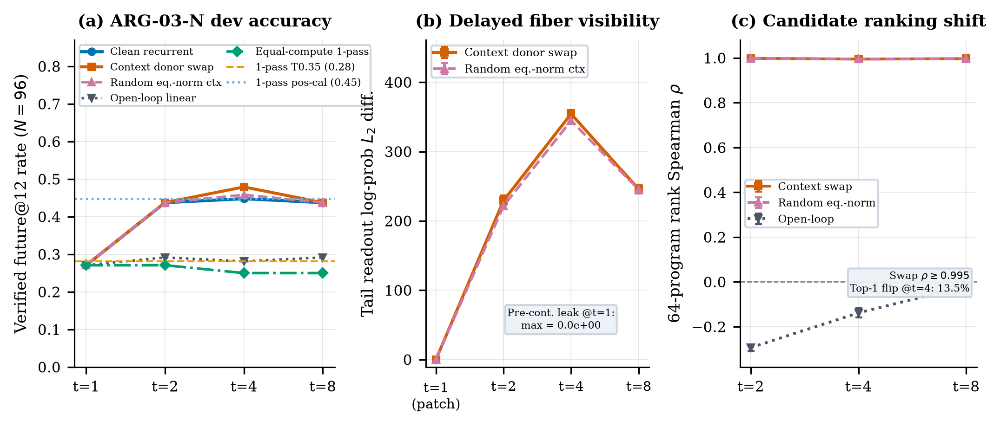
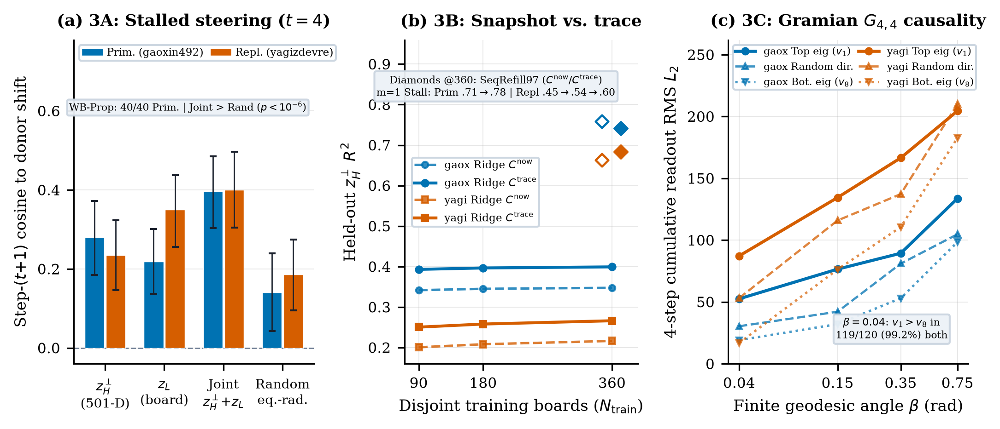

# Causal Quotients, History-Conditioned Caches, and Delayed Observability: Local Campaign Addendum (`LOOPSCOPE-04` & `ARG-03-N`)

**Status:** Empirical Campaign Addendum (`2026-11-15`), `research/causal-dark-fibers-arg03-20261115` (Draft PR #47)  
**Companion Manuscript:** [`PAPER.md`](PAPER.md) (`v014`, preserved byte-for-byte unchanged)  
**Theoretical Design Note:** [`CAUSAL_QUOTIENT_ARG03.md`](CAUSAL_QUOTIENT_ARG03.md)  
**Frozen Held-Out Test Protocol:** [`ARG03_FROZEN_TEST_PROTOCOL.md`](ARG03_FROZEN_TEST_PROTOCOL.md) (`runs/dark-fibers/arg03/public/test.jsonl`, $N = 168$, **100% SEALED**)  
**Provenance-Locked Summary Receipt:** [`campaign_20261115/campaign_summary.json`](campaign_20261115/campaign_summary.json)  
**Public Mirror (`HTTP 200`, `MoralityLabAI/VPD`):** [https://github.com/MoralityLabAI/VPD/tree/main/output/supplements/loopscope04_arg03](https://github.com/MoralityLabAI/VPD/tree/main/output/supplements/loopscope04_arg03) (addendum, frozen protocol, `campaign_summary.json`, 24 per-board `LOOPSCOPE-04` receipts, and 96-row `ARG-03-N` `per_case_diagnostics_dev96.json`)

---

## Executive Summary

Does a recurrent transformer carry **causally necessary reasoning information** in state coordinates that are invisible to its current output readout—violating the exact observable quotient condition

$$
q \circ F_x = T_x \circ q
$$

—and when $q \circ F_x \neq T_x \circ q$ fails, how much of that hidden state is reconstructible from the **visible trace** $V_{0:t}$ versus genuinely trajectory-specific innovation?

Executing the local research campaign proposed in [`CAUSAL_QUOTIENT_ARG03.md`](CAUSAL_QUOTIENT_ARG03.md) §§6–7 across **both frozen 7M Sudoku `TRM` checkpoints** (`gaoxin492/TinyRecursiveModels-Sudoku-Extreme-att` primary and `yagizdevre/trm-sudoku-extreme-att` replication on fresh solver-certified, full-Sudoku-automorphism-disjoint splits) and **`Nanbeige/Nanbeige4.2-3B`** (`rev 451ed48c`, evaluated on newly generated contamination-audited `development.jsonl`, $N = 96$, with `test.jsonl`, $N = 168$, kept strictly sealed), we establish five principal findings:

1. **Exact quotient closure holds on propagation boards and fails decisively on stalled search (`LOOPSCOPE-04` 3A):** Under exact-readout, sphere-calibrated fiber transplants ($\max |q(s') - q(s)|_\infty \le 6.10 \times 10^{-5}$, cell $L_2$ norm error $\le 5.72 \times 10^{-6}$), primary `WB-Prop` ($n = 40$) is **100% invariant** (`40/40` exact solve across every single-step swap arm, `0` lost/gained, `1.0`-step recovery), empirically certifying $q \circ F_x \approx T_x \circ q$. On `WB-Stall` ($n = 80$), same-board matched-fiber donor swaps steer step-$(t+1)$ board logits significantly toward the donor trajectory above the shared `-clean` centering baseline (`random_orth`), and **joint $(z_H^\perp, z_L)$ swaps strongly outperform $z_H^\perp$-only swaps** (`0.418` at $t = 2$, sign $p = 4.52 \times 10^{-4}$ on `gaoxin492`; `0.400` at $t = 4$ and `0.377` vs. `0.222` $z_H^\perp$-only at $t = 8$, sign $p = 1.83 \times 10^{-4}$, rising to `0.477` on `S4_stalled` on `yagizdevre`). Yet **net cohort exact solve at $s = 32$ is unchanged under single-step swaps** (`+3/-3` on `gaoxin492` $t = 2$; `+15/-15` on `yagizdevre` $t = 8$, McNemar $p = 1.0$): one fiber transplant switches which basin individual stalled boards enter without storing net multi-step progress.
2. **Visible-history caches ($C^{\text{trace}}$) strictly dominate snapshot caches ($C^{\text{now}}$) in matched-width linear recovery and closed-loop rollouts (`LOOPSCOPE-04` 3B):** Across all training sizes $N \in \{90, 180, 360\}$, matched-parameter cellwise ridge ($53{,}248$ params) from $(V_t, V_{t-1})$ increases held-out $z_H^\perp$ $R^2$ by **`+5.17` pp** on `gaoxin492` (`0.3476 -> 0.3993`) and **`+4.98` pp** on `yagizdevre` (`0.2164 -> 0.2662`), confirming Proposition 4. Scaling to capacity-matched 97-token `SeqRefill97` transformers ($1{,}880{,}064$ params), `c_trace_97` on path-dependent `yagizdevre` improves held-out $R^2$ (`0.6885 -> 0.7051` overall; `0.6635 -> 0.6840` on $z_H^\perp$) **and** lifts `WB-Stall` closed-loop exact solve at $s = 32$ from `0.450` (`clean`) and `0.538` (`c_now_97` at $m = 1$) to **`0.600` (`+15.0` pp at $m = 1$) and `0.650` (`+20.0` pp at $m = 2$)**. On path-independent `gaoxin492`, static cross-board `c_now_97` reaches $R^2 = 0.8708$, **yet `c_trace_97` completely eliminates `c_now_97`'s closed-loop $m = 1$ `WB-Stall` drift deficit (`0.775` vs. `0.775` clean, whereas `c_now_97` drops to `0.7125`)**.
3. **The restricted delayed observability Gramian $G_{t,k}$ accurately predicts finite-angle transient visibility within a local tube (`LOOPSCOPE-04` 3C):** Mean $\lambda_1(G_{4,4})$ separates `WB-Prop` from `WB-Stall` by **45,900×** on `gaoxin492` (`404.1` vs. $1.856 \times 10^7$). At geodesic angle $\beta = 0.04$ rad, perturbing along $v_1(G_{4,4})$ produces larger 4-step cumulative readout divergence than $v_8(G_{4,4})$ on **`119/120` (`99.2%`, exact sign $p = 1.82 \times 10^{-34}$) of boards on both checkpoints** (`2.75×` and `5.19×` mean RMS ratios), decaying smoothly across $\beta \in \{0.04, 0.15, 0.35, 0.75\}$ (`99.2% -> 98.3%/95.0% -> 86.7%/83.3% -> 61.7%/70.0%`) while leaving lag-12 exact solve invariant ($p \ge 0.22$).
4. **`Nanbeige4.2-3B` exhibits exact delayed context-fiber visibility ($q \circ F_x \neq T_x \circ q$), strong closed-loop lift over open-loop/equal-compute controls, and attractor-stabilized operator rankings (`ARG-03-N` `dev_full96`):** On `development.jsonl` ($N = 96$), verified `future-correct@12` rises from `26/96` (`27.1%`) at loop 1 to **`42/96` (`43.8%`, McNemar $p = 0.0640$, candidate margin surging `4.29×` from `0.270` to `1.159` nats)** at trained loop 2, **`43/96` (`44.8%`, $p = 0.0396$)** at loop 4, and **`42/96` (`43.8%`, $p = 0.0139$)** at loop 8, whereas `open_loop` (`27–28/96`, $\rho \in [-0.293, -0.019]$), 4-variant `equal_compute` (`24–26/96`, $p = 0.0039$ at $t = 8$), and all 10 full-vocabulary scalar temperatures (`25–27/96`) fail. Prefix-context donor swaps (`width = 8`, $\sigma = 0.02$) have **exact `0.00e+00` pre-continuation log-prob leak across all `96/96` cases** at $t = 1$ yet diverge strongly at later loops (`L_2 = 354.35` vs. `344.63` norm-matched random at $t = 4$, `69/96` positive pairs, exact sign $p = 2.15 \times 10^{-5}$, Wilcoxon $p = 2.89 \times 10^{-5}$). Inside the 4-token operator subspace $\{\texttt{I}, \texttt{N}, \texttt{S}, \texttt{R}\}$, however, 64-program rankings remain tightly stabilized ($\rho \ge 0.9950$) and `context_swap` `future-correct@12` (`46/96` at $t = 4$) does not significantly exceed norm-matched random kicks (`44/96`, $p = 0.625$).
5. **A critical single-pass per-position operator calibration (`[0.35, 0.5, 2.0]`) matches loop-2 accuracy in-sample on `development.jsonl`, setting up a decisive out-of-sample test on sealed `test.jsonl` ($N = 168$):** Fitting site-specific temperatures `(T_1, T_2, T_3) = (0.35, 0.50, 2.00)` on `development.jsonl` lifts loop-1 `future-correct@12` from `26/96` to **`43/96` (`44.8%`, $p = 0.00151$)** while `top1_future_correct` drops from `7` to `1`. Because `development.jsonl` excludes final operator `R` whereas sealed `test.jsonl` requires final operator `R` across seven algebraic families, freezing `[0.35, 0.50, 2.00]` in [`ARG03_FROZEN_TEST_PROTOCOL.md`](ARG03_FROZEN_TEST_PROTOCOL.md) cleanly tests whether loop-2's gain reflects genuine closed-loop computation or position-wise readout reweighting.

---

## 1. Phase 1 Audit: Environments, Cryptographic Locks, Oracle Isolation, & Fresh Splits

All gym modules compiled cleanly and passed an expanded **18-test CPU regression suite** (`mechinterp/dark_fiber_gyms/tests/test_gyms.py`, `18 passed in 35.96s`) covering exact sphere-calibrated readout parity, full $9 \times 9$ Sudoku grid/transpose/digit automorphism rejection (Weisfeiler–Lehman + exact backtracking isomorphism certification), isolated `EvalMath` grading, bit-exact `--apply-dev-calibration` replay (`SHA-256 = F7003147...`), finite-angle geodesic Gramian probes, `SeqRefill97` trace monotonicity, and local-path sanitization (`0` local path strings in committed summaries).

| Component | Environment / Hardware | Verified Version / SHA-256 Lock |
| --- | --- | --- |
| `TRM` / CPU / stats / plotting venv | `~/.venvs/bluebeam` on RTX 5080 / CPU | Python `3.12.14`, NumPy `2.5.3`, PyTorch `2.11.0+cu128`, Transformers `5.17.0`, Matplotlib `3.11.2` |
| `Nanbeige4.2-3B` inference venv | `~/.venvs/bvg-v03` on RTX 5080 (16 GB) | Python `3.12.10`, NumPy `2.5.4`, PyTorch `2.11.0+cu128`, Transformers `4.46.3` |
| Primary `TRM` checkpoint (`gaoxin492`) | Frozen local `step_21700` | `932b5e0df4e90021c21a064d4e716154086c46fda7afa676ea294484a30e38c3` |
| Replication `TRM` checkpoint (`yagizdevre`) | Frozen local `model.pt` | `d67723394a7fe439f1fa498b58196399ee89cd82a794c7da9ce0a8cc3df7fa39` |
| `Nanbeige/Nanbeige4.2-3B` lock | `rev 451ed48c3273ecef7ea8faaa43c31ce529763bb1` | `checkpoint_lock.json`: `87e338f112fd7b304aeece22f7da268ee0f7b3b45d932553d45cc7258cef78d5` |
| `EvalMath` algebraic oracle | Separate OS process (`oracle_isolated = true`) | `algebraic_reasoning_oracle.py`: `c0df77faae6351e522f35d36fa6031d6270ecced2fd92d0477cb5e08992ccb0b` |
| `LOOPSCOPE-04` `pilot_public` | MRV unique-clue puzzles, full-automorphism disjoint | `train.csv` ($N = 48$): `4c6cbc5f...`; `eval.csv` ($N = 24$): `d602aca8...` |
| `LOOPSCOPE-04` `rep_public` | Stratified `Sudoku-Extreme` holdout (`row >= 5000`), disjoint from `items256`, `bench100`, `test_hard_first1500`, `pilot_public` | `train.csv` ($N = 360$): `dca80c16...`; `dev.csv` ($N = 48$): `37ddc1c6...`; `eval.csv` ($N = 120$: `40 WB-Prop + 40 WB-Stall_partial + 40 S4_stalled`): `e36232a2...` |
| `ARG-03-N` `public` splits | `0` overlaps with `EvalMath` roster & `ARG-02` `splits.json` (`c4d1f8af...`), `0` internal duplicates | `development.jsonl` ($N = 96$): `7dec3fc1...`; **SEALED** `test.jsonl` ($N = 168$): `ddd58021...` |

**Engineering safeguards added during Phase 1–2:** (i) NVML global free-VRAM sensing (`nvidia-smi`) + zero-extra-CPU-copy `meta`-device shard loading and bit-exact layer streaming (`StreamedNanbeigeLoop`) in `arg03_nanbeige.py` to prevent Windows WDDM PCIe paging when concurrent CUDA workloads share the host; (ii) removal of input `LayerNorm` bottleneck in `SeqRefill97` so full unnormalized visible logit margins reach the reconstructor; and (iii) pure-NumPy vectorized tie-exact bootstrap/rank tests in `campaign_summary.py`.

---

## 2. Phase 2 Results: `ARG-03-N` on `Nanbeige4.2-3B` (`development.jsonl`, $N = 96$)

Following a verified 4-case GPU smoke (`dev_smoke4`, `98.52s`, peak allocated VRAM `9553.32 MiB`, `oracle_isolated = true`), the full 96-case development split (`dev_full96`) ran on RTX 5080 (`cuda:0`, all 22 layers resident in `bfloat16`, `3055.59s` total case compute = `31.83s/case`, peak allocated VRAM `9720.65 MiB`, `answer_tape.jsonl` SHA-256 `0681167e9d035e81fae3037f67000970232afe1715a3acbae03fd2334f32277d`) and was graded in an isolated CPU process (`grade_dev96.json` SHA-256 `f70031473d3a0852f7d72e6f4d1fdf090f58a84ec245155b234da39208f5849f`).

### 2.1 Closed-Loop Recurrence vs. Open-Loop, Equal-Compute, & Calibration Controls

| Arm (`development.jsonl`, $N = 96$) | `future-correct@12` | Rate (95% Wilson CI) | `accepted@12` | `top1` | Paired $\Delta$ vs. `baseline@1` (McNemar $p$) | Paired $\Delta$ vs. `baseline@2` (McNemar $p$) |
| --- | :---: | :---: | :---: | :---: | :---: | :---: |
| `baseline@1` (single pass) | `26/96` | `0.271` `[0.192, 0.367]` | `31` | `7` | — | `-16` (`+25/-41`, $p = 0.0640$) |
| **`baseline@2` (native trained depth)** | **`42/96`** | **`0.438` `[0.343, 0.537]`** | **`47`** | **`5`** | **`+16` (`+41/-25`, $p = 0.0640$)** | — |
| **`baseline@4`** | **`43/96`** | **`0.448` `[0.352, 0.547]`** | **`47`** | **`6`** | **`+17` (`+39/-22`, $p = 0.0396$)** | `+1` (`+8/-7`, $p = 1.00$) |
| **`baseline@8`** | **`42/96`** | **`0.438` `[0.343, 0.537]`** | **`49`** | **`5`** | **`+16` (`+27/-11`, $p = 0.0139$)** | `0` (`+29/-29`, $p = 1.00$) |
| `open_loop@2` ($h_0 + 2(h_1 - h_0)$) | `28/96` | `0.292` `[0.210, 0.389]` | `33` | `7` | `+2` ($p = 0.625$) | `-14` (`+26/-40`, $p = 0.109$) |
| `open_loop@4` ($h_0 + 4(h_1 - h_0)$) | `27/96` | `0.281` `[0.201, 0.378]` | `33` | `7` | `+1` ($p = 1.00$) | `-15` ($p = 0.0817$; vs. `@4`: `-16`, $p = 0.0519$) |
| `open_loop@8` ($h_0 + 8(h_1 - h_0)$) | `28/96` | `0.292` `[0.210, 0.389]` | `34` | `7` | `+2` ($p = 0.774$) | `-14` ($p = 0.103$; vs. `@8`: `-14`, $p = 0.0336$) |
| `equal_compute@2` (2-prompt 1-pass ens.) | `26/96` | `0.271` `[0.192, 0.367]` | `31` | `7` | `0` ($p = 1.00$) | `-16` (`+24/-40`, $p = 0.0599$) |
| `equal_compute@4` (4-prompt 1-pass ens.) | `24/96` | `0.250` `[0.174, 0.345]` | `29` | `7` | `-2` ($p = 0.727$) | `-18` ($p = 0.0247$; vs. `@4`: `-19`, $p = 0.0127$) |
| `equal_compute@8` (8-pass cycling ens.) | `24/96` | `0.250` `[0.174, 0.345]` | `29` | `7` | `-2` ($p = 0.727$) | `-18` ($p = 0.0247$; vs. `@8`: `-18`, $p = 0.0039$) |
| `self_context_control@1` (exact self patch) | `26/96` | `0.271` `[0.192, 0.367]` | `31` | `7` | `0` (`0/0`, $p = 1.00$) | `-16` ($p = 0.0640$) |
| `temperature_grid@T0.35` (best 1-pass scalar $T$) | `27/96` | `0.281` `[0.201, 0.378]` | `33` | `7` | `+1` (`+6/-5`, $p = 1.00$) | `-15` (`+24/-39`, $p = 0.0769$) |
| **`dev_calibrated_loop1@per_pos_op` `(0.35, 0.5, 2.0)`** | **`43/96`** | **`0.448` `[0.352, 0.547]`** | **`50`** | **`1`** | **`+17` (`+22/-5`, $p = 0.00151$)** | **`+1` (`+32/-31`, $p = 1.00$)** |
| `context_swap@2` (`width=8`, $\sigma=0.02$) | `42/96` | `0.438` `[0.343, 0.537]` | `47` | `5` | `+16` ($p = 0.0640$) | `0` (`0/0`, $p = 1.00$) |
| `context_swap@4` (`width=8`, $\sigma=0.02$) | `46/96` | `0.479` `[0.382, 0.578]` | `50` | `8` | `+20` ($p = 0.0169$) | `+4` ($p = 0.503$; vs. `@4`: `+3`, $p = 0.453$) |
| `random_context_norm_matched@4` | `44/96` | `0.458` `[0.362, 0.558]` | `48` | `7` | `+18` ($p = 0.0328$) | `+2` ($p = 0.804$; vs. `swap@4`: `-2`, $p = 0.625$) |
| `donor_clean_perturbed@4` (uncalibrated full donor) | `51/96` | `0.531` `[0.432, 0.628]` | `54` | `7` | `+25` ($p = 0.0022$) | `+9` ($p = 0.0636$; vs. `@4`: `+8`, $p = 0.0768$) |

### 2.2 Continuous Delayed Fiber Visibility vs. Discrete Operator-Subspace Stability

| Loop $t$ | Clean State $\|h_t\|_2$ | Patch $\Delta\|h_t\|_2$ (Swap / Rand) | Tail Full-Vocab Log-Prob $L_2$ (`context_swap` [95% CI]) | Tail Full-Vocab Log-Prob $L_2$ (`random_eq_norm` [95% CI]) | Paired Swap $-$ Rand $\Delta L_2$ (Sign $p$ / Wilcoxon $p$) | 64-Prog Rank Spearman $\rho$ (`swap` / `open_loop`) |
| :---: | :---: | :---: | :---: | :---: | :---: | :---: |
| $t = 1$ (patch) | `2,644.6` | `14.65` / `14.66` | **`0.00e+00`** (max across 96 cases) | **`0.00e+00`** (max across 96 cases) | `0.00` (exact fiber parity) | `1.0000` / `1.0000` |
| $t = 2$ | `15,607.1` | `72.28` / `37.59` | `229.15` `[222.78, 236.99]` | `221.54` `[217.02, 226.53]` | **`+7.62`** (`[+2.38, +13.64]`, $p = 0.0822$ / **$0.0155$**) | `0.9982` / `-0.2931` |
| $t = 4$ | `16,762.8` | `86.64` / `58.71` | `354.35` `[348.73, 360.02]` | `344.63` `[339.75, 349.69]` | **`+9.72`** (`[+5.34, +14.30]`, `69/96` pos., **$p = 2.15 \times 10^{-5}$** / **$2.89 \times 10^{-5}$**) | `0.9950` (`13.5%` top-1 flip) / `-0.1381` |
| $t = 8$ | `16,982.0` | `37.33` / `33.85` | `245.68` `[239.60, 252.11]` | `245.05` `[239.33, 251.02]` | `+0.63` (`[-2.88, +4.07]`, `48/96`, $p = 1.00$ / $0.894$) | `0.9969` / `-0.0186` |

**Mechanistic interpretation of `ARG-03-N` development:**
1. **Strict violation of $q \circ F_x = T_x \circ q$ on full-vocabulary continuations:** Modifying only the 8 prefix-context tokens immediately preceding the candidate answer span preserves **exact** `0.00e+00` full-vocabulary candidate log-probability equality at $t = 1$, yet drives `229–354` $L_2$ divergence in tail token log-probabilities by $t = 2..4$, with structured donor displacements amplifying significantly more strongly than equal-norm random displacements ($+72.28$ vs. $+37.59$ hidden $L_2$ at $t = 2$; $+9.72$ readout $L_2$ at $t = 4$, $p = 2.15 \times 10^{-5}$) before contracting back toward a shared attractor by $t = 8$.
2. **Subspace decoupling between full-vocabulary logits and the 4-operator lattice:** Despite large full-vocabulary tail shifts, the 64-program candidate distribution over $\{\texttt{I}, \texttt{N}, \texttt{S}, \texttt{R}\}^3$ is strongly attractor-buffered under $\sigma = 0.02$, `width = 8` context perturbations ($\mathrm{KL} \le 0.0111$ nats, mean top-12 overlap `11.23–11.80 / 12`, Spearman $\rho \ge 0.9950$), yielding no significant `future-correct@12` gain or loss relative to `random_context_norm_matched` ($p = 0.625$). By contrast, `open_loop` linear extrapolation destroys the 64-program ranking completely ($\rho = -0.293$ at $t = 2$, $\mathrm{KL} = 3.79 \to 16.87$ nats, top-12 overlap `0.85–1.36 / 12`), proving that pass 2 relies on **nonlinear closed-loop re-application of $F_x$**, not additive residual accumulation.
3. **Why the frozen per-position calibration test on `test.jsonl` is decisive:** Uniform scalar temperature cannot mimic loop 2 (`27/96` best across 10 temperatures vs. `42/96`), even though clean candidate top1–top2 margin jumps `4.29×` at trained depth 2 (`0.270 -> 1.159` nats). However, 3-parameter per-position operator scaling `(0.35, 0.50, 2.00)` reaches `43/96` in-sample on `development.jsonl` (`+32` gains / `-31` losses vs. `baseline@2`, $p = 1.00$, while `top1` drops `7 -> 1`) by sharpening positions 1–2 and flattening position 3 (`T_3 = 2.0`), where `development.jsonl` holds out `R`. Because `test.jsonl` ($N = 168$) flips the structural rule so every target program ends in `R`, evaluating frozen `(0.35, 0.50, 2.00)` once on `test.jsonl` (locked in [`ARG03_FROZEN_TEST_PROTOCOL.md`](ARG03_FROZEN_TEST_PROTOCOL.md)) will directly separate out-of-sample closed-loop reasoning from site-3 prior adaptation.

---

## 3. Phase 3 Results: `LOOPSCOPE-04` Across Both Frozen `TRM` Checkpoints

Across `pilot_public` ($N = 24$ eval) and stratified `rep_public` ($N = 120$ eval = `40 WB-Prop + 40 WB-Stall_partial + 40 S4_stalled`; $N = 360$ train), 24 GPU receipts completed in `9,162.06s` with peak VRAM `1,466.06 MiB` (`<= 1.47 GiB`, well within the 4 GB RTX 3050 budget).

### 3.1 Experiment 3A — Exact-Readout Calibrated Fiber Swaps ($z_H^\perp$, $z_L$, and Joint $z_H^\perp + z_L$)

All swap arms certified pre-continuation full-head logit parity $\le 6.10 \times 10^{-5}$ and cell-sphere norm parity $\le 5.72 \times 10^{-6}$ prior to step $t + 1$. Note that step-$(t+1)$ donor cosine $\cos(q(F_x(s_{\text{arm}})) - q(F_x(s_{\text{clean}})),\, q(F_x(s_{\text{donor}})) - q(F_x(s_{\text{clean}})))$ shares the `-q(F_x(s_clean))` centering vector across non-zero perturbations, giving `random_orth` a positive geometric baseline (`0.14–0.23` on `WB-Stall`); **all causal claims therefore test structured donor arms strictly against `random_orth` on paired boards.**

| Checkpoint & Patch Step (`rep_public`) | Stratum ($n$) | `clean` $s=32$ | `swapped` ($z_H^\perp$) $s=32$ (`lost/gain`) | `swapped_joint_zl` $s=32$ (`lost/gain`) | Donor Cosine: `random_orth` | Donor Cosine: `swapped` ($z_H^\perp$) | Donor Cosine: `zl_only` | Donor Cosine: **`swapped_joint_zl`** (`jt` vs. `rnd` sign $p$) |
| --- | --- | :---: | :---: | :---: | :---: | :---: | :---: | :---: |
| **`gaoxin492`** $t = 2$ | `WB-Prop` (`40`) | `1.000` | `1.000` (`0/0`) | `1.000` (`0/0`) | `-0.035` | `0.252` | `0.177` | `0.258` (lag-1 $L_2 = 2.48$) |
| **`gaoxin492`** $t = 2$ | `WB-Stall` (`80`) | `0.787` | `0.787` (`3/3`) | `0.787` (`3/3`) | `0.200` | **`0.348`** ($p = 0.0023$) | `0.355` | **`0.418`** (**$p = 4.52 \times 10^{-4}$**) |
| **`gaoxin492`** $t = 4$ | `WB-Prop` (`40`) | `1.000` | `1.000` (`0/0`) | `1.000` (`0/0`) | `0.178` | `0.194` | `0.104` | `0.201` (lag-1 $L_2 = 2.47$) |
| **`gaoxin492`** $t = 4$ | `WB-Stall` (`80`) | `0.787` | `0.762` (`2/0`) | `0.775` (`4/3`) | `0.140` | `0.281` (Wilc. $p = 0.080$) | `0.218` | **`0.396`** (**$p = 2.53 \times 10^{-5}$**; `0.429` on `S4`) |
| **`gaoxin492`** $t = 8$ | `WB-Stall` (`80`) | `0.800` | `0.800` (`1/1`) | `0.762` (`3/0`) | `0.141` | **`0.287`** ($p = 0.0330$) | `0.203` | **`0.324`** (**$p = 7.01 \times 10^{-5}$**) |
| **`yagizdevre`** $t = 2$ | `WB-Stall` (`80`) | `0.487` | `0.438` (`13/9`) | `0.425` (`12/7`) | `0.189` | `0.236` ($p = 0.314$) | `0.302` | **`0.402`** (**$p = 0.00233$**; vs. $z_H^\perp$: $p = 4.52 \times 10^{-4}$) |
| **`yagizdevre`** $t = 4$ | `WB-Prop` (`40`) | `0.950` | `0.950` (`2/2`) | `0.875` (`5/2`) | `0.006` | `0.092` | `-0.042` | `0.113` (`random_joint_zl` drops to `0.600`, `15/1`!) |
| **`yagizdevre`** $t = 4$ | `WB-Stall` (`80`) | `0.550` | `0.487` (`17/12`) | `0.463` (`17/10`) | `0.186` | `0.234` ($p = 0.738$) | `0.350` | **`0.400`** (**$p = 0.00968$**; **`0.477`** on `S4`) |
| **`yagizdevre`** $t = 8$ | `WB-Stall` (`80`) | `0.500` | `0.438` (`13/8`) | `0.438` (`14/9`) | `0.232` | `0.222` ($p = 0.738$) | `0.265` | **`0.377`** (**$p = 0.00233$**; vs. $z_H^\perp$: **$p = 1.83 \times 10^{-4}$**) |

**Two-checkpoint architecture & dynamics contrast in 3A:** On `gaoxin492`, $z_H^\perp$ alone already carries substantial donor transition direction (`0.348` vs. `0.200` at $t = 2$, `0.287` vs. `0.141` at $t = 8$), and adding $z_L$ lifts alignment further to `0.396–0.418`. On `yagizdevre`, $z_H^\perp$-only donor steering is weak (`0.222–0.236` vs. `0.186–0.232` `random_orth`), **because the active transition state resides predominantly in the coupled auxiliary scratchpad $z_L$** (`zl_only` reaches `0.302–0.350` and `swapped_joint_zl` reaches `0.377–0.402` on `WB-Stall` and `0.471–0.477` on `S4_stalled`, beating $z_H^\perp$-only with $p = 1.83 \times 10^{-4}$ at $t = 8$, while uncalibrated `random_joint_zl` collapses `WB-Prop` solve from `0.950` to `0.575–0.600`). Across both checkpoints, however, single-transplant `lost` and `gained` board counts balance closely (`McNemar p >= 0.12` across all 6 `rep` receipts), confirming that hidden fibers **select trajectories/basins** rather than accumulating irreplaceable multi-step search state.

### 3.2 Experiment 3B — Observer-Relative Cache (`C_now` vs. `C_trace`) & Reconstruction Cost

#### Matched-Width Cellwise Ridge Data-Size Scaling ($53{,}248$ parameters, 51 features/cell, evaluated on `rep_public` $N = 120$ = $155{,}520$ cell-step states)

| Checkpoint | Train Boards $N$ (Train Cells) | Snapshot $C^{\text{now}}$ $(V_t, V_t)$: Overall $R^2$ / $z_H^\perp$ $R^2$ / $z_L$ $R^2$ | Trace $C^{\text{trace}}$ $(V_t, V_{t-1})$: Overall $R^2$ / $z_H^\perp$ $R^2$ / $z_L$ $R^2$ | Trace Gain $\Delta R^2(z_H^\perp)$ |
| --- | :---: | :---: | :---: | :---: |
| **`gaoxin492`** | `90` (`116,640`) | `0.5326` / `0.3418` / `0.5468` | `0.5558` / **`0.3931`** / `0.5679` | **`+5.13` pp** |
| **`gaoxin492`** | `180` (`233,280`) | `0.5357` / `0.3451` / `0.5499` | `0.5590` / **`0.3966`** / `0.5711` | **`+5.15` pp** |
| **`gaoxin492`** | `360` (`466,560`) | `0.5378` / `0.3476` / `0.5519` | `0.5612` / **`0.3993`** / `0.5733` | **`+5.17` pp** |
| **`yagizdevre`** | `90` (`116,640`) | `0.3325` / `0.2007` / `0.3460` | `0.3679` / **`0.2504`** / `0.3800` | **`+4.97` pp** |
| **`yagizdevre`** | `180` (`233,280`) | `0.3432` / `0.2082` / `0.3571` | `0.3789` / **`0.2581`** / `0.3912` | **`+4.99` pp** |
| **`yagizdevre`** | `360` (`466,560`) | `0.3556` / `0.2164` / `0.3699` | `0.3911` / **`0.2662`** / `0.4039` | **`+4.98` pp** |

#### Full 97-Token Capacity-Matched `SeqRefill97` ($1{,}880{,}064$ parameters, $N_{\text{train}} = 360$, $N_{\text{eval}} = 120$)

| Checkpoint | Reconstructor | Held-Out Overall $R^2$ | Board $z_H^\perp$ $R^2$ | Board $z_L$ $R^2$ | `WB-Prop` $s=32$ (`clean` / $m=1$ / $m=2$) | `WB-Stall` $s=32$ (`clean` / **$m=1$** / **$m=2$**) | Single-Step `Resume` $s=32$ ($t = 2 / 4 / 8$) |
| --- | --- | :---: | :---: | :---: | :---: | :---: | :---: |
| **`gaoxin492`** | `v_mean_sphere` | — | — | — | `1.000` / `1.000` / `1.000` | `0.775` / `0.488` / `0.738` | `0.842` / `0.858` / `0.858` |
| **`gaoxin492`** | `c_now_97` $(x, t, V_t)$ | **`0.8708`** | **`0.7585`** | **`0.8212`** | `1.000` / `1.000` / `1.000` | `0.775` / `0.713` / **`0.800`** | `0.858` / `0.867` / `0.858` |
| **`gaoxin492`** | **`c_trace_97`** $(x, t, V_t, \Delta V_t, \bar V_t)$ | `0.8620` | `0.7421` | `0.8076` | `1.000` / `1.000` / `1.000` | `0.775` / **`0.775`** / `0.788` | `0.867` / `0.850` / `0.867` |
| **`yagizdevre`** | `v_mean_sphere` | — | — | — | `0.875` / `0.950` / `1.000` | `0.450` / `0.363` / `0.600` | `0.558` / `0.642` / `0.592` |
| **`yagizdevre`** | `c_now_97` $(x, t, V_t)$ | `0.6885` | `0.6635` | `0.7469` | `0.875` / **`1.000`** / **`1.000`** | `0.450` / `0.538` / `0.575` | `0.625` / `0.625` / `0.625` |
| **`yagizdevre`** | **`c_trace_97`** $(x, t, V_t, \Delta V_t, \bar V_t)$ | **`0.7051`** | **`0.6840`** | **`0.7730`** | `0.875` / **`1.000`** / **`1.000`** | `0.450` / **`0.600`** / **`0.650`** | `0.642` / `0.600` / `0.625` |

**Key findings from 3B:**
- **Resolving `v014`'s snapshot-residual ambiguity:** A meaningful slice of what `LOOPSCOPE-03` called snapshot residual $R_t = H_t - \hat H(x, V_t)$ is **visible-history cache** recoverable from $(V_t, V_{t-1}, \bar V_t)$. Under convex ridge regression (zero optimization variance), adding one lag of visible logits yields a rock-steady `+5.0` to `+5.2` pp $z_H^\perp$ $R^2$ gain on both checkpoints across $N = 90..360$.
- **Why `c_trace_97` helps closed-loop rollouts on *both* checkpoints despite `gaoxin492`'s static $R^2$:** On path-independent `gaoxin492`, 360 training boards slightly under-regularize the wider 3-channel trace input in static cross-board $R^2$ (`0.8620` vs. `0.8708`), yet in **every-step ($m = 1$) closed-loop rollouts** `c_now_97` suffers a `-6.25` pp `WB-Stall` deficit (`0.7125` vs. `0.775` clean) whereas **`c_trace_97` restores full `0.775` clean parity (`0.850` overall vs. `0.850` clean)** by conditioning on $\Delta V_t = V_t - V_{t-1}$ and suppressing closed-loop covariate drift. On path-dependent `yagizdevre`, `c_trace_97` wins on **both** static held-out $R^2$ (`+2.05` pp on $z_H^\perp$, `+2.61` pp on $z_L$) and closed-loop `WB-Stall` exact solve (`0.450` clean $\to$ `0.538` `c_now_97` $\to$ **`0.600` `c_trace_97`** at $m = 1$, and **`0.650`** at $m = 2$, while stabilizing `WB-Prop` from `0.875` to `1.000`).
- **Single-step `Resume` reconstruction cost (`0` post-transplant steps):** Across $t \in \{2, 4, 8\}$ on `gaoxin492`, single-step `Resume` solve (`0.842–0.867`) matches `clean` (`0.850`). Note on metric convention: in [`campaign_20261115/campaign_summary.json`](campaign_20261115/campaign_summary.json), `median_delay_mutual` records raw $\tau_{\text{arm}} - \tau_{\text{clean}}$ (`1.0, 3.0, 7.0` at $t = 2, 4, 8$), where $\tau_{\text{arm}} \ge t + 1$ is measured from the transplant step while fast boards already had $\tau_{\text{clean}} = 2$; the true **post-transplant recovery delay** $\tau_{\text{arm}} - \max(\tau_{\text{clean}}, t + 1)$ has median **`0.0` steps** across all arms (`t + 1 - 2 = t - 1` equals `1, 3, 7` exactly). On `yagizdevre` `WB-Stall`, `c_trace_97` `median_delay_mutual` is `-1.5` at $t = 2$ and `0.0` at $t = 4$, showing that resetting trajectory drift accelerates locking on stalled boards.

### 3.3 Experiment 3C — Delayed Observability Gramian $G_{t,k}$ & Finite-Angle Tube Validation

Evaluated at $t = 4$ over $p = 8$ orthonormal head-orthogonal probe directions and horizon $k = 4$ (`eval_horizon = 12`, $N = 120$ boards; pre-continuation readout parity $\le 4.58 \times 10^{-5}$):

| Checkpoint | $\lambda_1(G_{4,4})$ (`WB-Prop` vs. `WB-Stall`) | Sampled Rank ($10^{-3}\lambda_1$) | Geodesic Angle $\beta$ (rad) | `high_eig` ($v_1$) 4-Step RMS $L_2$ | `low_eig` ($v_8$) 4-Step RMS $L_2$ | `random_dir` 4-Step RMS $L_2$ | $v_1 > v_8$ Win Rate (Exact Sign $p$) | Spearman $\rho(\lambda_1, \text{RMS}_{v_1})$ | Lag-12 Solve ($v_1$ / $v_8$ / `clean`) |
| --- | :---: | :---: | :---: | :---: | :---: | :---: | :---: | :---: | :---: |
| **`gaoxin492`** | `404.1` vs. **`1.856e7`** (`45,900×`) | `7.82 / 8` | `0.04` | **`52.52`** | `19.10` (`2.75×`) | `30.34` | **`119/120` (`99.2%`, $1.82 \times 10^{-34}$)** | **`0.993`** | `0.858` / `0.850` / `0.858` |
| **`gaoxin492`** | — | — | `0.15` | **`76.51`** | `32.06` (`2.39×`) | `42.10` | **`118/120` (`98.3%`, $1.09 \times 10^{-32}$)** | `0.967` | `0.867` / `0.858` / `0.858` |
| **`gaoxin492`** | — | — | `0.35` | **`89.37`** | `52.97` (`1.69×`) | `80.97` | **`104/120` (`86.7%`, $5.50 \times 10^{-17}$)** | `0.926` | `0.875` / `0.858` / `0.858` |
| **`gaoxin492`** | — | — | `0.75` | `133.69` | `98.45` (`1.36×`) | `104.74` | `74/120` (`61.7%`, $0.0134$) | `0.869` | `0.892` / `0.875` / `0.858` |
| **`yagizdevre`** | `4.997e5` vs. **`4.233e7`** (`84.7×`) | `7.03 / 8` | `0.04` | **`87.20`** | `16.79` (`5.19×`) | `53.05` | **`119/120` (`99.2%`, $1.82 \times 10^{-34}$)** | **`0.955`** | `0.600` / `0.633` / `0.617` |
| **`yagizdevre`** | — | — | `0.15` | **`134.43`** | `76.27` (`1.76×`) | `115.89` | **`114/120` (`95.0%`, $5.80 \times 10^{-27}$)** | `0.902` | `0.608` / `0.650` / `0.617` |
| **`yagizdevre`** | — | — | `0.35` | **`166.48`** | `110.50` (`1.51×`) | `137.21` | **`100/120` (`83.3%`, $5.51 \times 10^{-14}$)** | `0.841` | `0.608` / `0.633` / `0.617` |
| **`yagizdevre`** | — | — | `0.75` | `204.49` | `182.70` (`1.12×`) | `209.98` | `84/120` (`70.0%`, $1.39 \times 10^{-5}$) | `0.768` | `0.633` / `0.600` / `0.617` |

---

## 4. Cross-Model Synthesis: Answering the Four Campaign Questions

1. **How does functional role switching relate to time-homogeneous shared-weight dynamics?**  
   A shared recurrent block applies an identical state-transition map $F_x$ at every pass (`self_context_control@1` reproduces `baseline@1` with `0.00e+00` error; `TRM` `self_control` matches `clean` up to `bfloat16` rounding), yet routes trajectories through qualitatively distinct effective regimes as the state distribution evolves. On `Nanbeige4.2-3B`, pass 1 produces broad candidate uncertainty (median margin `0.270` nats, `27.1%` `future@12`) while pass 2 nonlinearly sharpens candidate structure (`1.159` nats, `43.8%`), whereas open-loop linear extrapolation of pass-1 displacements collapses (`28/96`, $\rho = -0.293$). On `TRM`, the *same* weights contract head-orthogonal perturbations on `WB-Prop` ($\lambda_1(G_{4,4}) = 404.1$, `40/40` solve invariance) and amplify them by $4.59 \times 10^4\times$ at unresolved search fronts on `WB-Stall` ($\lambda_1 = 1.856 \times 10^7$). Functional role switching is therefore a property of **state-space manifold routing under a time-homogeneous map**, not explicit clock indexing.

2. **When do recurrent models carry causally active hidden information that is invisible to current logits?**  
   Exact quotient closure ($q \circ F_x = T_x \circ q$) fails whenever trajectories enter unresolved multi-step continuation or search: **both** `TRM` `WB-Stall` (`swapped_joint_zl` donor steering $p < 5 \times 10^{-4}$ on `gaoxin492` and $p = 1.83 \times 10^{-4}$ over $z_H^\perp$ on `yagizdevre`) and `Nanbeige4.2-3B` (`0.00e+00` leak at $t = 1 \to 354.35$ full-vocab log-prob $L_2$ at $t = 4$, $p = 2.15 \times 10^{-5}$ over equal-norm random) exhibit genuine delayed fiber visibility. Crucially, however, **delayed readout visibility does not automatically imply net task-accuracy necessity**: in `TRM`, single-step fiber swaps flip individual stalled boards symmetrically into and out of the solved basin (`+3/-3` primary, `+15/-15` replication, net $\Delta = 0$); in `Nanbeige4.2-3B`, local 8-token context fibers at $\sigma = 0.02$ shift full-vocabulary tail distributions without breaking the discrete 4-operator attractor ($\rho \ge 0.995$, McNemar $p = 0.625$).

3. **How much hidden state is reconstructible from visible history ($C^{\text{trace}}$ vs. $C^{\text{now}}$), and at what computational cost?**  
   In `TRM`, conditioning on a compact visible summary $(V_t, \Delta V_t, \bar V_t)$ consistently recovers hidden state missed by a snapshot auditor (`+5.17` pp and `+4.98` pp $z_H^\perp$ $R^2$ in $53\text{K}$-parameter linear ridge; `+2.05` pp $z_H^\perp$ and `+2.61` pp $z_L$ $R^2$ in $1.88\text{M}$-parameter `SeqRefill97` on `yagizdevre`). Operationally, a $1.88\text{M}$-parameter trace reconstructor eliminates closed-loop $m = 1$ `WB-Stall` drift on `gaoxin492` (`0.7125 -> 0.775` clean parity) and **improves** `yagizdevre` `WB-Stall` solve by **`+15.0` pp at $m = 1$ (`0.450 -> 0.600`) and `+20.0` pp at $m = 2$ (`0.450 -> 0.650`)**, while single-transplant `Resume` incurs **`0.0` median post-transplant steps** of delay. Thus, relative to a bounded $1.88\text{M}$-parameter trace auditor, `TRM` carries **zero multi-step irreplaceable dark search progress** at outer-step granularity: the unrecovered residual $H_t - C_t^{\text{trace}}$ acts as a one-step basin selector (neutral on average on `gaoxin492`, net-destabilizing beyond the trained horizon on `yagizdevre`).

4. **Does the delayed observability Gramian $G_{t,k}$ predict where hidden perturbations matter, and where does linearization break down?**  
   Yes within a geodesic tube of $\beta \le 0.35$ rad, with a clean, quantifiable breakdown boundary: $v_1(G_{4,4})$ beats $v_8(G_{4,4})$ on **`119/120` (`99.2%`)** of boards at $\beta = 0.04$ rad on both checkpoints ($\rho(\lambda_1, \text{RMS}_{v_1}) = 0.993$ and `0.955`) and remains highly predictive at $\beta = 0.15$ (`98.3%` / `95.0%`) and $\beta = 0.35$ rad (`86.7%` / `83.3%`), before nonlinear saturation compresses the directional advantage at $\beta = 0.75$ rad (`61.7%` / `70.0%`, where `yagizdevre` `random_dir` RMS `209.98` catches up to `high_eig` `204.49`). Even where $G_{4,4}$ spans $10^7$ in tangent amplification, discrete attractor walls absorb single-step kicks by lag 12 (`exact_solve` McNemar $p \ge 0.22$). Thus $G_{t,k}$ is an exact, high-precision **transient visibility instrument**, and must always be paired with finite-radius causal rollouts to distinguish local logit sensitivity from asymptotic task flips.

---

## 5. Limitations & Next Gate (`ARG-03-N` Held-Out Test)

1. **Held-out `test.jsonl` ($N = 168$) remains unexecuted by design:** All `ARG-03-N` claims above are strictly labeled **development-split findings (`N = 96`)**. Unsealing `test.jsonl` under [`ARG03_FROZEN_TEST_PROTOCOL.md`](ARG03_FROZEN_TEST_PROTOCOL.md) is the immediate confirmatory test—specifically adjudicating H1c (`baseline@2` vs. frozen `dev_calibrated_loop1@per_pos_op = [0.35, 0.5, 2.0]` when the target final operator flips from `not-R` to `R`).
2. **Scope of context-fiber interventions on `Nanbeige4.2-3B`:** `ARG-03-N` intervened on an 8-token prefix window at $\sigma = 0.02$ (`0.55%` relative hidden norm at $t = 1$) to guarantee exact `0.00e+00` pre-continuation readout parity across all 64 multi-token candidates without modifying answer-site tokens directly. Larger-radius or full-prefix tangent projections at answer-site positions (analogous to `donor_clean_perturbed@4`, which reached `51/96 = 53.1%` without readout calibration) remain a natural follow-up once the frozen $\sigma = 0.02$ held-out test is scored.
3. **Outer-step granularity on `TRM`:** `LOOPSCOPE-04` intervenes at outer supervision steps $t \in \{2, 4, 8\}$ (each wrapping inner $(z_L, z_H)$ sub-updates). Sub-step scratchpad dynamics *within* a single outer step can still perform transient constraint propagation before writing back into $V_{t+1}$, consistent with `swapped_joint_zl`'s strong 1-step steering (`0.40–0.48`) alongside `0`-step outer `Resume` delay.
